# TiCrafter Architecture Graphs

> Generated from `docs/architecture/graph.json`. Edit the graph, then run `bun tools/architecture/render-graphs.mjs`.


Mermaid source lives in `docs/architecture/graphs/`. GitHub renders these fenced blocks directly. For local SVG rendering, run `bun run render:svg -- <input.mmd> <output.svg>`; it uses the installed Firefox browser and never downloads Chromium.

## Fleet overview

Systems and externals with aggregated relation counts.

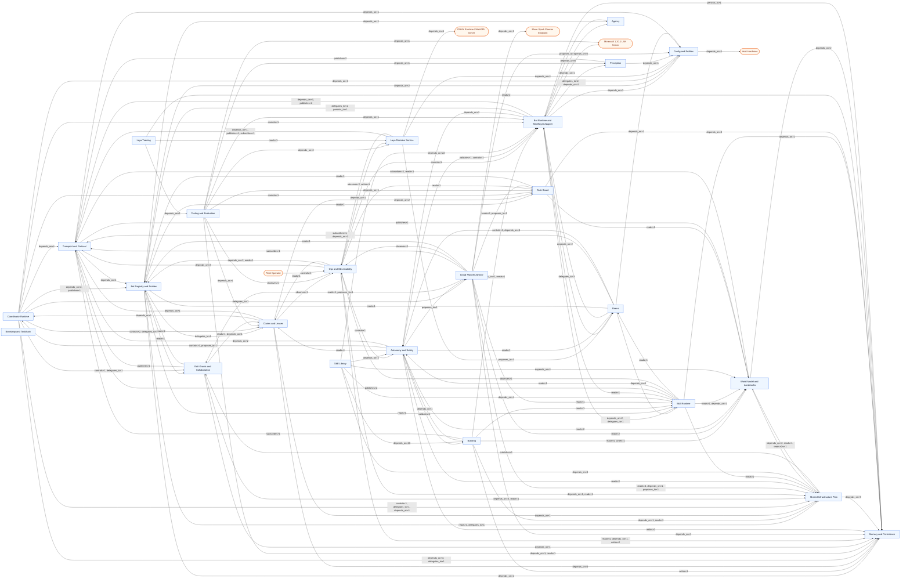

## Cross-system dependencies

System-to-system view with relation types.


## Safety and control authority

Guardian veto, grant/claim control, ops stop path, and planner proposal path.

```mermaid
flowchart TD
n0["Coordinator Runtime"]
n9["Laya Decision Service"]
n10["Cloud Planner Advisor"]
n11["Skill Runtime"]
n13["Building"]
n14["Bot Runtime and Mineflayer Adapter"]
n15["Autonomy and Safety"]
n17["Ops and Observability"]
n21["Brains"]
n28(["Fleet Operator"])
n14 -->|delegates_to| n21
n14 -->|delegates_to| n11
n0 -->|delegates_to| n10
n9 -->|proposes_to| n21
n17 -->|controls| n15
n17 -->|controls| n14
n15 -->|validates| n14
n15 -->|validates| n13
n15 -->|controls| n14
n15 -->|controls| n0
n21 -->|controls| n15
n15 -->|proposes_to| n0
n15 -->|proposes_to| n10
n0 -->|controls| n14
n29["Command Router"]
n30["Coordinator Epoch Authority"]
n31["Global Scheduler"]
n32["Restart Recovery Orchestrator"]
n33["Bot Process Supervisor"]
n34["Model Loader"]
n35["Execution Provider Selector"]
n36["Batch Runner"]
n37["Single In-flight Guard"]
n38["Output Parser"]
n39["Confidence Calibrator"]
n40["Timeout and Fallback Handler"]
n41["OpenAI-Compatible Client"]
n42["Planner Context Builder"]
n43["Planner Trigger Evaluator"]
n44["Planner Schema Validator"]
n45["Planner Semantic Validator"]
n46["Planner Repair Loop"]
n47["SIP Mutation Translator"]
n48["Task DAG Translator"]
n49["Planner Budget Limiter"]
n50["Planner Arbitration Handler"]
n51["Keep Last Good Fallback"]
n52["Skill Context Builder"]
n53["Block Executor"]
n54["Connection Lifecycle"]
n55["Mineflayer Event Bridge"]
n56["World Cache Adapter"]
n57["Action Executor"]
n58["Guardian Hook"]
n59["Skill Host"]
n60["Agent Loop"]
n61["Chat Adapter"]
n62["Reconnect Supervisor"]
n63["Action Veto Gate"]
n64["Recovery Ladder"]
n65["Emergency Stop Controller"]
n66["Ops API"]
n67["Pause and Resume Controller"]
n68["Fleet Emergency Stop"]
n69["Reflex Guardian Loop"]
n70["Deterministic Policy"]
n71["Laya Client"]
n58 -->|delegates_to| n69
n56 -->|delegates_to| n52
n31 -->|delegates_to| n43
n39 -->|proposes_to| n70
n35 -->|controls| n34
n37 -->|controls| n36
n40 -->|controls| n38
n68 -->|controls| n65
n67 -->|controls| n59
n49 -->|controls| n41
n41 -->|delegates_to| n50
n46 -->|controls| n51
n44 -->|controls| n46
n45 -->|controls| n46
n43 -->|delegates_to| n42
n63 -->|validates| n57
n63 -->|validates| n53
n65 -->|controls| n57
n65 -->|controls| n29
n69 -->|controls| n63
n64 -->|proposes_to| n29
n64 -->|proposes_to| n43
n64 -->|controls| n65
n33 -->|controls| n54
n60 -->|delegates_to| n71
n60 -->|delegates_to| n70
n60 -->|delegates_to| n59
classDef system fill:#eef6ff,stroke:#2563eb,color:#0f172a;
classDef component fill:#f8fafc,stroke:#64748b,color:#0f172a;
classDef external fill:#fff7ed,stroke:#ea580c,color:#7c2d12;
class n0,n9,n10,n11,n13,n14,n15,n17,n21 system;
class n29,n30,n31,n32,n33,n34,n35,n36,n37,n38,n39,n40,n41,n42,n43,n44,n45,n46,n47,n48,n49,n50,n51,n52,n53,n54,n55,n56,n57,n58,n59,n60,n61,n62,n63,n64,n65,n66,n67,n68,n69,n70,n71 component;
class n28 external;
```

## Data flow

Perception, world model, SIP, decisions, skills, building, and persistence.

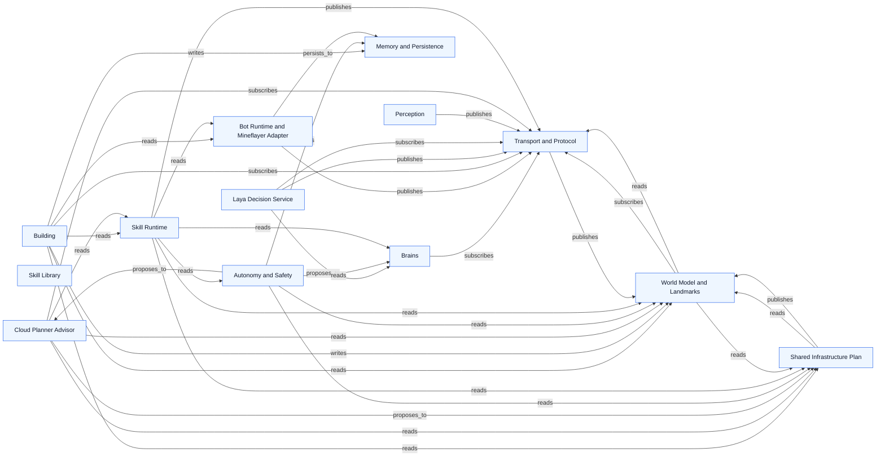

## Per-system graphs

### Coordinator Runtime

Source: `docs/architecture/graphs/system-core.mmd`


### Transport and Protocol

Source: `docs/architecture/graphs/system-transport.mmd`

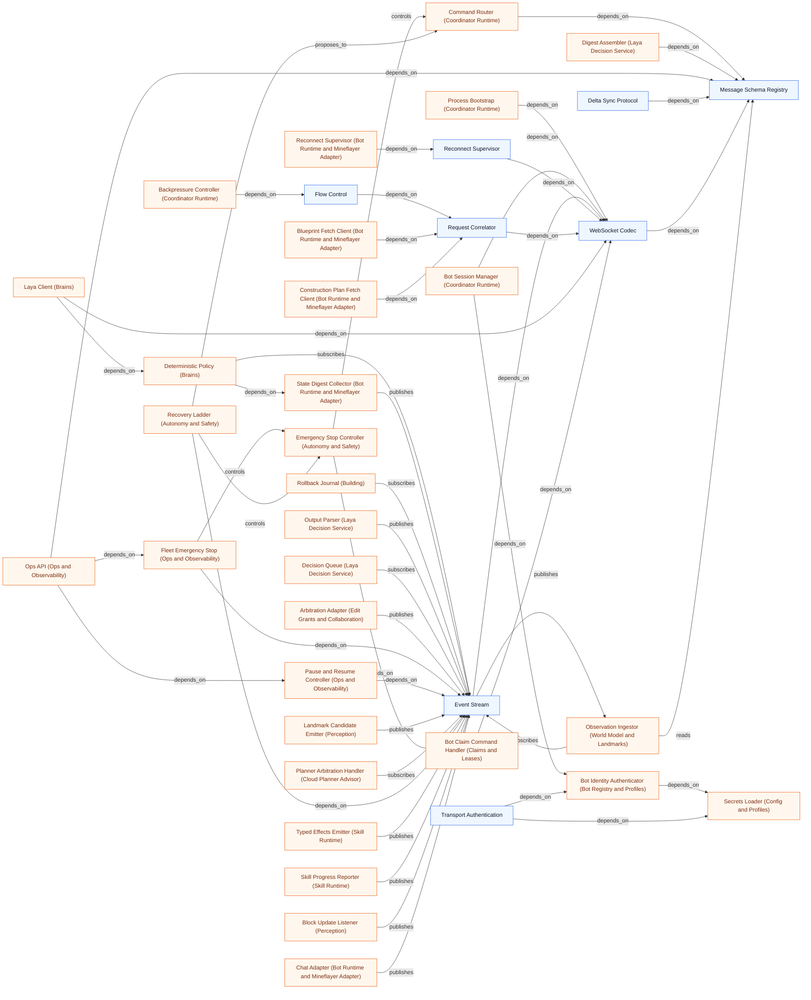

### Shared Infrastructure Plan

Source: `docs/architecture/graphs/system-sip.mmd`

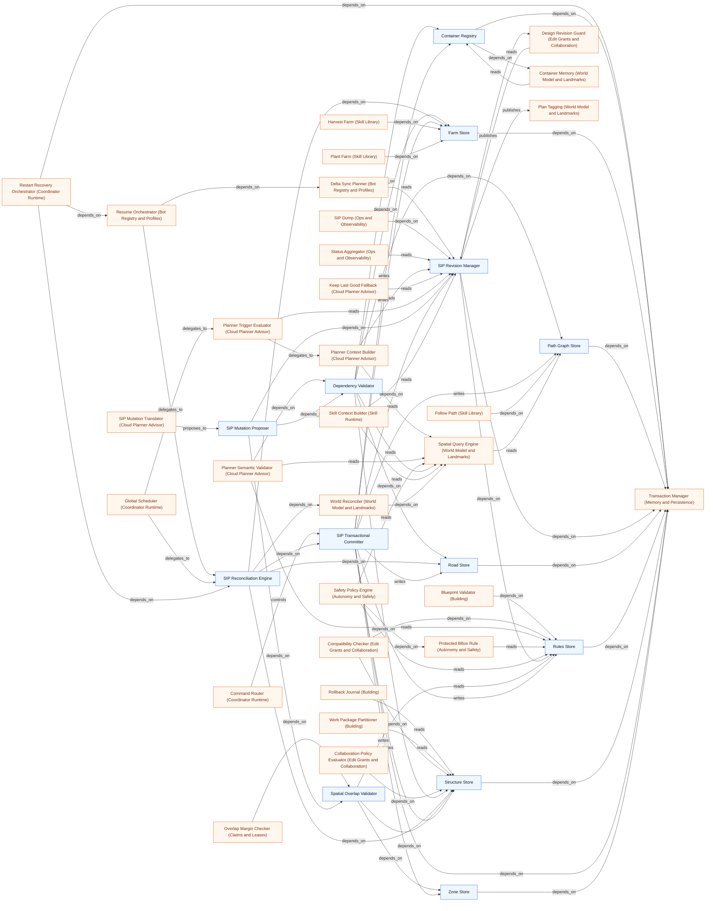

### Task Board

Source: `docs/architecture/graphs/system-tasks.mmd`

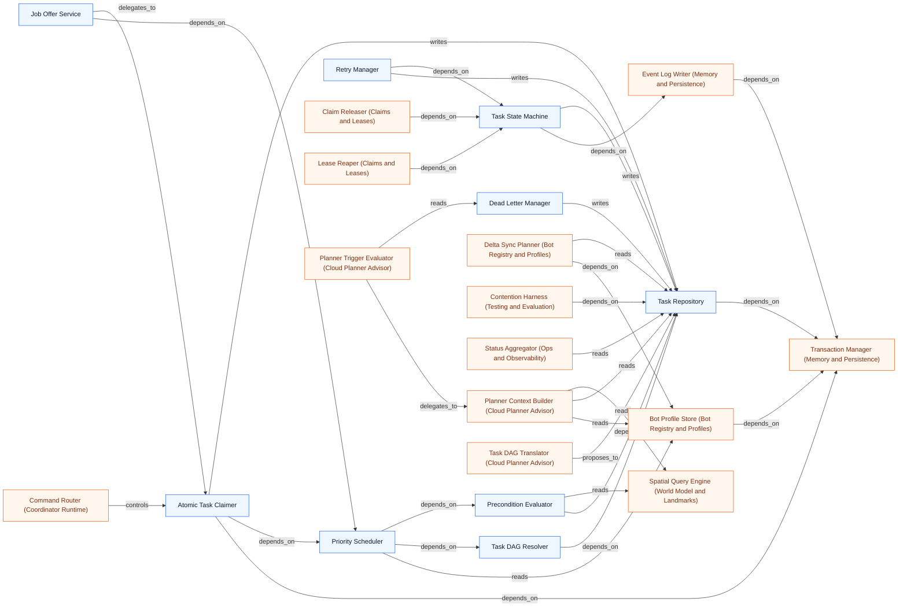

### Claims and Leases

Source: `docs/architecture/graphs/system-claims.mmd`

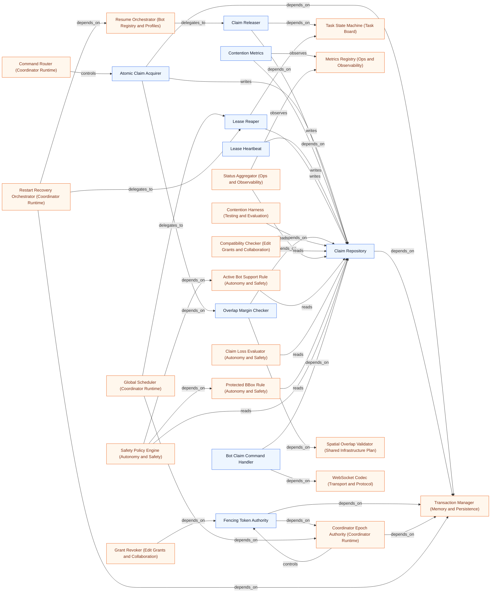

### Edit Grants and Collaboration

Source: `docs/architecture/graphs/system-grants.mmd`


### Bot Registry and Profiles

Source: `docs/architecture/graphs/system-bots.mmd`

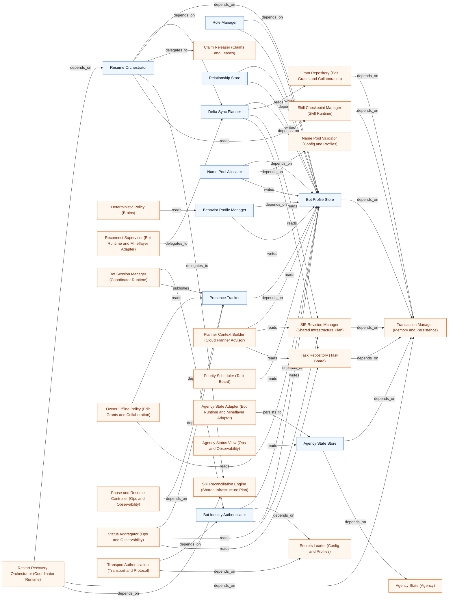

### World Model and Landmarks

Source: `docs/architecture/graphs/system-world.mmd`

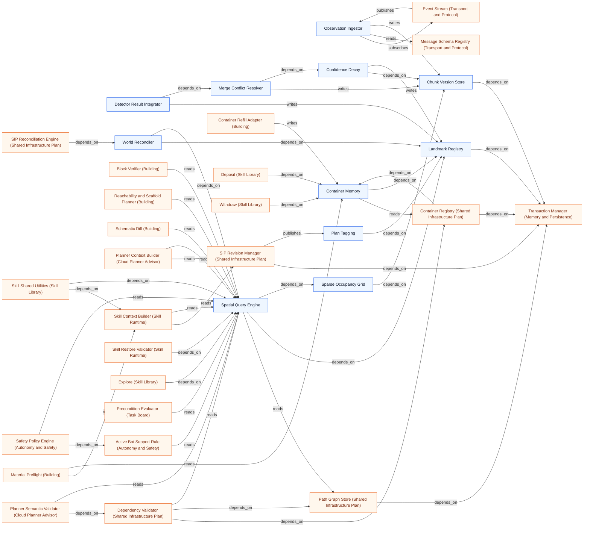

### Perception

Source: `docs/architecture/graphs/system-perception.mmd`

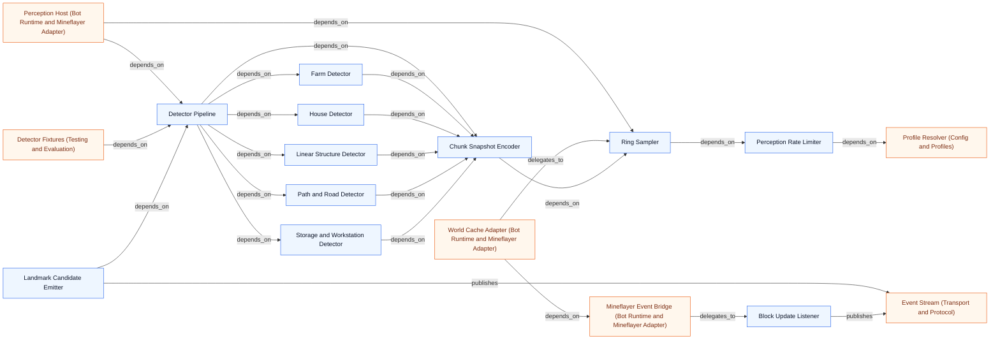

### Laya Decision Service

Source: `docs/architecture/graphs/system-decision.mmd`


### Cloud Planner Advisor

Source: `docs/architecture/graphs/system-planner.mmd`


### Skill Runtime

Source: `docs/architecture/graphs/system-skill-runtime.mmd`

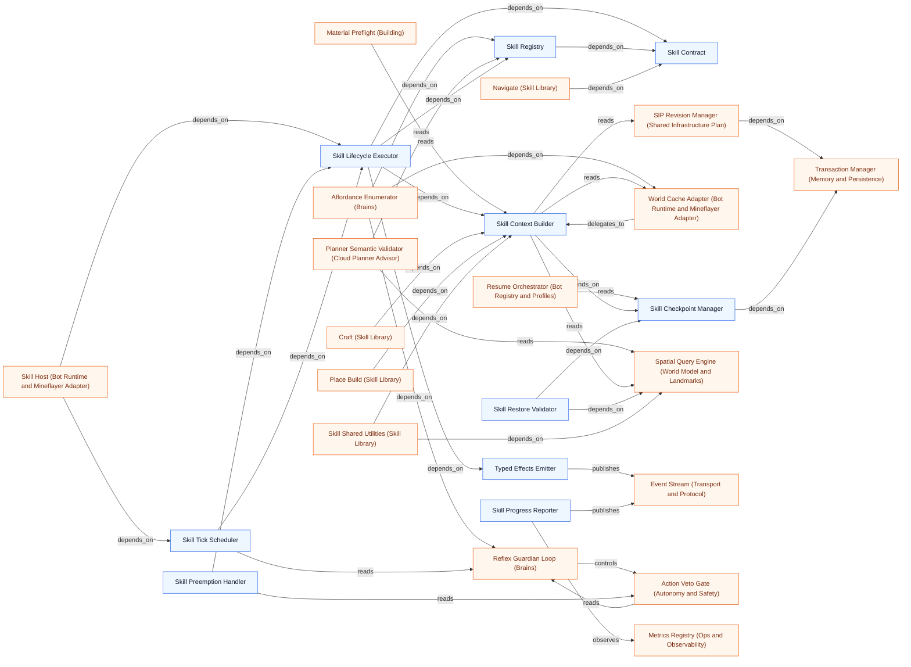

### Skill Library

Source: `docs/architecture/graphs/system-skills.mmd`

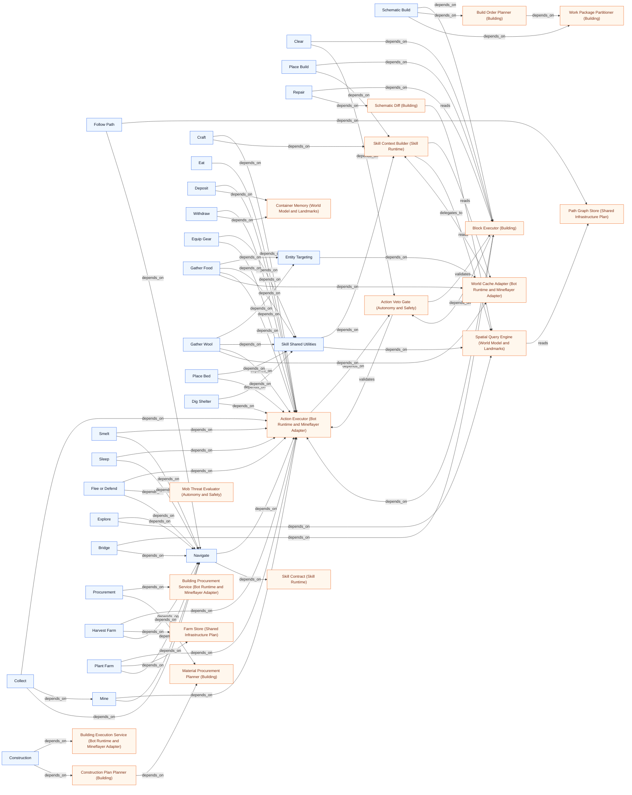

### Building

Source: `docs/architecture/graphs/system-building.mmd`

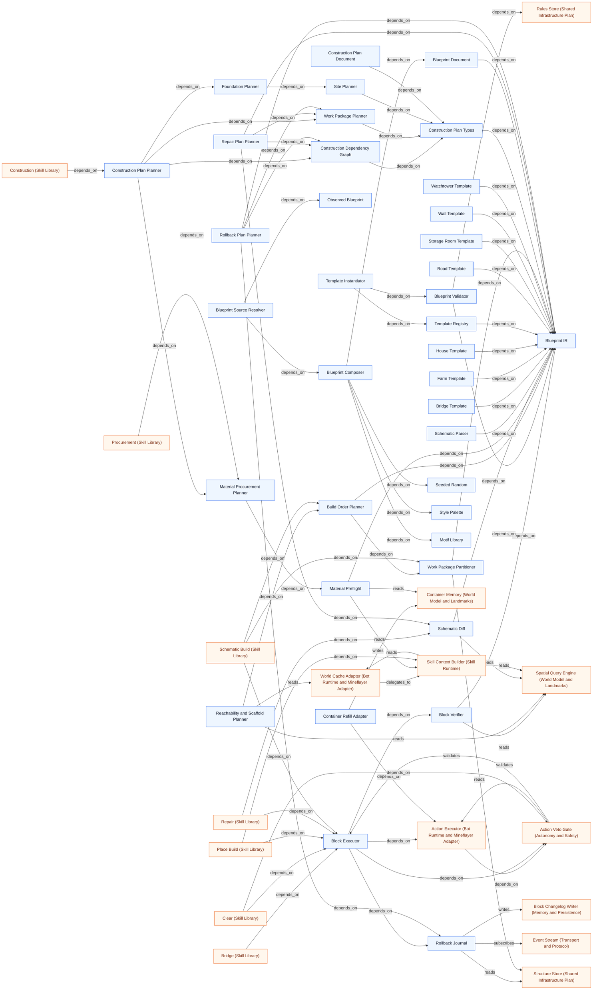

### Bot Runtime and Mineflayer Adapter

Source: `docs/architecture/graphs/system-bot-runtime.mmd`

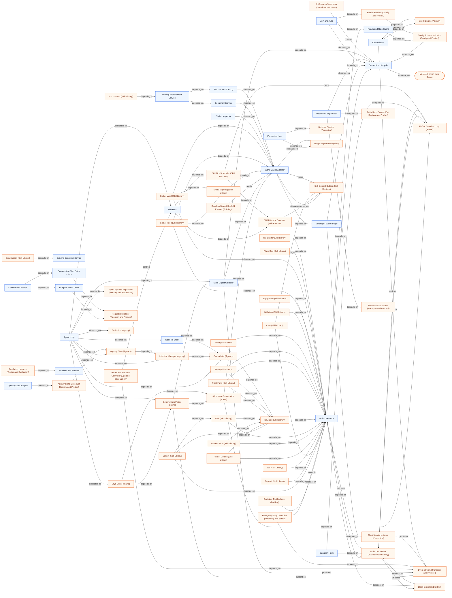

### Autonomy and Safety

Source: `docs/architecture/graphs/system-safety.mmd`

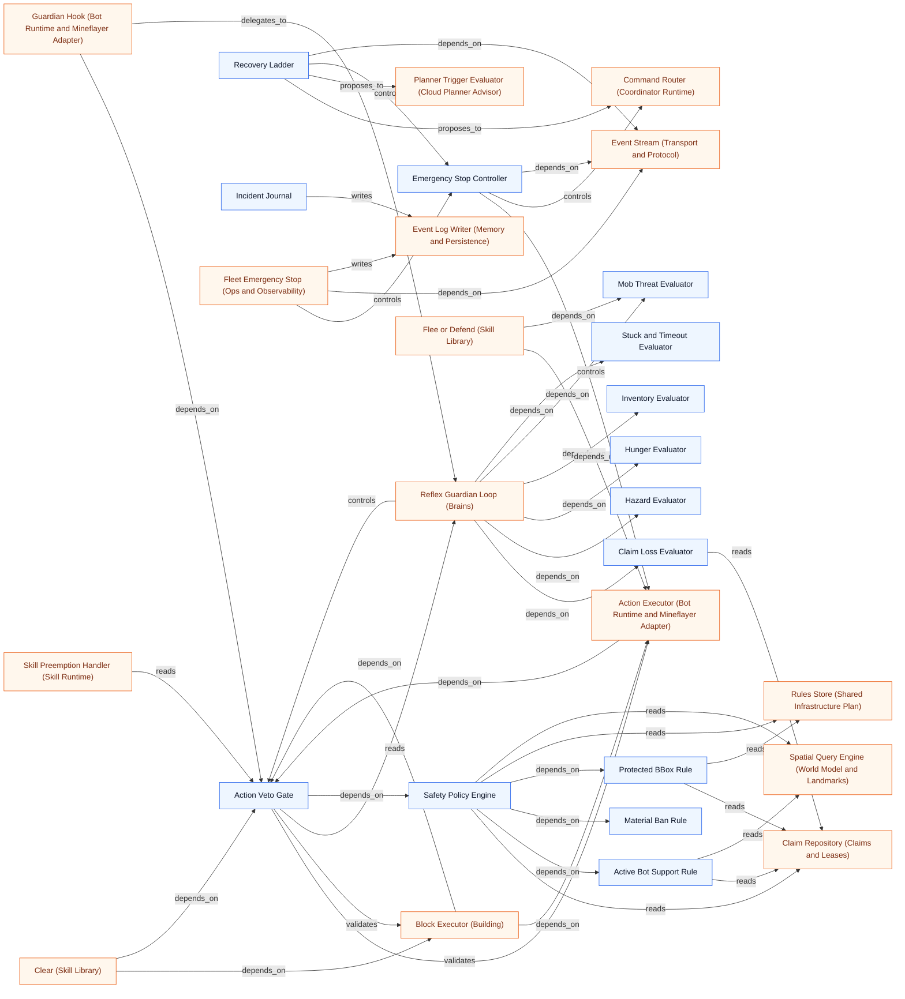

### Memory and Persistence

Source: `docs/architecture/graphs/system-memory.mmd`

```mermaid
flowchart LR
n295["SQLite Runtime"]
n177["Migration Runner"]
n171["Transaction Manager"]
n229["Event Log Writer"]
n288["Block Changelog Writer"]
n173["Retention Pruner"]
n296["Snapshot Export"]
n297["Schema Version Registry"]
n298["Episode Store"]
n292["Agent Episode Repository"]
n228["Bot Profile Store (Bot Registry and Profiles)"]
n111["Rollback Journal (Building)"]
n166["Atomic Claim Acquirer (Claims and Leases)"]
n230["Claim Repository (Claims and Leases)"]
n164["Fencing Token Authority (Claims and Leases)"]
n30["Coordinator Epoch Authority (Coordinator Runtime)"]
n31["Global Scheduler (Coordinator Runtime)"]
n72["Process Bootstrap (Coordinator Runtime)"]
n32["Restart Recovery Orchestrator (Coordinator Runtime)"]
n299["Replay Engine (Testing and Evaluation)"]
n234["Grant Repository (Edit Grants and Collaboration)"]
n161["Audit Viewer (Ops and Observability)"]
n160["Health and Readiness (Ops and Observability)"]
n81["Plan Cache (Cloud Planner Advisor)"]
n154["Incident Journal (Autonomy and Safety)"]
n199["Container Registry (Shared Infrastructure Plan)"]
n198["Farm Store (Shared Infrastructure Plan)"]
n200["Path Graph Store (Shared Infrastructure Plan)"]
n202["SIP Revision Manager (Shared Infrastructure Plan)"]
n197["Road Store (Shared Infrastructure Plan)"]
n201["Rules Store (Shared Infrastructure Plan)"]
n196["Structure Store (Shared Infrastructure Plan)"]
n168["SIP Transactional Committer (Shared Infrastructure Plan)"]
n195["Zone Store (Shared Infrastructure Plan)"]
n88["Skill Checkpoint Manager (Skill Runtime)"]
n169["Atomic Task Claimer (Task Board)"]
n218["Task Repository (Task Board)"]
n225["Task State Machine (Task Board)"]
n300["Trace Exporter (Laya Training)"]
n243["Chunk Version Store (World Model and Landmarks)"]
n247["Landmark Registry (World Model and Landmarks)"]
n67["Pause and Resume Controller (Ops and Observability)"]
n68["Fleet Emergency Stop (Ops and Observability)"]
n60["Agent Loop (Bot Runtime and Mineflayer Adapter)"]
n239["Agency State Store (Bot Registry and Profiles)"]
n156["Agency Status View (Ops and Observability)"]
n228 -->|depends_on| n171
n111 -->|writes| n288
n111 -->|reads| n196
n166 -->|writes| n230
n166 -->|depends_on| n171
n230 -->|depends_on| n171
n164 -->|depends_on| n30
n164 -->|depends_on| n171
n30 -->|controls| n164
n30 -->|depends_on| n171
n31 -->|depends_on| n30
n31 -->|delegates_to| n173
n72 -->|depends_on| n32
n72 -->|depends_on| n177
n32 -->|depends_on| n171
n299 -->|depends_on| n229
n234 -->|depends_on| n171
n288 -->|depends_on| n171
n229 -->|depends_on| n171
n177 -->|depends_on| n295
n173 -->|depends_on| n288
n173 -->|depends_on| n229
n173 -->|depends_on| n171
n297 -->|depends_on| n177
n296 -->|depends_on| n171
n171 -->|depends_on| n295
n161 -->|reads| n288
n161 -->|reads| n229
n160 -->|depends_on| n295
n81 -->|depends_on| n171
n154 -->|writes| n229
n199 -->|depends_on| n171
n198 -->|depends_on| n171
n200 -->|depends_on| n171
n202 -->|depends_on| n171
n202 -->|depends_on| n201
n197 -->|depends_on| n171
n201 -->|depends_on| n171
n196 -->|depends_on| n171
n168 -->|depends_on| n171
n168 -->|writes| n199
n168 -->|writes| n198
n168 -->|writes| n200
n168 -->|depends_on| n202
n168 -->|writes| n197
n168 -->|writes| n201
n168 -->|writes| n196
n168 -->|writes| n195
n195 -->|depends_on| n171
n88 -->|depends_on| n171
n169 -->|depends_on| n171
n169 -->|writes| n218
n218 -->|depends_on| n171
n225 -->|depends_on| n229
n225 -->|writes| n218
n300 -->|reads| n229
n243 -->|depends_on| n171
n247 -->|depends_on| n171
n299 -->|reads| n298
n300 -->|reads| n298
n161 -->|reads| n298
n173 -->|depends_on| n298
n67 -->|writes| n229
n68 -->|writes| n229
n60 -->|persists_to| n292
n239 -->|depends_on| n171
n292 -->|depends_on| n171
n156 -->|reads| n239
n156 -->|reads| n292
classDef internal fill:#eef6ff,stroke:#2563eb,color:#0f172a;
classDef external fill:#fff7ed,stroke:#ea580c,color:#7c2d12;
class n295,n177,n171,n229,n288,n173,n296,n297,n298,n292 internal;
class n228,n111,n166,n230,n164,n30,n31,n72,n32,n299,n234,n161,n160,n81,n154,n199,n198,n200,n202,n197,n201,n196,n168,n195,n88,n169,n218,n225,n300,n243,n247,n67,n68,n60,n239,n156 external;
```

### Ops and Observability

Source: `docs/architecture/graphs/system-ops.mmd`

```mermaid
flowchart LR
n66["Ops API"]
n155["Status Aggregator"]
n156["Agency Status View"]
n67["Pause and Resume Controller"]
n68["Fleet Emergency Stop"]
n157["SIP Dump"]
n158["Metrics Registry"]
n159["Structured Logger"]
n160["Health and Readiness"]
n161["Audit Viewer"]
n232["Contention Metrics (Claims and Leases)"]
n35["Execution Provider Selector (Laya Decision Service)"]
n80["Latency Metrics (Laya Decision Service)"]
n301["Metrics Reporter (Testing and Evaluation)"]
n28(["Fleet Operator"])
n288["Block Changelog Writer (Memory and Persistence)"]
n229["Event Log Writer (Memory and Persistence)"]
n65["Emergency Stop Controller (Autonomy and Safety)"]
n185["Event Stream (Transport and Protocol)"]
n34["Model Loader (Laya Decision Service)"]
n295["SQLite Runtime (Memory and Persistence)"]
n170["Message Schema Registry (Transport and Protocol)"]
n59["Skill Host (Bot Runtime and Mineflayer Adapter)"]
n183["Presence Tracker (Bot Registry and Profiles)"]
n202["SIP Revision Manager (Shared Infrastructure Plan)"]
n230["Claim Repository (Claims and Leases)"]
n218["Task Repository (Task Board)"]
n49["Planner Budget Limiter (Cloud Planner Advisor)"]
n43["Planner Trigger Evaluator (Cloud Planner Advisor)"]
n87["Skill Progress Reporter (Skill Runtime)"]
n298["Episode Store (Memory and Persistence)"]
n239["Agency State Store (Bot Registry and Profiles)"]
n292["Agent Episode Repository (Memory and Persistence)"]
n232 -->|depends_on| n230
n232 -->|observes| n158
n35 -->|controls| n34
n35 -->|observes| n159
n80 -->|observes| n158
n80 -->|writes| n158
n301 -->|observes| n158
n28 -->|controls| n66
n161 -->|reads| n288
n161 -->|reads| n229
n68 -->|controls| n65
n68 -->|depends_on| n185
n160 -->|depends_on| n34
n160 -->|depends_on| n295
n160 -->|depends_on| n155
n66 -->|depends_on| n68
n66 -->|depends_on| n67
n66 -->|depends_on| n155
n66 -->|depends_on| n170
n67 -->|controls| n59
n67 -->|depends_on| n183
n67 -->|depends_on| n185
n157 -->|depends_on| n202
n155 -->|depends_on| n183
n155 -->|reads| n230
n155 -->|observes| n158
n155 -->|reads| n202
n155 -->|reads| n218
n49 -->|observes| n158
n43 -->|observes| n158
n43 -->|reads| n202
n65 -->|depends_on| n185
n87 -->|observes| n158
n87 -->|publishes| n185
n161 -->|reads| n298
n67 -->|writes| n229
n68 -->|writes| n229
n156 -->|reads| n239
n156 -->|reads| n292
n66 -->|depends_on| n156
classDef internal fill:#eef6ff,stroke:#2563eb,color:#0f172a;
classDef external fill:#fff7ed,stroke:#ea580c,color:#7c2d12;
class n66,n155,n156,n67,n68,n157,n158,n159,n160,n161 internal;
class n232,n35,n80,n301,n288,n229,n65,n185,n34,n295,n170,n59,n183,n202,n230,n218,n49,n43,n87,n298,n239,n292,n28 external;
```

### Config and Profiles

Source: `docs/architecture/graphs/system-config.mmd`

```mermaid
flowchart LR
n176["Environment Parser"]
n175["Config Schema Validator"]
n181["Profile Resolver"]
n263["Hardware Probe"]
n191["Secrets Loader"]
n241["Name Pool Validator"]
n264["Laya Runtime Resolver"]
n302["Fail Fast Handler"]
n54["Connection Lifecycle (Bot Runtime and Mineflayer Adapter)"]
n129["Join and Auth (Bot Runtime and Mineflayer Adapter)"]
n131["Reach and Rate Guard (Bot Runtime and Mineflayer Adapter)"]
n182["Bot Identity Authenticator (Bot Registry and Profiles)"]
n240["Name Pool Allocator (Bot Registry and Profiles)"]
n27(["Host Hardware"])
n72["Process Bootstrap (Coordinator Runtime)"]
n73["Service Composition (Coordinator Runtime)"]
n39["Confidence Calibrator (Laya Decision Service)"]
n35["Execution Provider Selector (Laya Decision Service)"]
n34["Model Loader (Laya Decision Service)"]
n77["Decision Rate Limiter (Laya Decision Service)"]
n261["Perception Rate Limiter (Perception)"]
n41["OpenAI-Compatible Client (Cloud Planner Advisor)"]
n188["Transport Authentication (Transport and Protocol)"]
n163["Tactical Decision Policy (Brains)"]
n54 -->|depends_on| n175
n129 -->|depends_on| n54
n129 -->|depends_on| n181
n131 -->|depends_on| n175
n182 -->|depends_on| n191
n240 -->|depends_on| n241
n175 -->|depends_on| n176
n302 -->|depends_on| n175
n263 -->|depends_on| n181
n263 -->|depends_on| n27
n264 -->|depends_on| n263
n264 -->|depends_on| n181
n241 -->|depends_on| n175
n181 -->|depends_on| n175
n191 -->|depends_on| n176
n72 -->|depends_on| n175
n72 -->|depends_on| n176
n72 -->|depends_on| n73
n73 -->|depends_on| n181
n39 -->|depends_on| n175
n35 -->|depends_on| n263
n35 -->|controls| n34
n34 -->|depends_on| n264
n77 -->|depends_on| n181
n261 -->|depends_on| n181
n41 -->|depends_on| n175
n41 -->|depends_on| n191
n188 -->|depends_on| n182
n188 -->|depends_on| n191
n163 -->|depends_on| n175
classDef internal fill:#eef6ff,stroke:#2563eb,color:#0f172a;
classDef external fill:#fff7ed,stroke:#ea580c,color:#7c2d12;
class n176,n175,n181,n263,n191,n241,n264,n302 internal;
class n54,n129,n131,n182,n240,n72,n73,n39,n35,n34,n77,n261,n41,n188,n163,n27 external;
```

### Testing and Evaluation

Source: `docs/architecture/graphs/system-eval.mmd`

```mermaid
flowchart LR
n303["Unit Fixtures"]
n262["Detector Fixtures"]
n304["Docker Server Harness"]
n305["Scenario Runner"]
n299["Replay Engine"]
n227["Contention Harness"]
n301["Metrics Reporter"]
n306["Soak Runner"]
n307["Architecture Guard Tests"]
n265["Laya Benchmark Harness"]
n294["Simulation Harness"]
n308["Behavior Assertions"]
n309["Trace Inspector"]
n230["Claim Repository (Claims and Leases)"]
n218["Task Repository (Task Board)"]
n260["Detector Pipeline (Perception)"]
n24(["Minecraft 1.20.1 LAN Server"])
n80["Latency Metrics (Laya Decision Service)"]
n34["Model Loader (Laya Decision Service)"]
n158["Metrics Registry (Ops and Observability)"]
n229["Event Log Writer (Memory and Persistence)"]
n310["Promotion Gate (Laya Training)"]
n298["Episode Store (Memory and Persistence)"]
n143["Headless Bot Runtime (Bot Runtime and Mineflayer Adapter)"]
n80 -->|observes| n158
n80 -->|writes| n158
n307 -->|depends_on| n303
n227 -->|depends_on| n230
n227 -->|delegates_to| n305
n227 -->|depends_on| n218
n262 -->|depends_on| n303
n262 -->|depends_on| n260
n304 -->|depends_on| n303
n304 -->|depends_on| n24
n265 -->|depends_on| n80
n265 -->|depends_on| n34
n265 -->|delegates_to| n305
n301 -->|observes| n158
n299 -->|depends_on| n305
n299 -->|depends_on| n229
n305 -->|controls| n304
n305 -->|publishes| n301
n306 -->|depends_on| n301
n306 -->|delegates_to| n305
n310 -->|depends_on| n265
n299 -->|reads| n298
n294 -->|depends_on| n143
n294 -->|depends_on| n308
n309 -->|depends_on| n294
classDef internal fill:#eef6ff,stroke:#2563eb,color:#0f172a;
classDef external fill:#fff7ed,stroke:#ea580c,color:#7c2d12;
class n303,n262,n304,n305,n299,n227,n301,n306,n307,n265,n294,n308,n309 internal;
class n230,n218,n260,n80,n34,n158,n229,n310,n298,n143,n24 external;
```

### Laya Training

Source: `docs/architecture/graphs/system-training.mmd`

```mermaid
flowchart LR
n300["Trace Exporter"]
n311["Labeling Pipeline"]
n312["Reward Computer"]
n313["Fine-tune Runner"]
n314["ONNX Exporter"]
n266["Calibration Fitter"]
n310["Promotion Gate"]
n39["Confidence Calibrator (Laya Decision Service)"]
n265["Laya Benchmark Harness (Testing and Evaluation)"]
n229["Event Log Writer (Memory and Persistence)"]
n298["Episode Store (Memory and Persistence)"]
n266 -->|reads| n39
n266 -->|depends_on| n300
n313 -->|depends_on| n311
n313 -->|depends_on| n312
n311 -->|depends_on| n300
n314 -->|depends_on| n313
n310 -->|depends_on| n265
n310 -->|depends_on| n266
n310 -->|depends_on| n314
n312 -->|depends_on| n300
n300 -->|reads| n229
n300 -->|reads| n298
classDef internal fill:#eef6ff,stroke:#2563eb,color:#0f172a;
classDef external fill:#fff7ed,stroke:#ea580c,color:#7c2d12;
class n300,n311,n312,n313,n314,n266,n310 internal;
class n39,n265,n229,n298 external;
```

### Brains

Source: `docs/architecture/graphs/system-brains.mmd`

```mermaid
flowchart LR
n69["Reflex Guardian Loop"]
n162["Affordance Enumerator"]
n70["Deterministic Policy"]
n71["Laya Client"]
n163["Tactical Decision Policy"]
n56["World Cache Adapter (Bot Runtime and Mineflayer Adapter)"]
n84["Skill Registry (Skill Runtime)"]
n139["State Digest Collector (Bot Runtime and Mineflayer Adapter)"]
n237["Behavior Profile Manager (Bot Registry and Profiles)"]
n185["Event Stream (Transport and Protocol)"]
n58["Guardian Hook (Bot Runtime and Mineflayer Adapter)"]
n39["Confidence Calibrator (Laya Decision Service)"]
n63["Action Veto Gate (Autonomy and Safety)"]
n149["Claim Loss Evaluator (Autonomy and Safety)"]
n144["Hazard Evaluator (Autonomy and Safety)"]
n146["Hunger Evaluator (Autonomy and Safety)"]
n148["Inventory Evaluator (Autonomy and Safety)"]
n145["Mob Threat Evaluator (Autonomy and Safety)"]
n147["Stuck and Timeout Evaluator (Autonomy and Safety)"]
n86["Skill Tick Scheduler (Skill Runtime)"]
n178["WebSocket Codec (Transport and Protocol)"]
n60["Agent Loop (Bot Runtime and Mineflayer Adapter)"]
n175["Config Schema Validator (Config and Profiles)"]
n162 -->|depends_on| n56
n162 -->|depends_on| n69
n162 -->|depends_on| n84
n70 -->|depends_on| n162
n70 -->|depends_on| n139
n70 -->|reads| n237
n70 -->|subscribes| n185
n58 -->|depends_on| n63
n58 -->|delegates_to| n69
n139 -->|depends_on| n56
n139 -->|publishes| n185
n39 -->|proposes_to| n70
n39 -->|depends_on| n175
n63 -->|reads| n69
n69 -->|controls| n63
n69 -->|depends_on| n149
n69 -->|depends_on| n144
n69 -->|depends_on| n146
n69 -->|depends_on| n148
n69 -->|depends_on| n145
n69 -->|depends_on| n147
n86 -->|reads| n69
n185 -->|depends_on| n178
n71 -->|depends_on| n162
n71 -->|depends_on| n178
n71 -->|depends_on| n70
n60 -->|delegates_to| n71
n60 -->|delegates_to| n70
n60 -->|depends_on| n139
n71 -->|depends_on| n163
n163 -->|depends_on| n175
classDef internal fill:#eef6ff,stroke:#2563eb,color:#0f172a;
classDef external fill:#fff7ed,stroke:#ea580c,color:#7c2d12;
class n69,n162,n70,n71,n163 internal;
class n56,n84,n139,n237,n185,n58,n39,n63,n149,n144,n146,n148,n145,n147,n86,n178,n60,n175 external;
```

### Agency

Source: `docs/architecture/graphs/system-agency.mmd`

```mermaid
flowchart LR
n315["Personality Model"]
n316["Needs Model"]
n317["Goal Catalog"]
n318["Goal Generator"]
n289["Goal Arbiter"]
n290["Intention Manager"]
n319["Routine Model"]
n320["Item Knowledge"]
n321["Night Preparation Config"]
n322["Shelter Strategy"]
n323["Shelter Plan"]
n324["Night Readiness"]
n291["Social Engine"]
n325["Working Memory"]
n326["Project Focus Policy"]
n242["Agency State"]
n327["Strategic Intent Policy"]
n293["Reflection"]
n60["Agent Loop (Bot Runtime and Mineflayer Adapter)"]
n61["Chat Adapter (Bot Runtime and Mineflayer Adapter)"]
n239["Agency State Store (Bot Registry and Profiles)"]
n141["Goal Tie-Break (Bot Runtime and Mineflayer Adapter)"]
n60 -->|depends_on| n289
n60 -->|depends_on| n290
n60 -->|depends_on| n242
n61 -->|depends_on| n291
n318 -->|depends_on| n317
n318 -->|depends_on| n316
n318 -->|depends_on| n315
n289 -->|depends_on| n318
n289 -->|depends_on| n316
n289 -->|depends_on| n315
n290 -->|depends_on| n289
n291 -->|depends_on| n315
n242 -->|depends_on| n316
n242 -->|depends_on| n315
n242 -->|depends_on| n290
n242 -->|depends_on| n319
n242 -->|depends_on| n325
n326 -->|depends_on| n325
n291 -->|proposes_to| n61
n239 -->|depends_on| n242
n324 -->|depends_on| n320
n324 -->|depends_on| n321
n324 -->|depends_on| n319
n324 -->|depends_on| n323
n324 -->|depends_on| n322
n322 -->|depends_on| n321
n318 -->|depends_on| n321
n318 -->|depends_on| n324
n318 -->|depends_on| n319
n327 -->|depends_on| n289
n327 -->|depends_on| n325
n60 -->|depends_on| n141
n141 -->|depends_on| n289
n60 -->|depends_on| n293
classDef internal fill:#eef6ff,stroke:#2563eb,color:#0f172a;
classDef external fill:#fff7ed,stroke:#ea580c,color:#7c2d12;
class n315,n316,n317,n318,n289,n290,n319,n320,n321,n322,n323,n324,n291,n325,n326,n242,n327,n293 internal;
class n60,n61,n239,n141 external;
```

### Bootstrap and Toolchain

Source: `docs/architecture/graphs/system-toolchain.mmd`

```mermaid
flowchart LR
n328["Bootstrap Orchestrator"]
n329["Capability Check"]
n330["Python Environment"]
n331["Minecraft Server Controller"]
n332["Firefox SVG Renderer"]
n328 -->|depends_on| n329
n328 -->|depends_on| n330
n328 -->|depends_on| n331
n328 -->|depends_on| n332
classDef internal fill:#eef6ff,stroke:#2563eb,color:#0f172a;
classDef external fill:#fff7ed,stroke:#ea580c,color:#7c2d12;
class n328,n329,n330,n331,n332 internal;
```
