# TiCrafter Architecture Graphs

> Generated from `docs/architecture/graph.json`. Edit the graph, then run `bun tools/architecture/render-graphs.mjs`.


Mermaid source lives in `docs/architecture/graphs/`. GitHub renders these fenced blocks directly. For local SVG rendering, run `bun run render:svg -- <input.mmd> <output.svg>`; it uses the installed Firefox browser and never downloads Chromium.

## Fleet overview

Systems and externals with aggregated relation counts.


## Cross-system dependencies

System-to-system view with relation types.


## Safety and control authority

Guardian veto, grant/claim control, ops stop path, and planner proposal path.


## Data flow

Perception, world model, SIP, decisions, skills, building, and persistence.

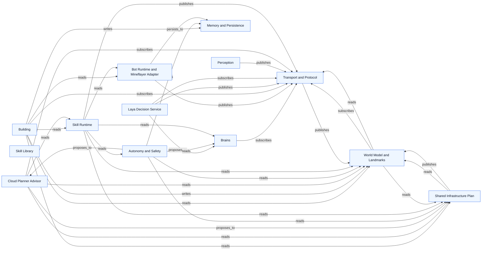

## Per-system graphs

### Coordinator Runtime

Source: `docs/architecture/graphs/system-core.mmd`


### Transport and Protocol

Source: `docs/architecture/graphs/system-transport.mmd`

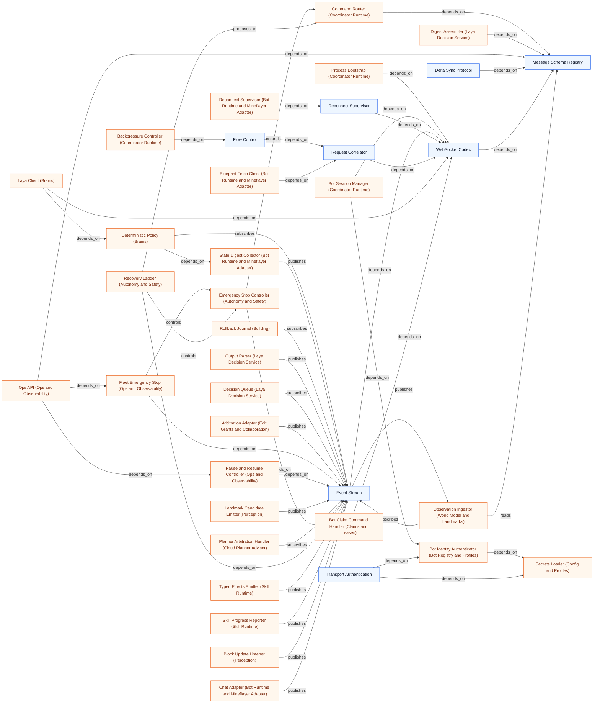

### Shared Infrastructure Plan

Source: `docs/architecture/graphs/system-sip.mmd`

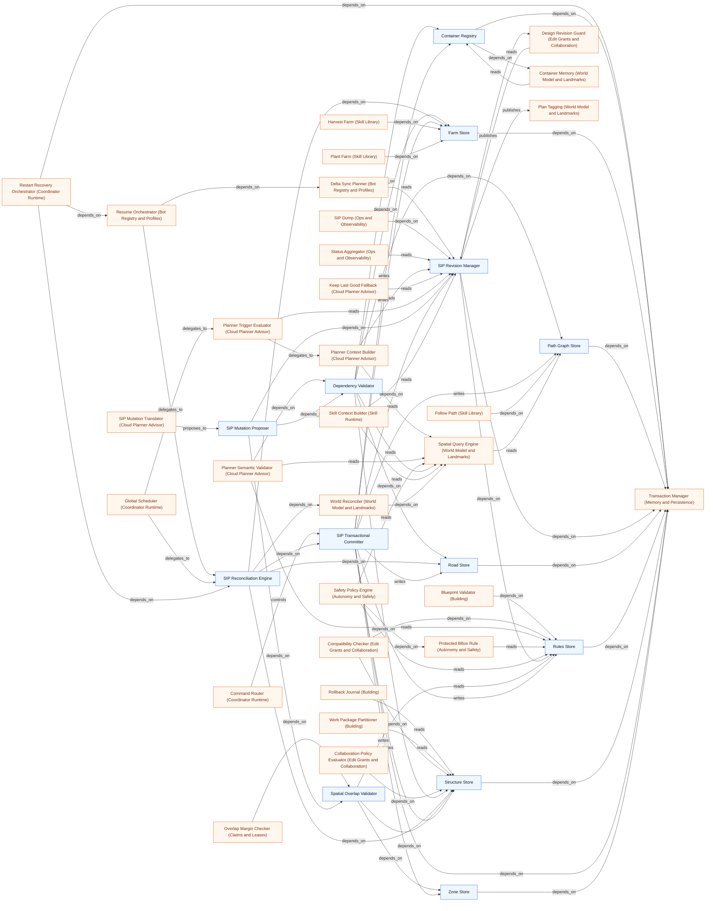

### Task Board

Source: `docs/architecture/graphs/system-tasks.mmd`

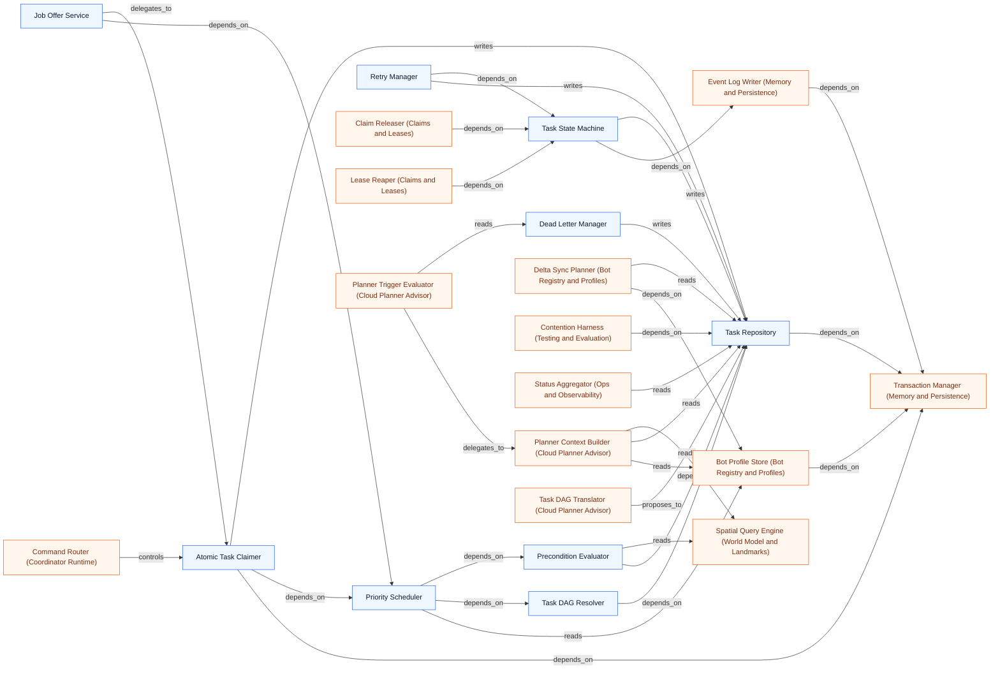

### Claims and Leases

Source: `docs/architecture/graphs/system-claims.mmd`

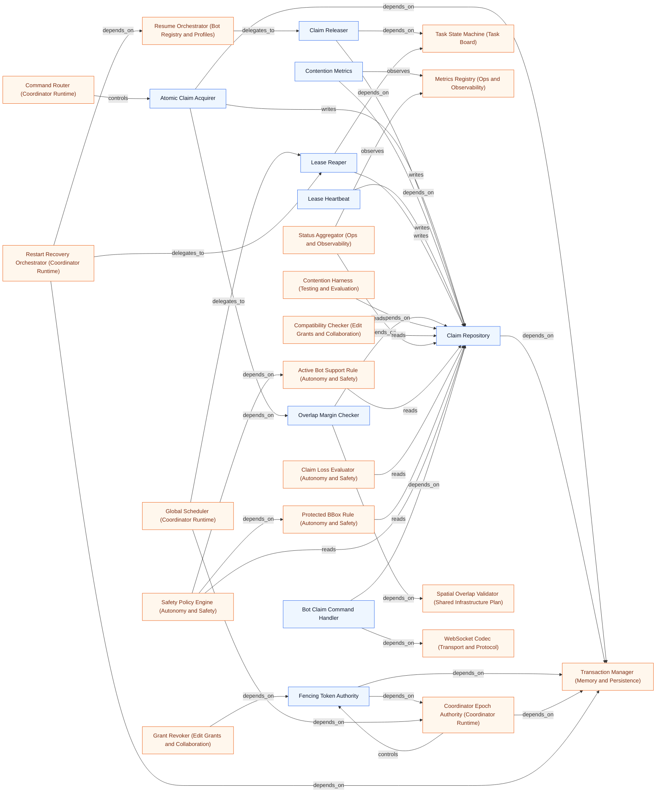

### Edit Grants and Collaboration

Source: `docs/architecture/graphs/system-grants.mmd`


### Bot Registry and Profiles

Source: `docs/architecture/graphs/system-bots.mmd`

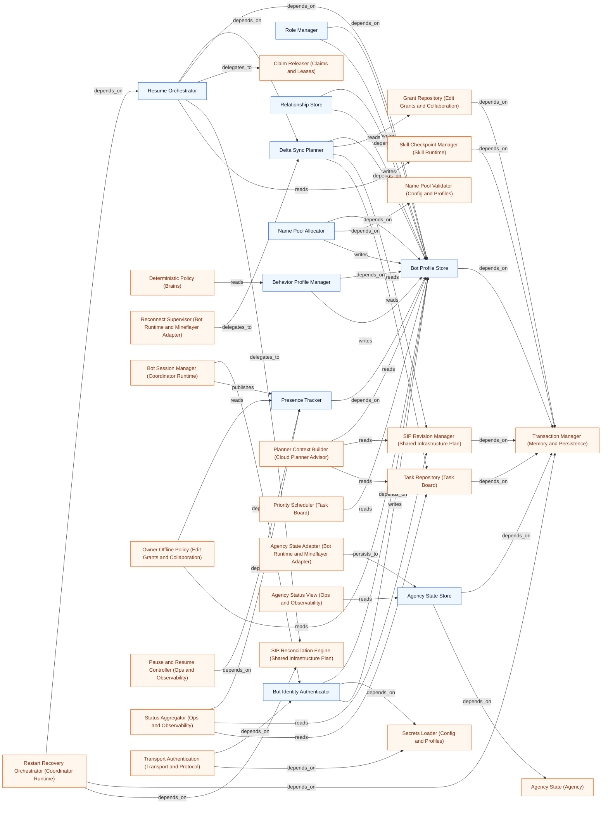

### World Model and Landmarks

Source: `docs/architecture/graphs/system-world.mmd`

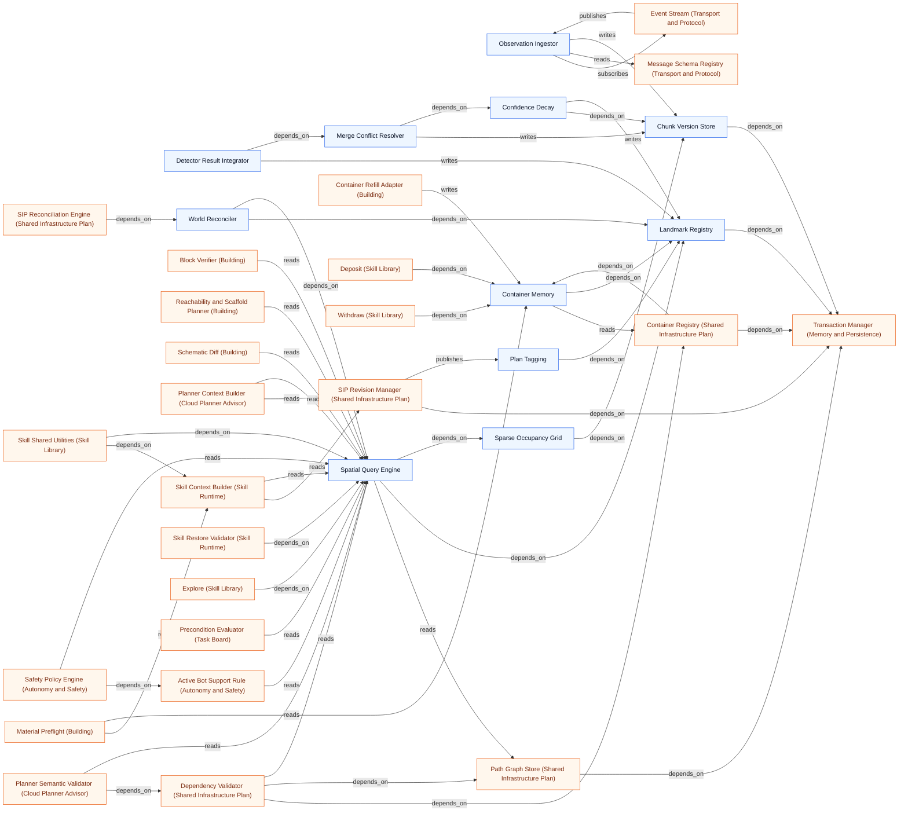

### Perception

Source: `docs/architecture/graphs/system-perception.mmd`

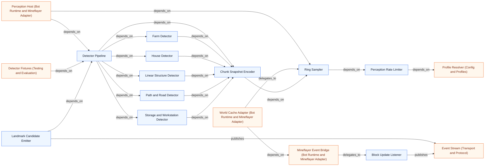

### Laya Decision Service

Source: `docs/architecture/graphs/system-decision.mmd`


### Cloud Planner Advisor

Source: `docs/architecture/graphs/system-planner.mmd`


### Skill Runtime

Source: `docs/architecture/graphs/system-skill-runtime.mmd`

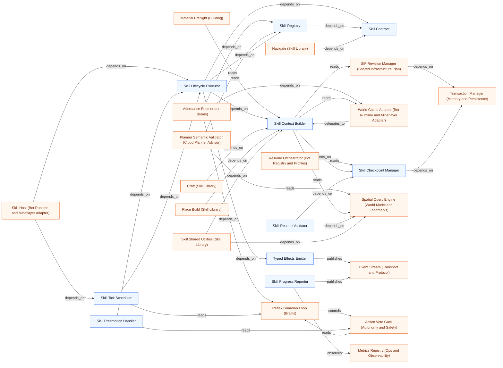

### Skill Library

Source: `docs/architecture/graphs/system-skills.mmd`

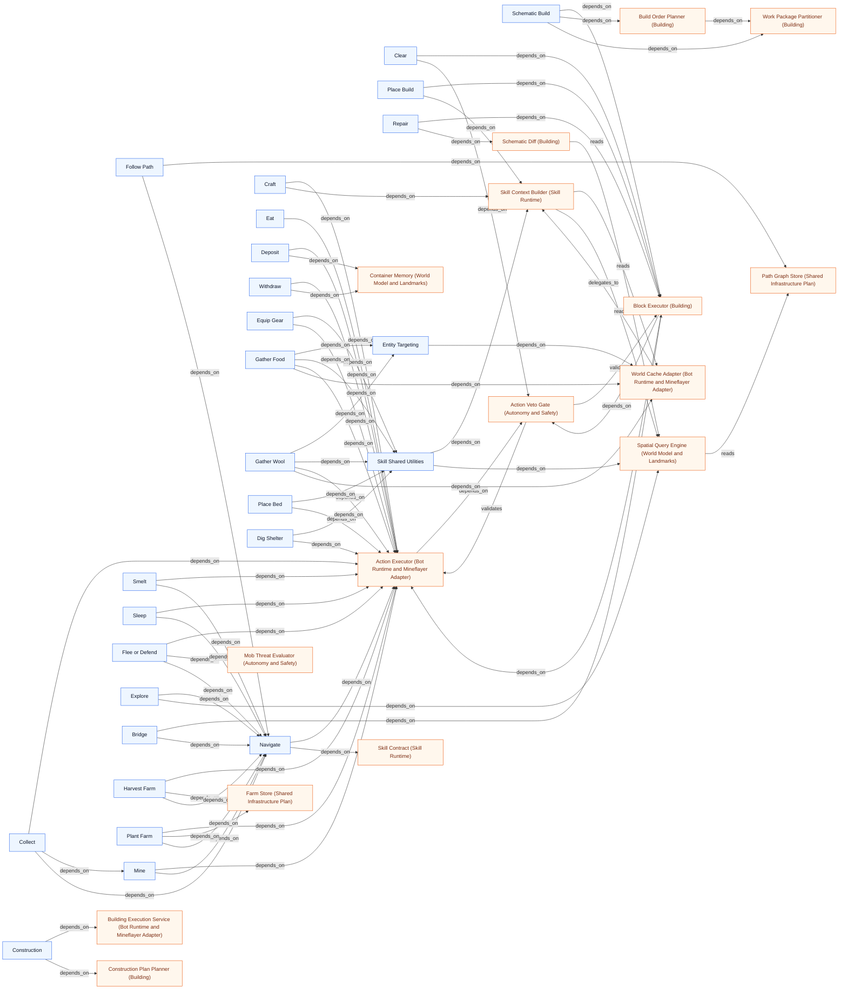

### Building

Source: `docs/architecture/graphs/system-building.mmd`

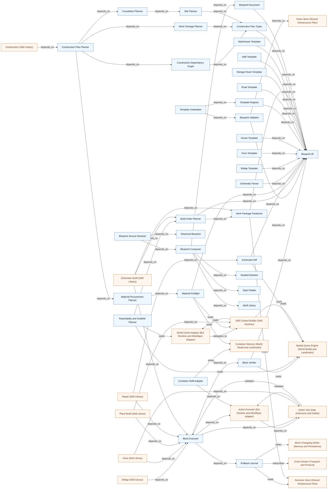

### Bot Runtime and Mineflayer Adapter

Source: `docs/architecture/graphs/system-bot-runtime.mmd`

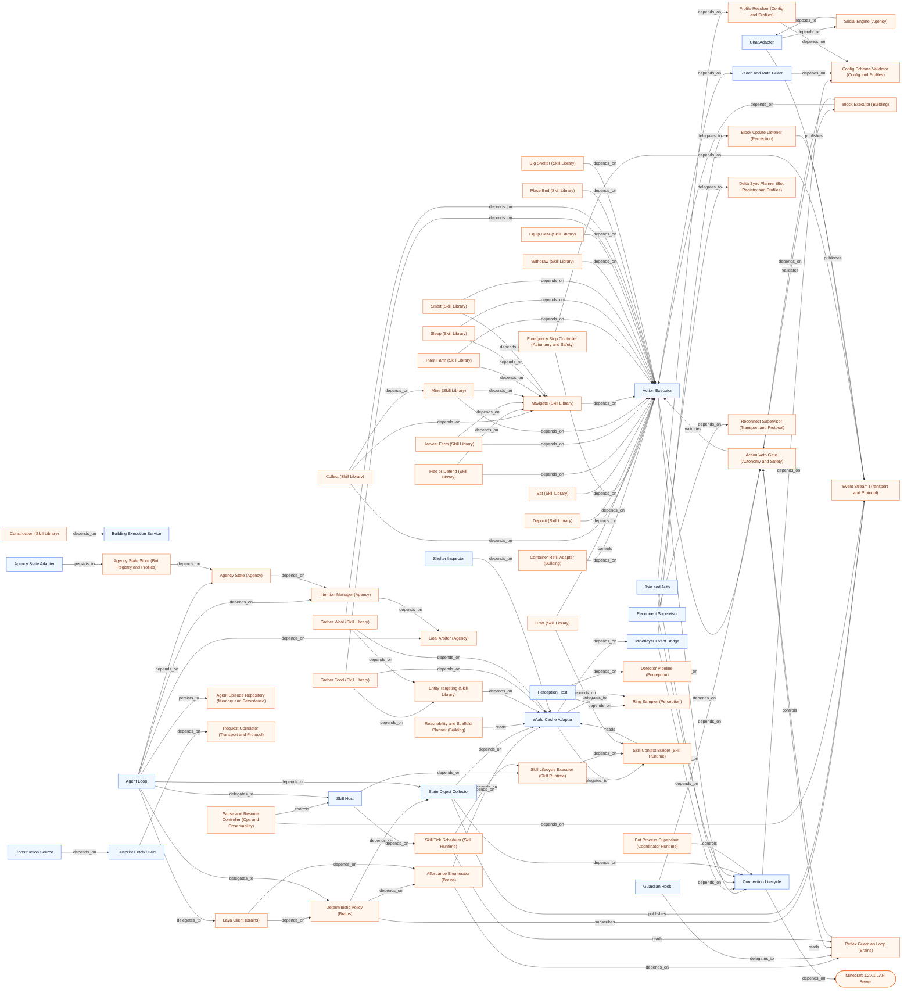

### Autonomy and Safety

Source: `docs/architecture/graphs/system-safety.mmd`

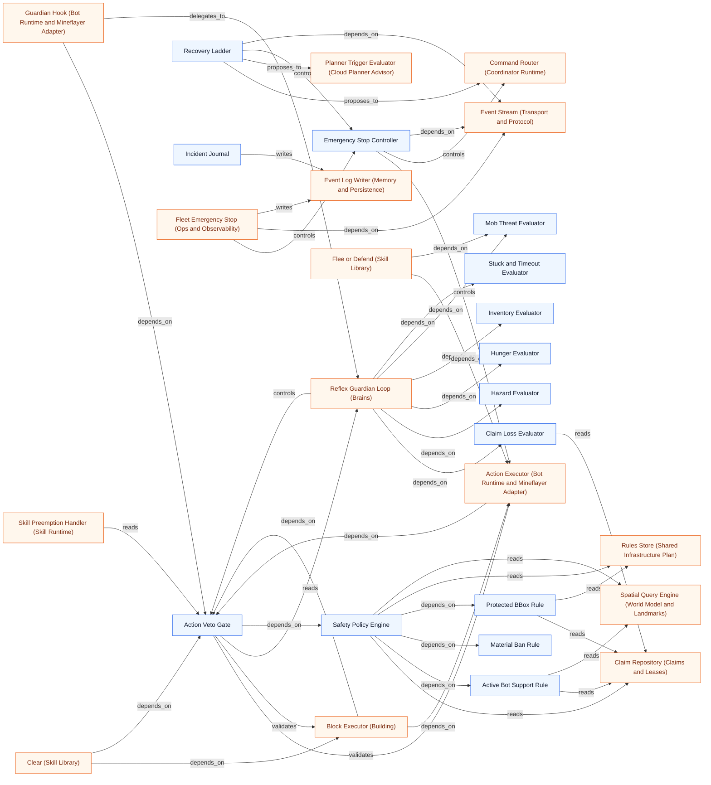

### Memory and Persistence

Source: `docs/architecture/graphs/system-memory.mmd`

```mermaid
flowchart LR
n281["SQLite Runtime"]
n166["Migration Runner"]
n160["Transaction Manager"]
n218["Event Log Writer"]
n276["Block Changelog Writer"]
n162["Retention Pruner"]
n282["Snapshot Export"]
n283["Schema Version Registry"]
n284["Episode Store"]
n280["Agent Episode Repository"]
n217["Bot Profile Store (Bot Registry and Profiles)"]
n110["Rollback Journal (Building)"]
n155["Atomic Claim Acquirer (Claims and Leases)"]
n219["Claim Repository (Claims and Leases)"]
n153["Fencing Token Authority (Claims and Leases)"]
n30["Coordinator Epoch Authority (Coordinator Runtime)"]
n31["Global Scheduler (Coordinator Runtime)"]
n72["Process Bootstrap (Coordinator Runtime)"]
n32["Restart Recovery Orchestrator (Coordinator Runtime)"]
n285["Replay Engine (Testing and Evaluation)"]
n223["Grant Repository (Edit Grants and Collaboration)"]
n151["Audit Viewer (Ops and Observability)"]
n150["Health and Readiness (Ops and Observability)"]
n81["Plan Cache (Cloud Planner Advisor)"]
n144["Incident Journal (Autonomy and Safety)"]
n188["Container Registry (Shared Infrastructure Plan)"]
n187["Farm Store (Shared Infrastructure Plan)"]
n189["Path Graph Store (Shared Infrastructure Plan)"]
n191["SIP Revision Manager (Shared Infrastructure Plan)"]
n186["Road Store (Shared Infrastructure Plan)"]
n190["Rules Store (Shared Infrastructure Plan)"]
n185["Structure Store (Shared Infrastructure Plan)"]
n157["SIP Transactional Committer (Shared Infrastructure Plan)"]
n184["Zone Store (Shared Infrastructure Plan)"]
n87["Skill Checkpoint Manager (Skill Runtime)"]
n158["Atomic Task Claimer (Task Board)"]
n207["Task Repository (Task Board)"]
n214["Task State Machine (Task Board)"]
n286["Trace Exporter (Laya Training)"]
n232["Chunk Version Store (World Model and Landmarks)"]
n236["Landmark Registry (World Model and Landmarks)"]
n67["Pause and Resume Controller (Ops and Observability)"]
n68["Fleet Emergency Stop (Ops and Observability)"]
n60["Agent Loop (Bot Runtime and Mineflayer Adapter)"]
n228["Agency State Store (Bot Registry and Profiles)"]
n146["Agency Status View (Ops and Observability)"]
n217 -->|depends_on| n160
n110 -->|writes| n276
n110 -->|reads| n185
n155 -->|writes| n219
n155 -->|depends_on| n160
n219 -->|depends_on| n160
n153 -->|depends_on| n30
n153 -->|depends_on| n160
n30 -->|controls| n153
n30 -->|depends_on| n160
n31 -->|depends_on| n30
n31 -->|delegates_to| n162
n72 -->|depends_on| n32
n72 -->|depends_on| n166
n32 -->|depends_on| n160
n285 -->|depends_on| n218
n223 -->|depends_on| n160
n276 -->|depends_on| n160
n218 -->|depends_on| n160
n166 -->|depends_on| n281
n162 -->|depends_on| n276
n162 -->|depends_on| n218
n162 -->|depends_on| n160
n283 -->|depends_on| n166
n282 -->|depends_on| n160
n160 -->|depends_on| n281
n151 -->|reads| n276
n151 -->|reads| n218
n150 -->|depends_on| n281
n81 -->|depends_on| n160
n144 -->|writes| n218
n188 -->|depends_on| n160
n187 -->|depends_on| n160
n189 -->|depends_on| n160
n191 -->|depends_on| n160
n191 -->|depends_on| n190
n186 -->|depends_on| n160
n190 -->|depends_on| n160
n185 -->|depends_on| n160
n157 -->|depends_on| n160
n157 -->|writes| n188
n157 -->|writes| n187
n157 -->|writes| n189
n157 -->|depends_on| n191
n157 -->|writes| n186
n157 -->|writes| n190
n157 -->|writes| n185
n157 -->|writes| n184
n184 -->|depends_on| n160
n87 -->|depends_on| n160
n158 -->|depends_on| n160
n158 -->|writes| n207
n207 -->|depends_on| n160
n214 -->|depends_on| n218
n214 -->|writes| n207
n286 -->|reads| n218
n232 -->|depends_on| n160
n236 -->|depends_on| n160
n285 -->|reads| n284
n286 -->|reads| n284
n151 -->|reads| n284
n162 -->|depends_on| n284
n67 -->|writes| n218
n68 -->|writes| n218
n60 -->|persists_to| n280
n228 -->|depends_on| n160
n280 -->|depends_on| n160
n146 -->|reads| n228
n146 -->|reads| n280
classDef internal fill:#eef6ff,stroke:#2563eb,color:#0f172a;
classDef external fill:#fff7ed,stroke:#ea580c,color:#7c2d12;
class n281,n166,n160,n218,n276,n162,n282,n283,n284,n280 internal;
class n217,n110,n155,n219,n153,n30,n31,n72,n32,n285,n223,n151,n150,n81,n144,n188,n187,n189,n191,n186,n190,n185,n157,n184,n87,n158,n207,n214,n286,n232,n236,n67,n68,n60,n228,n146 external;
```

### Ops and Observability

Source: `docs/architecture/graphs/system-ops.mmd`

```mermaid
flowchart LR
n66["Ops API"]
n145["Status Aggregator"]
n146["Agency Status View"]
n67["Pause and Resume Controller"]
n68["Fleet Emergency Stop"]
n147["SIP Dump"]
n148["Metrics Registry"]
n149["Structured Logger"]
n150["Health and Readiness"]
n151["Audit Viewer"]
n221["Contention Metrics (Claims and Leases)"]
n35["Execution Provider Selector (Laya Decision Service)"]
n80["Latency Metrics (Laya Decision Service)"]
n287["Metrics Reporter (Testing and Evaluation)"]
n28(["Fleet Operator"])
n276["Block Changelog Writer (Memory and Persistence)"]
n218["Event Log Writer (Memory and Persistence)"]
n65["Emergency Stop Controller (Autonomy and Safety)"]
n174["Event Stream (Transport and Protocol)"]
n34["Model Loader (Laya Decision Service)"]
n281["SQLite Runtime (Memory and Persistence)"]
n159["Message Schema Registry (Transport and Protocol)"]
n59["Skill Host (Bot Runtime and Mineflayer Adapter)"]
n172["Presence Tracker (Bot Registry and Profiles)"]
n191["SIP Revision Manager (Shared Infrastructure Plan)"]
n219["Claim Repository (Claims and Leases)"]
n207["Task Repository (Task Board)"]
n49["Planner Budget Limiter (Cloud Planner Advisor)"]
n43["Planner Trigger Evaluator (Cloud Planner Advisor)"]
n86["Skill Progress Reporter (Skill Runtime)"]
n284["Episode Store (Memory and Persistence)"]
n228["Agency State Store (Bot Registry and Profiles)"]
n280["Agent Episode Repository (Memory and Persistence)"]
n221 -->|depends_on| n219
n221 -->|observes| n148
n35 -->|controls| n34
n35 -->|observes| n149
n80 -->|observes| n148
n80 -->|writes| n148
n287 -->|observes| n148
n28 -->|controls| n66
n151 -->|reads| n276
n151 -->|reads| n218
n68 -->|controls| n65
n68 -->|depends_on| n174
n150 -->|depends_on| n34
n150 -->|depends_on| n281
n150 -->|depends_on| n145
n66 -->|depends_on| n68
n66 -->|depends_on| n67
n66 -->|depends_on| n145
n66 -->|depends_on| n159
n67 -->|controls| n59
n67 -->|depends_on| n172
n67 -->|depends_on| n174
n147 -->|depends_on| n191
n145 -->|depends_on| n172
n145 -->|reads| n219
n145 -->|observes| n148
n145 -->|reads| n191
n145 -->|reads| n207
n49 -->|observes| n148
n43 -->|observes| n148
n43 -->|reads| n191
n65 -->|depends_on| n174
n86 -->|observes| n148
n86 -->|publishes| n174
n151 -->|reads| n284
n67 -->|writes| n218
n68 -->|writes| n218
n146 -->|reads| n228
n146 -->|reads| n280
n66 -->|depends_on| n146
classDef internal fill:#eef6ff,stroke:#2563eb,color:#0f172a;
classDef external fill:#fff7ed,stroke:#ea580c,color:#7c2d12;
class n66,n145,n146,n67,n68,n147,n148,n149,n150,n151 internal;
class n221,n35,n80,n287,n276,n218,n65,n174,n34,n281,n159,n59,n172,n191,n219,n207,n49,n43,n86,n284,n228,n280,n28 external;
```

### Config and Profiles

Source: `docs/architecture/graphs/system-config.mmd`

```mermaid
flowchart LR
n165["Environment Parser"]
n164["Config Schema Validator"]
n170["Profile Resolver"]
n252["Hardware Probe"]
n180["Secrets Loader"]
n230["Name Pool Validator"]
n253["Laya Runtime Resolver"]
n288["Fail Fast Handler"]
n54["Connection Lifecycle (Bot Runtime and Mineflayer Adapter)"]
n125["Join and Auth (Bot Runtime and Mineflayer Adapter)"]
n127["Reach and Rate Guard (Bot Runtime and Mineflayer Adapter)"]
n171["Bot Identity Authenticator (Bot Registry and Profiles)"]
n229["Name Pool Allocator (Bot Registry and Profiles)"]
n27(["Host Hardware"])
n72["Process Bootstrap (Coordinator Runtime)"]
n73["Service Composition (Coordinator Runtime)"]
n39["Confidence Calibrator (Laya Decision Service)"]
n35["Execution Provider Selector (Laya Decision Service)"]
n34["Model Loader (Laya Decision Service)"]
n77["Decision Rate Limiter (Laya Decision Service)"]
n250["Perception Rate Limiter (Perception)"]
n41["OpenAI-Compatible Client (Cloud Planner Advisor)"]
n177["Transport Authentication (Transport and Protocol)"]
n54 -->|depends_on| n164
n125 -->|depends_on| n54
n125 -->|depends_on| n170
n127 -->|depends_on| n164
n171 -->|depends_on| n180
n229 -->|depends_on| n230
n164 -->|depends_on| n165
n288 -->|depends_on| n164
n252 -->|depends_on| n170
n252 -->|depends_on| n27
n253 -->|depends_on| n252
n253 -->|depends_on| n170
n230 -->|depends_on| n164
n170 -->|depends_on| n164
n180 -->|depends_on| n165
n72 -->|depends_on| n164
n72 -->|depends_on| n165
n72 -->|depends_on| n73
n73 -->|depends_on| n170
n39 -->|depends_on| n164
n35 -->|depends_on| n252
n35 -->|controls| n34
n34 -->|depends_on| n253
n77 -->|depends_on| n170
n250 -->|depends_on| n170
n41 -->|depends_on| n164
n41 -->|depends_on| n180
n177 -->|depends_on| n171
n177 -->|depends_on| n180
classDef internal fill:#eef6ff,stroke:#2563eb,color:#0f172a;
classDef external fill:#fff7ed,stroke:#ea580c,color:#7c2d12;
class n165,n164,n170,n252,n180,n230,n253,n288 internal;
class n54,n125,n127,n171,n229,n72,n73,n39,n35,n34,n77,n250,n41,n177,n27 external;
```

### Testing and Evaluation

Source: `docs/architecture/graphs/system-eval.mmd`

```mermaid
flowchart LR
n289["Unit Fixtures"]
n251["Detector Fixtures"]
n290["Docker Server Harness"]
n291["Scenario Runner"]
n285["Replay Engine"]
n216["Contention Harness"]
n287["Metrics Reporter"]
n292["Soak Runner"]
n293["Architecture Guard Tests"]
n254["Laya Benchmark Harness"]
n219["Claim Repository (Claims and Leases)"]
n207["Task Repository (Task Board)"]
n249["Detector Pipeline (Perception)"]
n24(["Minecraft 1.20.1 LAN Server"])
n80["Latency Metrics (Laya Decision Service)"]
n34["Model Loader (Laya Decision Service)"]
n148["Metrics Registry (Ops and Observability)"]
n218["Event Log Writer (Memory and Persistence)"]
n294["Promotion Gate (Laya Training)"]
n284["Episode Store (Memory and Persistence)"]
n80 -->|observes| n148
n80 -->|writes| n148
n293 -->|depends_on| n289
n216 -->|depends_on| n219
n216 -->|delegates_to| n291
n216 -->|depends_on| n207
n251 -->|depends_on| n289
n251 -->|depends_on| n249
n290 -->|depends_on| n289
n290 -->|depends_on| n24
n254 -->|depends_on| n80
n254 -->|depends_on| n34
n254 -->|delegates_to| n291
n287 -->|observes| n148
n285 -->|depends_on| n291
n285 -->|depends_on| n218
n291 -->|controls| n290
n291 -->|publishes| n287
n292 -->|depends_on| n287
n292 -->|delegates_to| n291
n294 -->|depends_on| n254
n285 -->|reads| n284
classDef internal fill:#eef6ff,stroke:#2563eb,color:#0f172a;
classDef external fill:#fff7ed,stroke:#ea580c,color:#7c2d12;
class n289,n251,n290,n291,n285,n216,n287,n292,n293,n254 internal;
class n219,n207,n249,n80,n34,n148,n218,n294,n284,n24 external;
```

### Laya Training

Source: `docs/architecture/graphs/system-training.mmd`

```mermaid
flowchart LR
n286["Trace Exporter"]
n295["Labeling Pipeline"]
n296["Reward Computer"]
n297["Fine-tune Runner"]
n298["ONNX Exporter"]
n255["Calibration Fitter"]
n294["Promotion Gate"]
n39["Confidence Calibrator (Laya Decision Service)"]
n254["Laya Benchmark Harness (Testing and Evaluation)"]
n218["Event Log Writer (Memory and Persistence)"]
n284["Episode Store (Memory and Persistence)"]
n255 -->|reads| n39
n255 -->|depends_on| n286
n297 -->|depends_on| n295
n297 -->|depends_on| n296
n295 -->|depends_on| n286
n298 -->|depends_on| n297
n294 -->|depends_on| n254
n294 -->|depends_on| n255
n294 -->|depends_on| n298
n296 -->|depends_on| n286
n286 -->|reads| n218
n286 -->|reads| n284
classDef internal fill:#eef6ff,stroke:#2563eb,color:#0f172a;
classDef external fill:#fff7ed,stroke:#ea580c,color:#7c2d12;
class n286,n295,n296,n297,n298,n255,n294 internal;
class n39,n254,n218,n284 external;
```

### Brains

Source: `docs/architecture/graphs/system-brains.mmd`

```mermaid
flowchart LR
n69["Reflex Guardian Loop"]
n152["Affordance Enumerator"]
n70["Deterministic Policy"]
n71["Laya Client"]
n56["World Cache Adapter (Bot Runtime and Mineflayer Adapter)"]
n83["Skill Registry (Skill Runtime)"]
n131["State Digest Collector (Bot Runtime and Mineflayer Adapter)"]
n226["Behavior Profile Manager (Bot Registry and Profiles)"]
n174["Event Stream (Transport and Protocol)"]
n58["Guardian Hook (Bot Runtime and Mineflayer Adapter)"]
n39["Confidence Calibrator (Laya Decision Service)"]
n63["Action Veto Gate (Autonomy and Safety)"]
n139["Claim Loss Evaluator (Autonomy and Safety)"]
n134["Hazard Evaluator (Autonomy and Safety)"]
n136["Hunger Evaluator (Autonomy and Safety)"]
n138["Inventory Evaluator (Autonomy and Safety)"]
n135["Mob Threat Evaluator (Autonomy and Safety)"]
n137["Stuck and Timeout Evaluator (Autonomy and Safety)"]
n85["Skill Tick Scheduler (Skill Runtime)"]
n167["WebSocket Codec (Transport and Protocol)"]
n60["Agent Loop (Bot Runtime and Mineflayer Adapter)"]
n152 -->|depends_on| n56
n152 -->|depends_on| n69
n152 -->|depends_on| n83
n70 -->|depends_on| n152
n70 -->|depends_on| n131
n70 -->|reads| n226
n70 -->|subscribes| n174
n58 -->|depends_on| n63
n58 -->|delegates_to| n69
n131 -->|depends_on| n56
n131 -->|publishes| n174
n39 -->|proposes_to| n70
n63 -->|reads| n69
n69 -->|controls| n63
n69 -->|depends_on| n139
n69 -->|depends_on| n134
n69 -->|depends_on| n136
n69 -->|depends_on| n138
n69 -->|depends_on| n135
n69 -->|depends_on| n137
n85 -->|reads| n69
n174 -->|depends_on| n167
n71 -->|depends_on| n152
n71 -->|depends_on| n167
n71 -->|depends_on| n70
n60 -->|delegates_to| n71
n60 -->|delegates_to| n70
n60 -->|depends_on| n131
classDef internal fill:#eef6ff,stroke:#2563eb,color:#0f172a;
classDef external fill:#fff7ed,stroke:#ea580c,color:#7c2d12;
class n69,n152,n70,n71 internal;
class n56,n83,n131,n226,n174,n58,n39,n63,n139,n134,n136,n138,n135,n137,n85,n167,n60 external;
```

### Agency

Source: `docs/architecture/graphs/system-agency.mmd`

```mermaid
flowchart LR
n299["Personality Model"]
n300["Needs Model"]
n301["Goal Catalog"]
n302["Goal Generator"]
n277["Goal Arbiter"]
n278["Intention Manager"]
n303["Routine Model"]
n304["Item Knowledge"]
n305["Night Preparation Config"]
n306["Shelter Strategy"]
n307["Shelter Plan"]
n308["Night Readiness"]
n279["Social Engine"]
n309["Working Memory"]
n310["Project Focus Policy"]
n231["Agency State"]
n60["Agent Loop (Bot Runtime and Mineflayer Adapter)"]
n61["Chat Adapter (Bot Runtime and Mineflayer Adapter)"]
n228["Agency State Store (Bot Registry and Profiles)"]
n60 -->|depends_on| n277
n60 -->|depends_on| n278
n60 -->|depends_on| n231
n61 -->|depends_on| n279
n302 -->|depends_on| n301
n302 -->|depends_on| n300
n302 -->|depends_on| n299
n277 -->|depends_on| n302
n277 -->|depends_on| n300
n277 -->|depends_on| n299
n278 -->|depends_on| n277
n279 -->|depends_on| n299
n231 -->|depends_on| n300
n231 -->|depends_on| n299
n231 -->|depends_on| n278
n231 -->|depends_on| n303
n231 -->|depends_on| n309
n310 -->|depends_on| n309
n279 -->|proposes_to| n61
n228 -->|depends_on| n231
n308 -->|depends_on| n304
n308 -->|depends_on| n305
n308 -->|depends_on| n303
n308 -->|depends_on| n307
n308 -->|depends_on| n306
n306 -->|depends_on| n305
n302 -->|depends_on| n305
n302 -->|depends_on| n308
n302 -->|depends_on| n303
classDef internal fill:#eef6ff,stroke:#2563eb,color:#0f172a;
classDef external fill:#fff7ed,stroke:#ea580c,color:#7c2d12;
class n299,n300,n301,n302,n277,n278,n303,n304,n305,n306,n307,n308,n279,n309,n310,n231 internal;
class n60,n61,n228 external;
```

### Bootstrap and Toolchain

Source: `docs/architecture/graphs/system-toolchain.mmd`

```mermaid
flowchart LR
n311["Bootstrap Orchestrator"]
n312["Capability Check"]
n313["Python Environment"]
n314["Minecraft Server Controller"]
n315["Firefox SVG Renderer"]
n311 -->|depends_on| n312
n311 -->|depends_on| n313
n311 -->|depends_on| n314
n311 -->|depends_on| n315
classDef internal fill:#eef6ff,stroke:#2563eb,color:#0f172a;
classDef external fill:#fff7ed,stroke:#ea580c,color:#7c2d12;
class n311,n312,n313,n314,n315 internal;
```
