# TiCrafter Architecture Graphs

> Generated from `docs/architecture/graph.json`. Edit the graph, then run `bun tools/architecture/render-graphs.mjs`.


Mermaid source lives in `docs/architecture/graphs/`. GitHub renders these fenced blocks directly. For local SVG rendering, run `bun run render:svg -- <input.mmd> <output.svg>`; it uses the installed Firefox browser and never downloads Chromium.

## Fleet overview

Systems and externals with aggregated relation counts.


## Cross-system dependencies

System-to-system view with relation types.

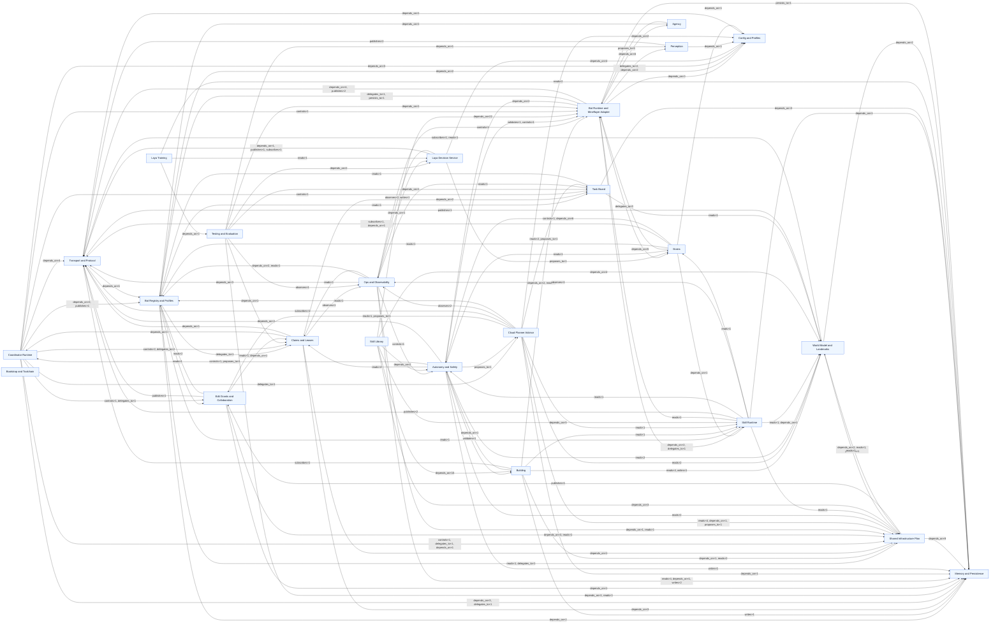

## Safety and control authority

Guardian veto, grant/claim control, ops stop path, and planner proposal path.


## Data flow

Perception, world model, SIP, decisions, skills, building, and persistence.

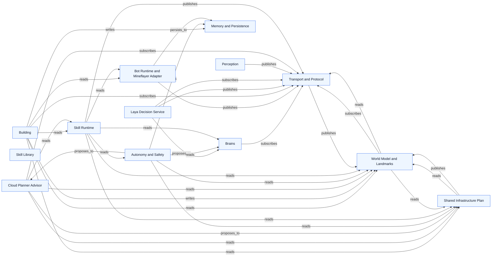

## Per-system graphs

### Coordinator Runtime

Source: `docs/architecture/graphs/system-core.mmd`


### Transport and Protocol

Source: `docs/architecture/graphs/system-transport.mmd`

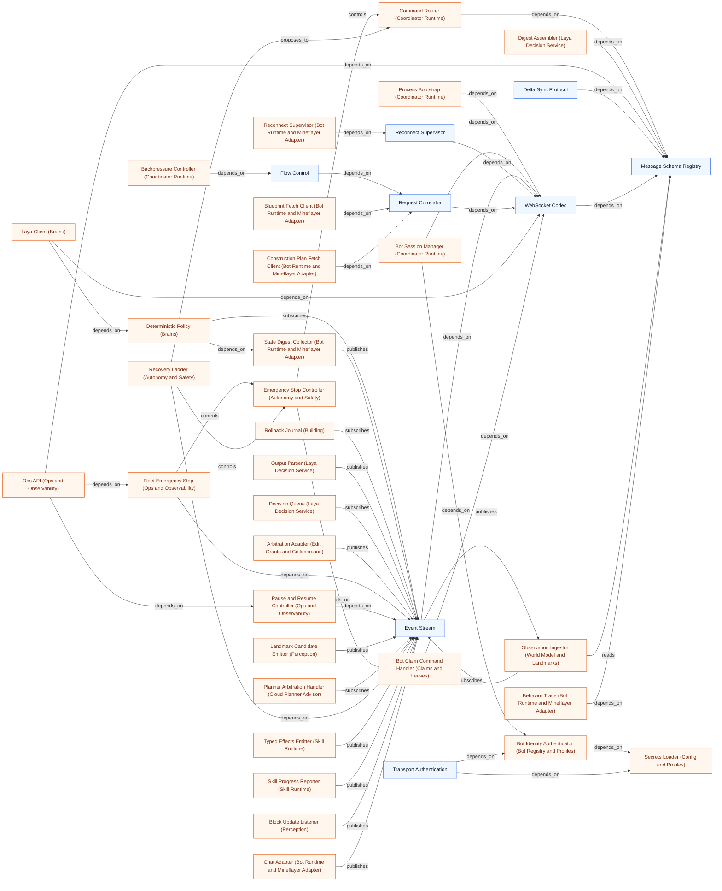

### Shared Infrastructure Plan

Source: `docs/architecture/graphs/system-sip.mmd`

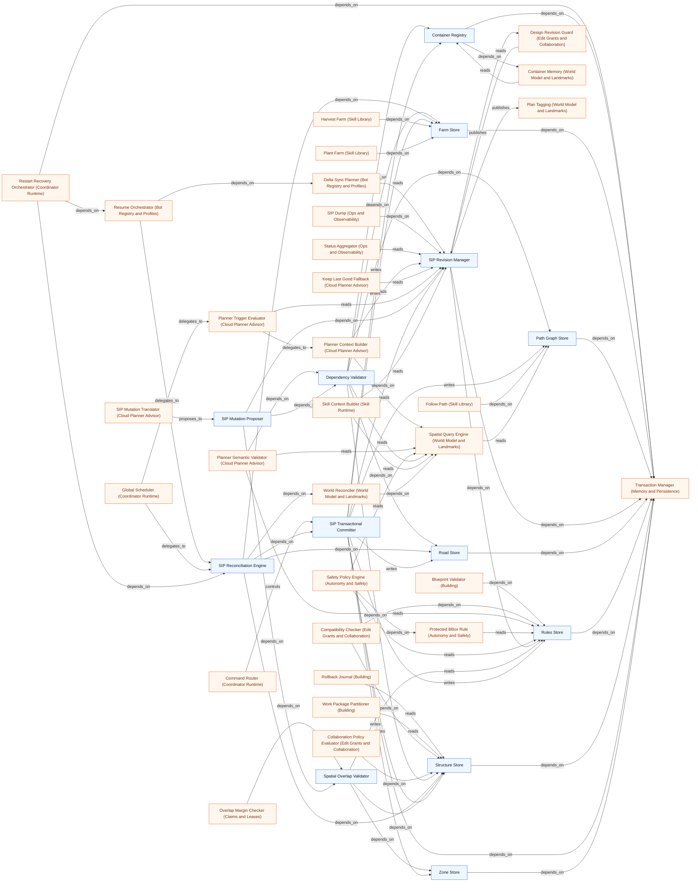

### Task Board

Source: `docs/architecture/graphs/system-tasks.mmd`

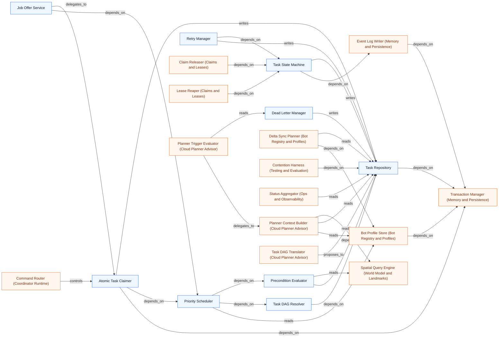

### Claims and Leases

Source: `docs/architecture/graphs/system-claims.mmd`

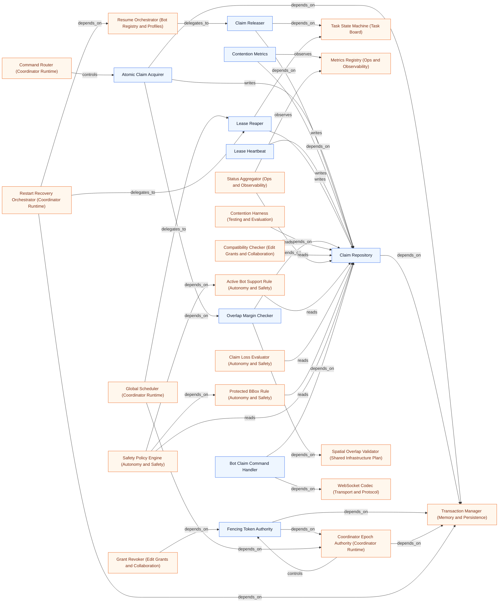

### Edit Grants and Collaboration

Source: `docs/architecture/graphs/system-grants.mmd`


### Bot Registry and Profiles

Source: `docs/architecture/graphs/system-bots.mmd`

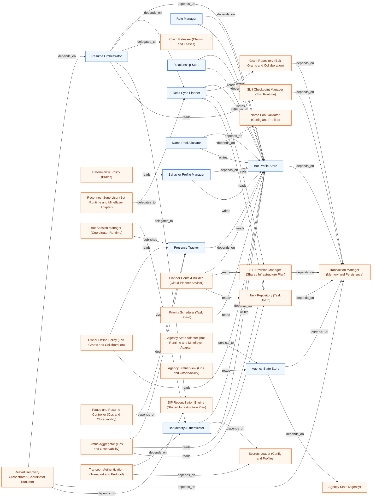

### World Model and Landmarks

Source: `docs/architecture/graphs/system-world.mmd`

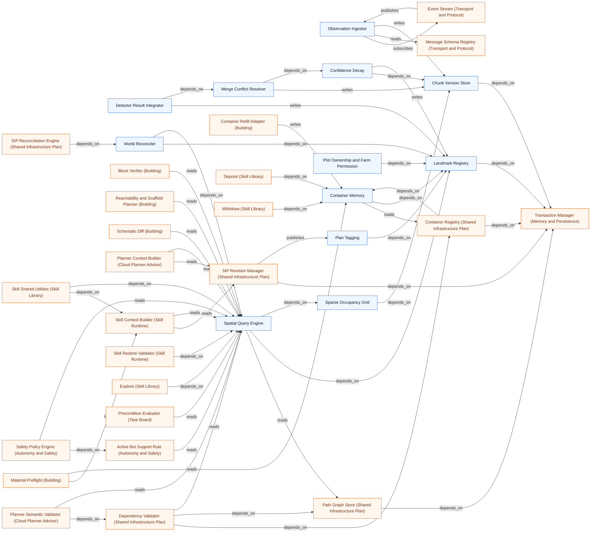

### Perception

Source: `docs/architecture/graphs/system-perception.mmd`

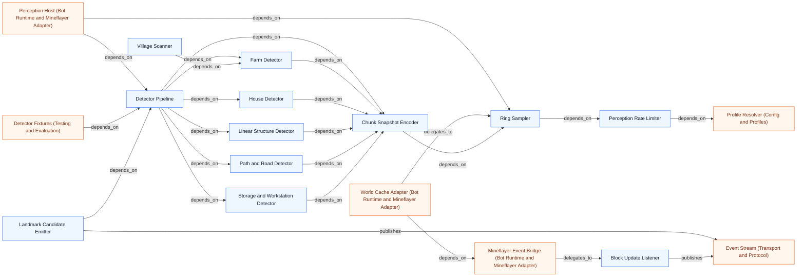

### Laya Decision Service

Source: `docs/architecture/graphs/system-decision.mmd`


### Cloud Planner Advisor

Source: `docs/architecture/graphs/system-planner.mmd`


### Skill Runtime

Source: `docs/architecture/graphs/system-skill-runtime.mmd`

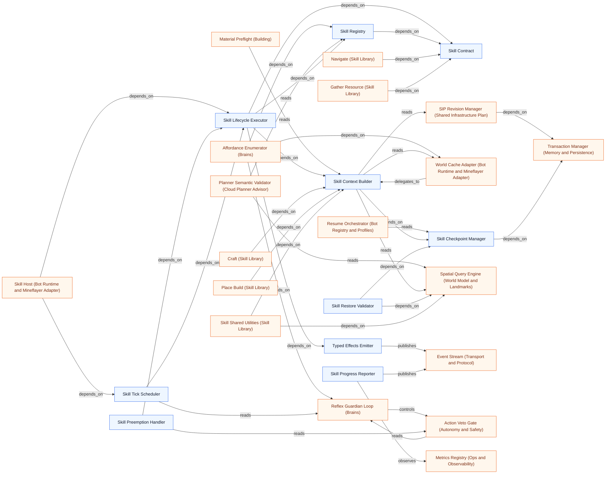

### Skill Library

Source: `docs/architecture/graphs/system-skills.mmd`

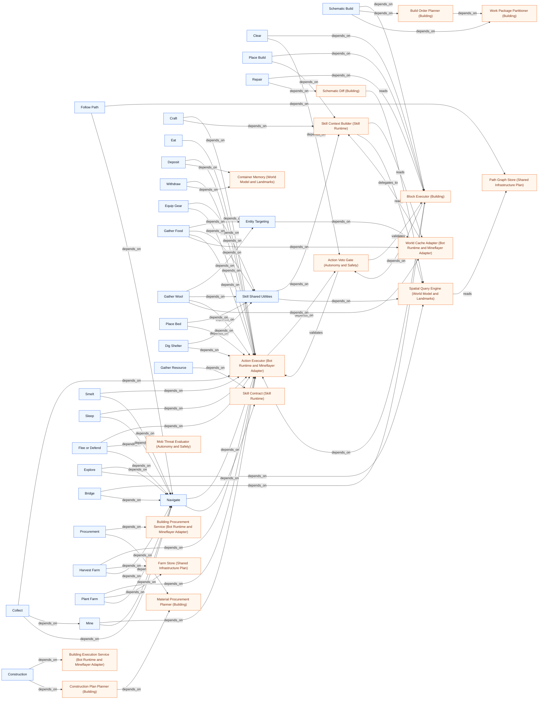

### Building

Source: `docs/architecture/graphs/system-building.mmd`

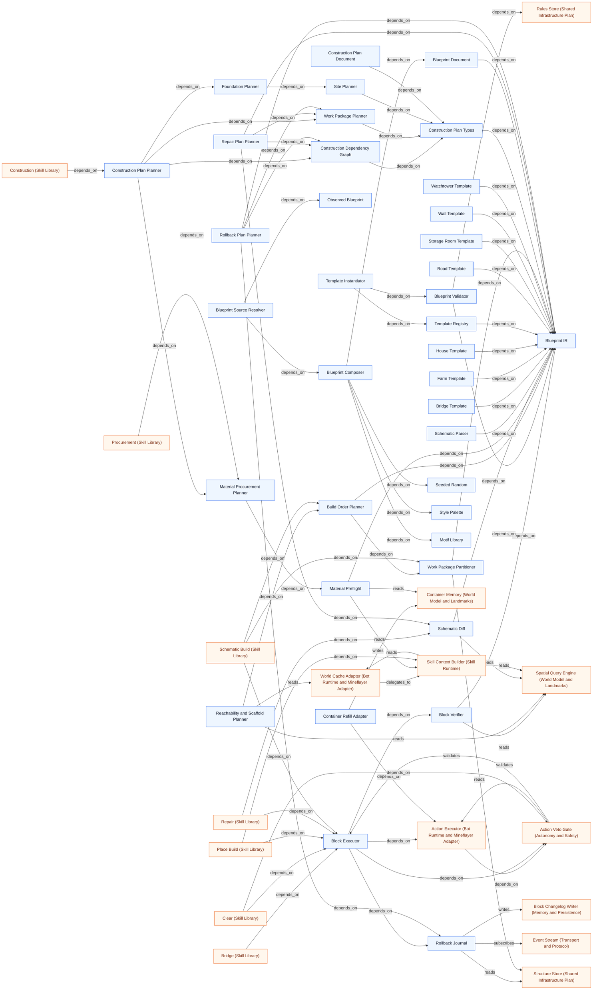

### Bot Runtime and Mineflayer Adapter

Source: `docs/architecture/graphs/system-bot-runtime.mmd`

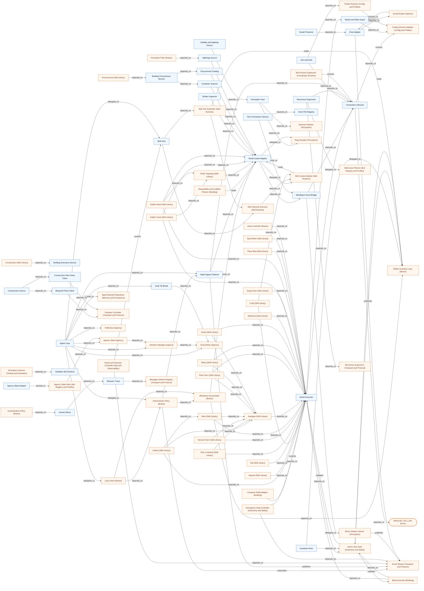

### Autonomy and Safety

Source: `docs/architecture/graphs/system-safety.mmd`

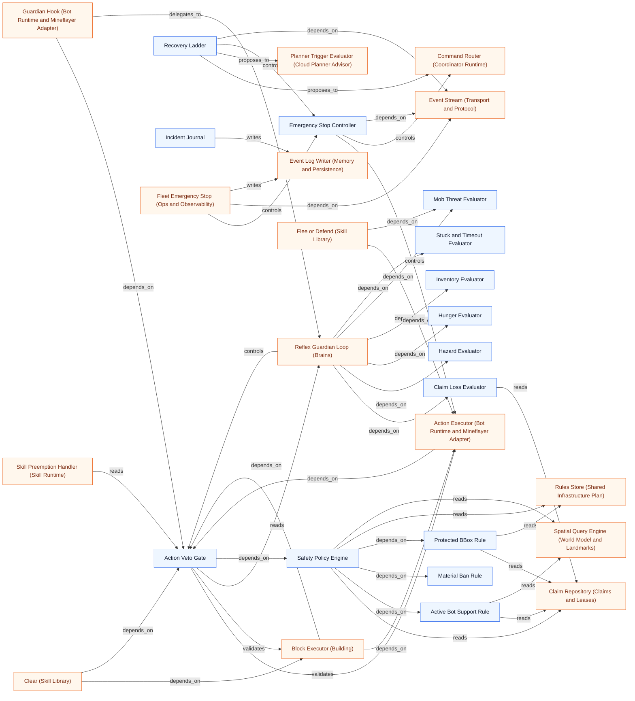

### Memory and Persistence

Source: `docs/architecture/graphs/system-memory.mmd`

```mermaid
flowchart LR
n308["SQLite Runtime"]
n187["Migration Runner"]
n181["Transaction Manager"]
n239["Event Log Writer"]
n301["Block Changelog Writer"]
n183["Retention Pruner"]
n309["Snapshot Export"]
n310["Schema Version Registry"]
n311["Episode Store"]
n305["Agent Episode Repository"]
n238["Bot Profile Store (Bot Registry and Profiles)"]
n111["Rollback Journal (Building)"]
n176["Atomic Claim Acquirer (Claims and Leases)"]
n240["Claim Repository (Claims and Leases)"]
n174["Fencing Token Authority (Claims and Leases)"]
n30["Coordinator Epoch Authority (Coordinator Runtime)"]
n31["Global Scheduler (Coordinator Runtime)"]
n72["Process Bootstrap (Coordinator Runtime)"]
n32["Restart Recovery Orchestrator (Coordinator Runtime)"]
n312["Replay Engine (Testing and Evaluation)"]
n244["Grant Repository (Edit Grants and Collaboration)"]
n168["Audit Viewer (Ops and Observability)"]
n167["Health and Readiness (Ops and Observability)"]
n81["Plan Cache (Cloud Planner Advisor)"]
n161["Incident Journal (Autonomy and Safety)"]
n209["Container Registry (Shared Infrastructure Plan)"]
n208["Farm Store (Shared Infrastructure Plan)"]
n210["Path Graph Store (Shared Infrastructure Plan)"]
n212["SIP Revision Manager (Shared Infrastructure Plan)"]
n207["Road Store (Shared Infrastructure Plan)"]
n211["Rules Store (Shared Infrastructure Plan)"]
n206["Structure Store (Shared Infrastructure Plan)"]
n178["SIP Transactional Committer (Shared Infrastructure Plan)"]
n205["Zone Store (Shared Infrastructure Plan)"]
n88["Skill Checkpoint Manager (Skill Runtime)"]
n179["Atomic Task Claimer (Task Board)"]
n228["Task Repository (Task Board)"]
n235["Task State Machine (Task Board)"]
n313["Trace Exporter (Laya Training)"]
n253["Chunk Version Store (World Model and Landmarks)"]
n257["Landmark Registry (World Model and Landmarks)"]
n67["Pause and Resume Controller (Ops and Observability)"]
n68["Fleet Emergency Stop (Ops and Observability)"]
n60["Agent Loop (Bot Runtime and Mineflayer Adapter)"]
n249["Agency State Store (Bot Registry and Profiles)"]
n163["Agency Status View (Ops and Observability)"]
n238 -->|depends_on| n181
n111 -->|writes| n301
n111 -->|reads| n206
n176 -->|writes| n240
n176 -->|depends_on| n181
n240 -->|depends_on| n181
n174 -->|depends_on| n30
n174 -->|depends_on| n181
n30 -->|controls| n174
n30 -->|depends_on| n181
n31 -->|depends_on| n30
n31 -->|delegates_to| n183
n72 -->|depends_on| n32
n72 -->|depends_on| n187
n32 -->|depends_on| n181
n312 -->|depends_on| n239
n244 -->|depends_on| n181
n301 -->|depends_on| n181
n239 -->|depends_on| n181
n187 -->|depends_on| n308
n183 -->|depends_on| n301
n183 -->|depends_on| n239
n183 -->|depends_on| n181
n310 -->|depends_on| n187
n309 -->|depends_on| n181
n181 -->|depends_on| n308
n168 -->|reads| n301
n168 -->|reads| n239
n167 -->|depends_on| n308
n81 -->|depends_on| n181
n161 -->|writes| n239
n209 -->|depends_on| n181
n208 -->|depends_on| n181
n210 -->|depends_on| n181
n212 -->|depends_on| n181
n212 -->|depends_on| n211
n207 -->|depends_on| n181
n211 -->|depends_on| n181
n206 -->|depends_on| n181
n178 -->|depends_on| n181
n178 -->|writes| n209
n178 -->|writes| n208
n178 -->|writes| n210
n178 -->|depends_on| n212
n178 -->|writes| n207
n178 -->|writes| n211
n178 -->|writes| n206
n178 -->|writes| n205
n205 -->|depends_on| n181
n88 -->|depends_on| n181
n179 -->|depends_on| n181
n179 -->|writes| n228
n228 -->|depends_on| n181
n235 -->|depends_on| n239
n235 -->|writes| n228
n313 -->|reads| n239
n253 -->|depends_on| n181
n257 -->|depends_on| n181
n312 -->|reads| n311
n313 -->|reads| n311
n168 -->|reads| n311
n183 -->|depends_on| n311
n67 -->|writes| n239
n68 -->|writes| n239
n60 -->|persists_to| n305
n249 -->|depends_on| n181
n305 -->|depends_on| n181
n163 -->|reads| n249
n163 -->|reads| n305
classDef internal fill:#eef6ff,stroke:#2563eb,color:#0f172a;
classDef external fill:#fff7ed,stroke:#ea580c,color:#7c2d12;
class n308,n187,n181,n239,n301,n183,n309,n310,n311,n305 internal;
class n238,n111,n176,n240,n174,n30,n31,n72,n32,n312,n244,n168,n167,n81,n161,n209,n208,n210,n212,n207,n211,n206,n178,n205,n88,n179,n228,n235,n313,n253,n257,n67,n68,n60,n249,n163 external;
```

### Ops and Observability

Source: `docs/architecture/graphs/system-ops.mmd`

```mermaid
flowchart LR
n66["Ops API"]
n162["Status Aggregator"]
n163["Agency Status View"]
n67["Pause and Resume Controller"]
n68["Fleet Emergency Stop"]
n164["SIP Dump"]
n165["Metrics Registry"]
n166["Structured Logger"]
n167["Health and Readiness"]
n168["Audit Viewer"]
n242["Contention Metrics (Claims and Leases)"]
n35["Execution Provider Selector (Laya Decision Service)"]
n80["Latency Metrics (Laya Decision Service)"]
n314["Metrics Reporter (Testing and Evaluation)"]
n28(["Fleet Operator"])
n301["Block Changelog Writer (Memory and Persistence)"]
n239["Event Log Writer (Memory and Persistence)"]
n65["Emergency Stop Controller (Autonomy and Safety)"]
n195["Event Stream (Transport and Protocol)"]
n34["Model Loader (Laya Decision Service)"]
n308["SQLite Runtime (Memory and Persistence)"]
n180["Message Schema Registry (Transport and Protocol)"]
n59["Skill Host (Bot Runtime and Mineflayer Adapter)"]
n193["Presence Tracker (Bot Registry and Profiles)"]
n212["SIP Revision Manager (Shared Infrastructure Plan)"]
n240["Claim Repository (Claims and Leases)"]
n228["Task Repository (Task Board)"]
n49["Planner Budget Limiter (Cloud Planner Advisor)"]
n43["Planner Trigger Evaluator (Cloud Planner Advisor)"]
n87["Skill Progress Reporter (Skill Runtime)"]
n311["Episode Store (Memory and Persistence)"]
n249["Agency State Store (Bot Registry and Profiles)"]
n305["Agent Episode Repository (Memory and Persistence)"]
n242 -->|depends_on| n240
n242 -->|observes| n165
n35 -->|controls| n34
n35 -->|observes| n166
n80 -->|observes| n165
n80 -->|writes| n165
n314 -->|observes| n165
n28 -->|controls| n66
n168 -->|reads| n301
n168 -->|reads| n239
n68 -->|controls| n65
n68 -->|depends_on| n195
n167 -->|depends_on| n34
n167 -->|depends_on| n308
n167 -->|depends_on| n162
n66 -->|depends_on| n68
n66 -->|depends_on| n67
n66 -->|depends_on| n162
n66 -->|depends_on| n180
n67 -->|controls| n59
n67 -->|depends_on| n193
n67 -->|depends_on| n195
n164 -->|depends_on| n212
n162 -->|depends_on| n193
n162 -->|reads| n240
n162 -->|observes| n165
n162 -->|reads| n212
n162 -->|reads| n228
n49 -->|observes| n165
n43 -->|observes| n165
n43 -->|reads| n212
n65 -->|depends_on| n195
n87 -->|observes| n165
n87 -->|publishes| n195
n168 -->|reads| n311
n67 -->|writes| n239
n68 -->|writes| n239
n163 -->|reads| n249
n163 -->|reads| n305
n66 -->|depends_on| n163
classDef internal fill:#eef6ff,stroke:#2563eb,color:#0f172a;
classDef external fill:#fff7ed,stroke:#ea580c,color:#7c2d12;
class n66,n162,n163,n67,n68,n164,n165,n166,n167,n168 internal;
class n242,n35,n80,n314,n301,n239,n65,n195,n34,n308,n180,n59,n193,n212,n240,n228,n49,n43,n87,n311,n249,n305,n28 external;
```

### Config and Profiles

Source: `docs/architecture/graphs/system-config.mmd`

```mermaid
flowchart LR
n186["Environment Parser"]
n185["Config Schema Validator"]
n191["Profile Resolver"]
n275["Hardware Probe"]
n201["Secrets Loader"]
n251["Name Pool Validator"]
n276["Laya Runtime Resolver"]
n315["Fail Fast Handler"]
n54["Connection Lifecycle (Bot Runtime and Mineflayer Adapter)"]
n129["Join and Auth (Bot Runtime and Mineflayer Adapter)"]
n131["Reach and Rate Guard (Bot Runtime and Mineflayer Adapter)"]
n192["Bot Identity Authenticator (Bot Registry and Profiles)"]
n250["Name Pool Allocator (Bot Registry and Profiles)"]
n27(["Host Hardware"])
n72["Process Bootstrap (Coordinator Runtime)"]
n73["Service Composition (Coordinator Runtime)"]
n39["Confidence Calibrator (Laya Decision Service)"]
n35["Execution Provider Selector (Laya Decision Service)"]
n34["Model Loader (Laya Decision Service)"]
n77["Decision Rate Limiter (Laya Decision Service)"]
n272["Perception Rate Limiter (Perception)"]
n41["OpenAI-Compatible Client (Cloud Planner Advisor)"]
n198["Transport Authentication (Transport and Protocol)"]
n170["Tactical Decision Policy (Brains)"]
n54 -->|depends_on| n185
n129 -->|depends_on| n54
n129 -->|depends_on| n191
n131 -->|depends_on| n185
n192 -->|depends_on| n201
n250 -->|depends_on| n251
n185 -->|depends_on| n186
n315 -->|depends_on| n185
n275 -->|depends_on| n191
n275 -->|depends_on| n27
n276 -->|depends_on| n275
n276 -->|depends_on| n191
n251 -->|depends_on| n185
n191 -->|depends_on| n185
n201 -->|depends_on| n186
n72 -->|depends_on| n185
n72 -->|depends_on| n186
n72 -->|depends_on| n73
n73 -->|depends_on| n191
n39 -->|depends_on| n185
n35 -->|depends_on| n275
n35 -->|controls| n34
n34 -->|depends_on| n276
n77 -->|depends_on| n191
n272 -->|depends_on| n191
n41 -->|depends_on| n185
n41 -->|depends_on| n201
n198 -->|depends_on| n192
n198 -->|depends_on| n201
n170 -->|depends_on| n185
classDef internal fill:#eef6ff,stroke:#2563eb,color:#0f172a;
classDef external fill:#fff7ed,stroke:#ea580c,color:#7c2d12;
class n186,n185,n191,n275,n201,n251,n276,n315 internal;
class n54,n129,n131,n192,n250,n72,n73,n39,n35,n34,n77,n272,n41,n198,n170,n27 external;
```

### Testing and Evaluation

Source: `docs/architecture/graphs/system-eval.mmd`

```mermaid
flowchart LR
n316["Unit Fixtures"]
n274["Detector Fixtures"]
n317["Docker Server Harness"]
n318["Scenario Runner"]
n312["Replay Engine"]
n237["Contention Harness"]
n314["Metrics Reporter"]
n319["Soak Runner"]
n320["Architecture Guard Tests"]
n277["Laya Benchmark Harness"]
n307["Simulation Harness"]
n321["Behavior Assertions"]
n322["Trace Inspector"]
n323["Behavior Oddity Detectors"]
n240["Claim Repository (Claims and Leases)"]
n228["Task Repository (Task Board)"]
n271["Detector Pipeline (Perception)"]
n24(["Minecraft 1.20.1 LAN Server"])
n80["Latency Metrics (Laya Decision Service)"]
n34["Model Loader (Laya Decision Service)"]
n165["Metrics Registry (Ops and Observability)"]
n239["Event Log Writer (Memory and Persistence)"]
n324["Promotion Gate (Laya Training)"]
n311["Episode Store (Memory and Persistence)"]
n143["Headless Bot Runtime (Bot Runtime and Mineflayer Adapter)"]
n80 -->|observes| n165
n80 -->|writes| n165
n320 -->|depends_on| n316
n237 -->|depends_on| n240
n237 -->|delegates_to| n318
n237 -->|depends_on| n228
n274 -->|depends_on| n316
n274 -->|depends_on| n271
n317 -->|depends_on| n316
n317 -->|depends_on| n24
n277 -->|depends_on| n80
n277 -->|depends_on| n34
n277 -->|delegates_to| n318
n314 -->|observes| n165
n312 -->|depends_on| n318
n312 -->|depends_on| n239
n318 -->|controls| n317
n318 -->|publishes| n314
n319 -->|depends_on| n314
n319 -->|delegates_to| n318
n324 -->|depends_on| n277
n312 -->|reads| n311
n307 -->|depends_on| n143
n307 -->|depends_on| n321
n322 -->|depends_on| n307
n323 -->|depends_on| n321
classDef internal fill:#eef6ff,stroke:#2563eb,color:#0f172a;
classDef external fill:#fff7ed,stroke:#ea580c,color:#7c2d12;
class n316,n274,n317,n318,n312,n237,n314,n319,n320,n277,n307,n321,n322,n323 internal;
class n240,n228,n271,n80,n34,n165,n239,n324,n311,n143,n24 external;
```

### Laya Training

Source: `docs/architecture/graphs/system-training.mmd`

```mermaid
flowchart LR
n313["Trace Exporter"]
n325["Labeling Pipeline"]
n326["Reward Computer"]
n327["Fine-tune Runner"]
n328["ONNX Exporter"]
n278["Calibration Fitter"]
n324["Promotion Gate"]
n39["Confidence Calibrator (Laya Decision Service)"]
n277["Laya Benchmark Harness (Testing and Evaluation)"]
n239["Event Log Writer (Memory and Persistence)"]
n311["Episode Store (Memory and Persistence)"]
n278 -->|reads| n39
n278 -->|depends_on| n313
n327 -->|depends_on| n325
n327 -->|depends_on| n326
n325 -->|depends_on| n313
n328 -->|depends_on| n327
n324 -->|depends_on| n277
n324 -->|depends_on| n278
n324 -->|depends_on| n328
n326 -->|depends_on| n313
n313 -->|reads| n239
n313 -->|reads| n311
classDef internal fill:#eef6ff,stroke:#2563eb,color:#0f172a;
classDef external fill:#fff7ed,stroke:#ea580c,color:#7c2d12;
class n313,n325,n326,n327,n328,n278,n324 internal;
class n39,n277,n239,n311 external;
```

### Brains

Source: `docs/architecture/graphs/system-brains.mmd`

```mermaid
flowchart LR
n69["Reflex Guardian Loop"]
n169["Affordance Enumerator"]
n70["Deterministic Policy"]
n71["Laya Client"]
n170["Tactical Decision Policy"]
n171["Gaze Controller"]
n172["Humanization Policy"]
n173["Perception Filter"]
n56["World Cache Adapter (Bot Runtime and Mineflayer Adapter)"]
n84["Skill Registry (Skill Runtime)"]
n139["State Digest Collector (Bot Runtime and Mineflayer Adapter)"]
n247["Behavior Profile Manager (Bot Registry and Profiles)"]
n195["Event Stream (Transport and Protocol)"]
n58["Guardian Hook (Bot Runtime and Mineflayer Adapter)"]
n39["Confidence Calibrator (Laya Decision Service)"]
n63["Action Veto Gate (Autonomy and Safety)"]
n156["Claim Loss Evaluator (Autonomy and Safety)"]
n151["Hazard Evaluator (Autonomy and Safety)"]
n153["Hunger Evaluator (Autonomy and Safety)"]
n155["Inventory Evaluator (Autonomy and Safety)"]
n152["Mob Threat Evaluator (Autonomy and Safety)"]
n154["Stuck and Timeout Evaluator (Autonomy and Safety)"]
n86["Skill Tick Scheduler (Skill Runtime)"]
n188["WebSocket Codec (Transport and Protocol)"]
n60["Agent Loop (Bot Runtime and Mineflayer Adapter)"]
n185["Config Schema Validator (Config and Profiles)"]
n57["Action Executor (Bot Runtime and Mineflayer Adapter)"]
n145["Human Mover (Bot Runtime and Mineflayer Adapter)"]
n146["Sightings Source (Bot Runtime and Mineflayer Adapter)"]
n57 -->|depends_on| n63
n169 -->|depends_on| n56
n169 -->|depends_on| n69
n169 -->|depends_on| n84
n70 -->|depends_on| n169
n70 -->|depends_on| n139
n70 -->|reads| n247
n70 -->|subscribes| n195
n58 -->|depends_on| n63
n58 -->|delegates_to| n69
n139 -->|depends_on| n56
n139 -->|publishes| n195
n39 -->|proposes_to| n70
n39 -->|depends_on| n185
n63 -->|validates| n57
n63 -->|reads| n69
n69 -->|controls| n63
n69 -->|depends_on| n156
n69 -->|depends_on| n151
n69 -->|depends_on| n153
n69 -->|depends_on| n155
n69 -->|depends_on| n152
n69 -->|depends_on| n154
n86 -->|reads| n69
n195 -->|depends_on| n188
n71 -->|depends_on| n169
n71 -->|depends_on| n188
n71 -->|depends_on| n70
n60 -->|delegates_to| n71
n60 -->|delegates_to| n70
n60 -->|depends_on| n139
n71 -->|depends_on| n170
n170 -->|depends_on| n185
n171 -->|depends_on| n57
n172 -->|depends_on| n145
n173 -->|depends_on| n146
n146 -->|depends_on| n56
classDef internal fill:#eef6ff,stroke:#2563eb,color:#0f172a;
classDef external fill:#fff7ed,stroke:#ea580c,color:#7c2d12;
class n69,n169,n70,n71,n170,n171,n172,n173 internal;
class n56,n84,n139,n247,n195,n58,n39,n63,n156,n151,n153,n155,n152,n154,n86,n188,n60,n185,n57,n145,n146 external;
```

### Agency

Source: `docs/architecture/graphs/system-agency.mmd`

```mermaid
flowchart LR
n329["Personality Model"]
n330["Needs Model"]
n331["Goal Catalog"]
n332["Goal Generator"]
n302["Goal Arbiter"]
n303["Intention Manager"]
n333["Routine Model"]
n334["Item Knowledge"]
n335["Night Preparation Config"]
n336["Shelter Strategy"]
n337["Shelter Plan"]
n338["Night Readiness"]
n304["Social Engine"]
n339["Working Memory"]
n340["Project Focus Policy"]
n252["Agency State"]
n341["Strategic Intent Policy"]
n306["Reflection"]
n342["Goal Deadline Policy"]
n343["Idle Life"]
n344["Progression Plan"]
n345["Progression Planner"]
n346["Recipe Port"]
n60["Agent Loop (Bot Runtime and Mineflayer Adapter)"]
n61["Chat Adapter (Bot Runtime and Mineflayer Adapter)"]
n249["Agency State Store (Bot Registry and Profiles)"]
n141["Goal Tie-Break (Bot Runtime and Mineflayer Adapter)"]
n60 -->|depends_on| n302
n60 -->|depends_on| n303
n60 -->|depends_on| n252
n61 -->|depends_on| n304
n332 -->|depends_on| n331
n332 -->|depends_on| n330
n332 -->|depends_on| n329
n302 -->|depends_on| n332
n302 -->|depends_on| n330
n302 -->|depends_on| n329
n303 -->|depends_on| n302
n304 -->|depends_on| n329
n252 -->|depends_on| n330
n252 -->|depends_on| n329
n252 -->|depends_on| n303
n252 -->|depends_on| n333
n252 -->|depends_on| n339
n340 -->|depends_on| n339
n304 -->|proposes_to| n61
n249 -->|depends_on| n252
n338 -->|depends_on| n334
n338 -->|depends_on| n335
n338 -->|depends_on| n333
n338 -->|depends_on| n337
n338 -->|depends_on| n336
n336 -->|depends_on| n335
n332 -->|depends_on| n335
n332 -->|depends_on| n338
n332 -->|depends_on| n333
n341 -->|depends_on| n302
n341 -->|depends_on| n339
n60 -->|depends_on| n141
n141 -->|depends_on| n302
n60 -->|depends_on| n306
n342 -->|depends_on| n303
n343 -->|depends_on| n332
n344 -->|depends_on| n339
n345 -->|depends_on| n344
n346 -->|depends_on| n344
classDef internal fill:#eef6ff,stroke:#2563eb,color:#0f172a;
classDef external fill:#fff7ed,stroke:#ea580c,color:#7c2d12;
class n329,n330,n331,n332,n302,n303,n333,n334,n335,n336,n337,n338,n304,n339,n340,n252,n341,n306,n342,n343,n344,n345,n346 internal;
class n60,n61,n249,n141 external;
```

### Bootstrap and Toolchain

Source: `docs/architecture/graphs/system-toolchain.mmd`

```mermaid
flowchart LR
n347["Bootstrap Orchestrator"]
n348["Capability Check"]
n349["Python Environment"]
n350["Minecraft Server Controller"]
n351["Firefox SVG Renderer"]
n347 -->|depends_on| n348
n347 -->|depends_on| n349
n347 -->|depends_on| n350
n347 -->|depends_on| n351
classDef internal fill:#eef6ff,stroke:#2563eb,color:#0f172a;
classDef external fill:#fff7ed,stroke:#ea580c,color:#7c2d12;
class n347,n348,n349,n350,n351 internal;
```
