# TiCrafter Architecture Graphs

> Generated from `docs/architecture/graph.json`. Edit the graph, then run `bun tools/architecture/render-graphs.mjs`.


Mermaid source lives in `docs/architecture/graphs/`. GitHub renders these fenced blocks directly. For local SVG rendering, run `bun run render:svg -- <input.mmd> <output.svg>`; it uses the installed Firefox browser and never downloads Chromium.

## Fleet overview

Systems and externals with aggregated relation counts.


## Cross-system dependencies

System-to-system view with relation types.

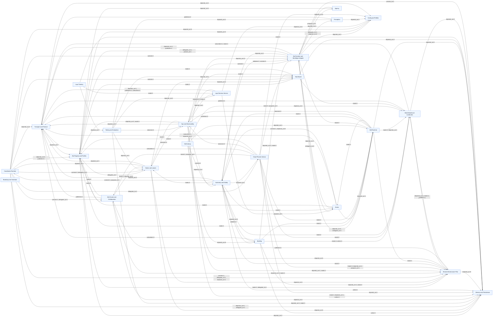

## Safety and control authority

Guardian veto, grant/claim control, ops stop path, and planner proposal path.


## Data flow

Perception, world model, SIP, decisions, skills, building, and persistence.

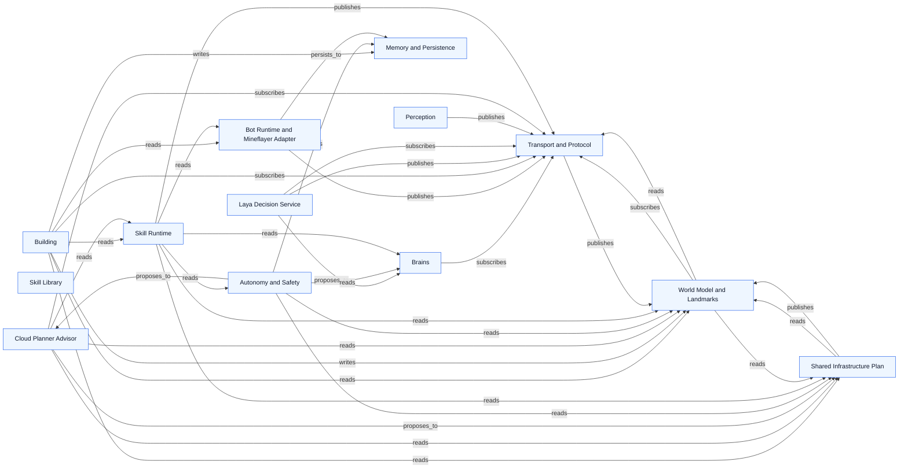

## Per-system graphs

### Coordinator Runtime

Source: `docs/architecture/graphs/system-core.mmd`


### Transport and Protocol

Source: `docs/architecture/graphs/system-transport.mmd`

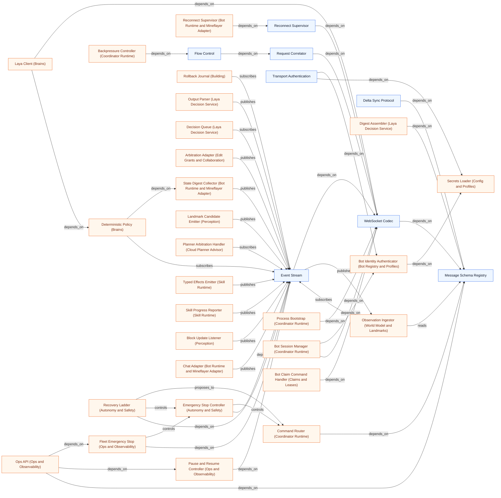

### Shared Infrastructure Plan

Source: `docs/architecture/graphs/system-sip.mmd`

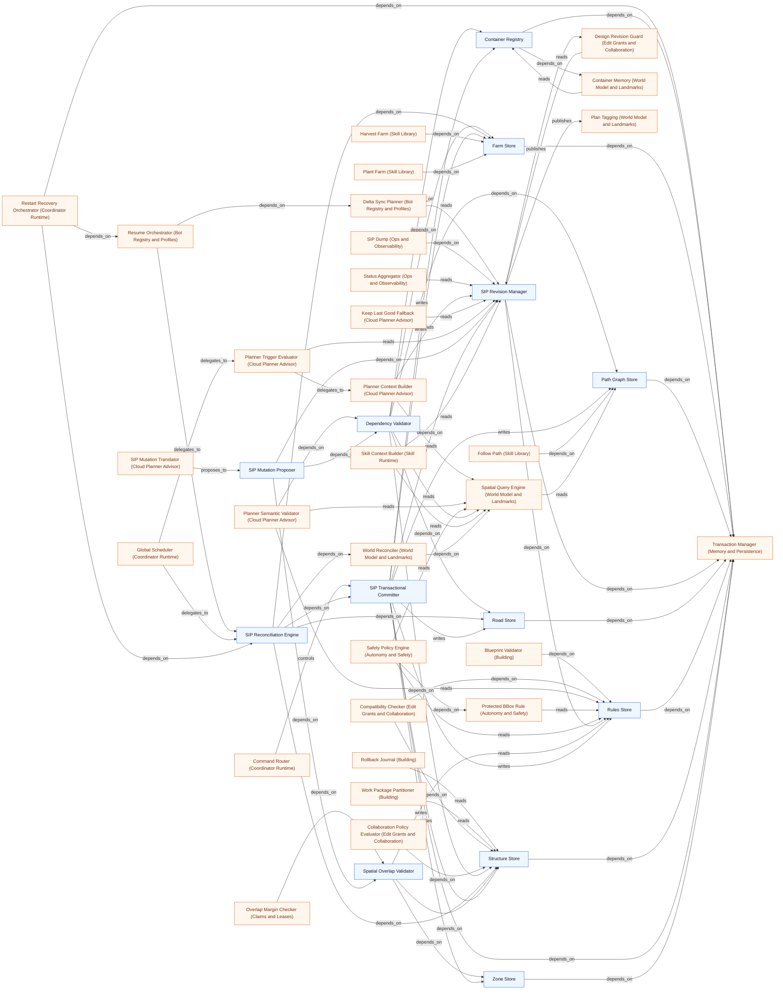

### Task Board

Source: `docs/architecture/graphs/system-tasks.mmd`

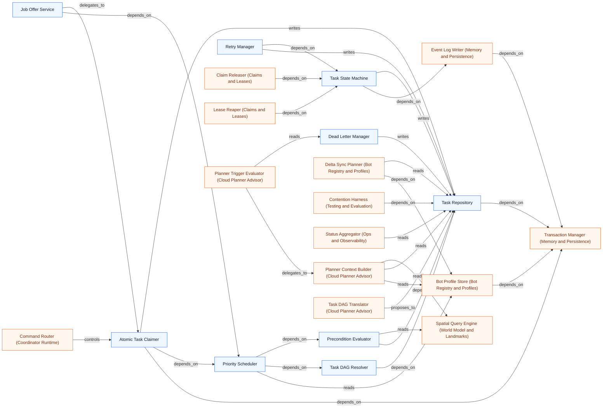

### Claims and Leases

Source: `docs/architecture/graphs/system-claims.mmd`

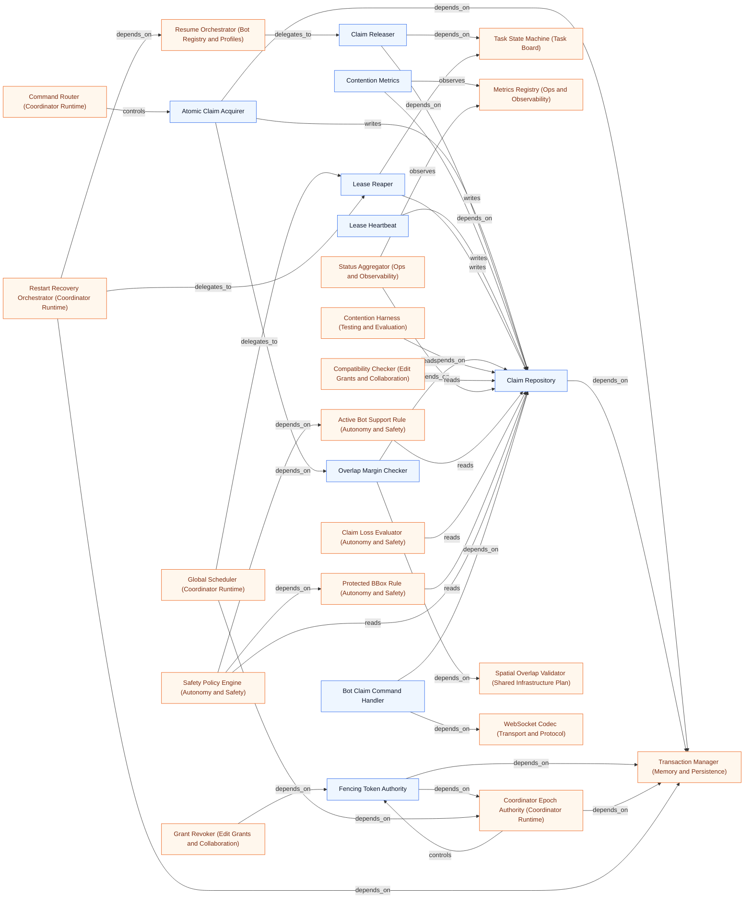

### Edit Grants and Collaboration

Source: `docs/architecture/graphs/system-grants.mmd`


### Bot Registry and Profiles

Source: `docs/architecture/graphs/system-bots.mmd`

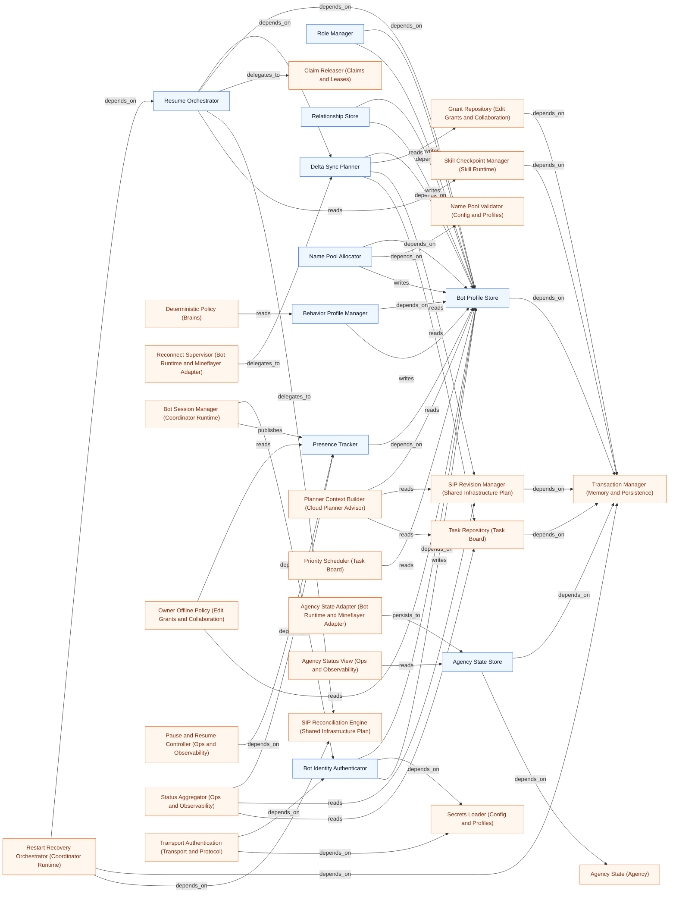

### World Model and Landmarks

Source: `docs/architecture/graphs/system-world.mmd`

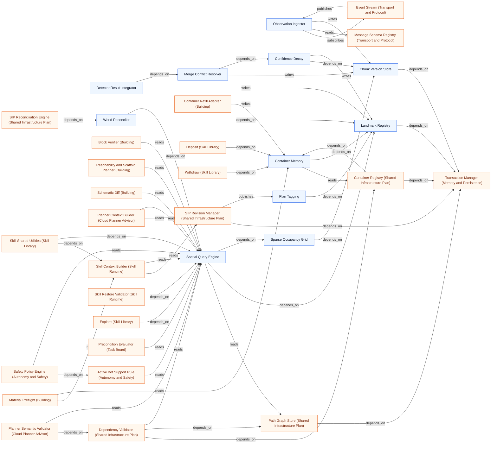

### Perception

Source: `docs/architecture/graphs/system-perception.mmd`

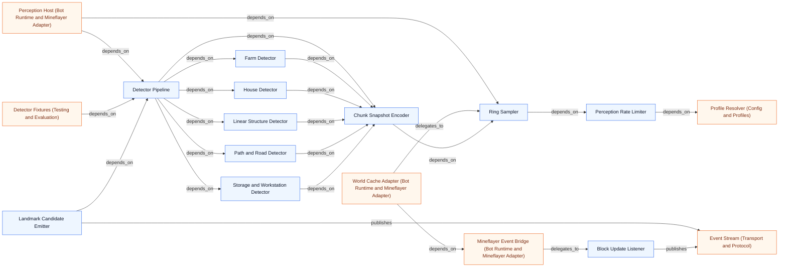

### Laya Decision Service

Source: `docs/architecture/graphs/system-decision.mmd`


### Cloud Planner Advisor

Source: `docs/architecture/graphs/system-planner.mmd`


### Skill Runtime

Source: `docs/architecture/graphs/system-skill-runtime.mmd`

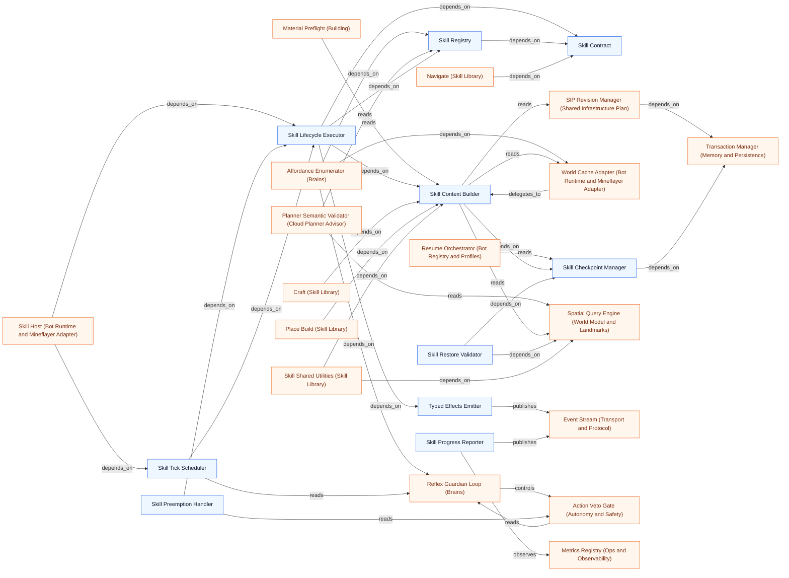

### Skill Library

Source: `docs/architecture/graphs/system-skills.mmd`

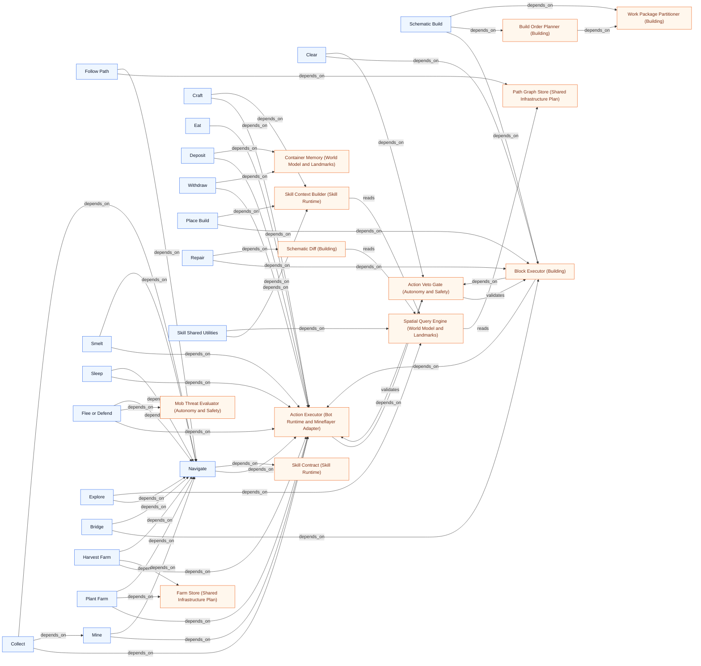

### Building

Source: `docs/architecture/graphs/system-building.mmd`

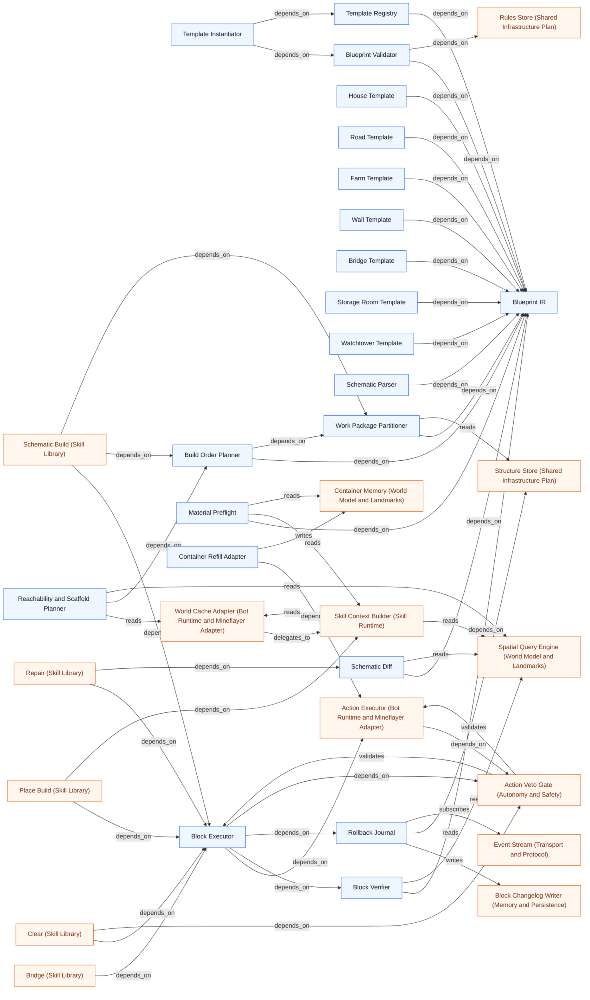

### Bot Runtime and Mineflayer Adapter

Source: `docs/architecture/graphs/system-bot-runtime.mmd`


### Autonomy and Safety

Source: `docs/architecture/graphs/system-safety.mmd`

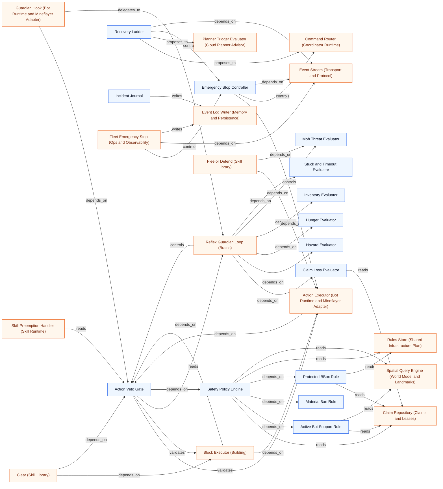

### Memory and Persistence

Source: `docs/architecture/graphs/system-memory.mmd`

```mermaid
flowchart LR
n256["SQLite Runtime"]
n148["Migration Runner"]
n142["Transaction Manager"]
n200["Event Log Writer"]
n251["Block Changelog Writer"]
n144["Retention Pruner"]
n257["Snapshot Export"]
n258["Schema Version Registry"]
n259["Episode Store"]
n255["Agent Episode Repository"]
n199["Bot Profile Store (Bot Registry and Profiles)"]
n110["Rollback Journal (Building)"]
n137["Atomic Claim Acquirer (Claims and Leases)"]
n201["Claim Repository (Claims and Leases)"]
n135["Fencing Token Authority (Claims and Leases)"]
n30["Coordinator Epoch Authority (Coordinator Runtime)"]
n31["Global Scheduler (Coordinator Runtime)"]
n72["Process Bootstrap (Coordinator Runtime)"]
n32["Restart Recovery Orchestrator (Coordinator Runtime)"]
n260["Replay Engine (Testing and Evaluation)"]
n205["Grant Repository (Edit Grants and Collaboration)"]
n133["Audit Viewer (Ops and Observability)"]
n132["Health and Readiness (Ops and Observability)"]
n81["Plan Cache (Cloud Planner Advisor)"]
n126["Incident Journal (Autonomy and Safety)"]
n170["Container Registry (Shared Infrastructure Plan)"]
n169["Farm Store (Shared Infrastructure Plan)"]
n171["Path Graph Store (Shared Infrastructure Plan)"]
n173["SIP Revision Manager (Shared Infrastructure Plan)"]
n168["Road Store (Shared Infrastructure Plan)"]
n172["Rules Store (Shared Infrastructure Plan)"]
n167["Structure Store (Shared Infrastructure Plan)"]
n139["SIP Transactional Committer (Shared Infrastructure Plan)"]
n166["Zone Store (Shared Infrastructure Plan)"]
n87["Skill Checkpoint Manager (Skill Runtime)"]
n140["Atomic Task Claimer (Task Board)"]
n189["Task Repository (Task Board)"]
n196["Task State Machine (Task Board)"]
n261["Trace Exporter (Laya Training)"]
n214["Chunk Version Store (World Model and Landmarks)"]
n218["Landmark Registry (World Model and Landmarks)"]
n67["Pause and Resume Controller (Ops and Observability)"]
n68["Fleet Emergency Stop (Ops and Observability)"]
n60["Agent Loop (Bot Runtime and Mineflayer Adapter)"]
n210["Agency State Store (Bot Registry and Profiles)"]
n128["Agency Status View (Ops and Observability)"]
n199 -->|depends_on| n142
n110 -->|writes| n251
n110 -->|reads| n167
n137 -->|writes| n201
n137 -->|depends_on| n142
n201 -->|depends_on| n142
n135 -->|depends_on| n30
n135 -->|depends_on| n142
n30 -->|controls| n135
n30 -->|depends_on| n142
n31 -->|depends_on| n30
n31 -->|delegates_to| n144
n72 -->|depends_on| n32
n72 -->|depends_on| n148
n32 -->|depends_on| n142
n260 -->|depends_on| n200
n205 -->|depends_on| n142
n251 -->|depends_on| n142
n200 -->|depends_on| n142
n148 -->|depends_on| n256
n144 -->|depends_on| n251
n144 -->|depends_on| n200
n144 -->|depends_on| n142
n258 -->|depends_on| n148
n257 -->|depends_on| n142
n142 -->|depends_on| n256
n133 -->|reads| n251
n133 -->|reads| n200
n132 -->|depends_on| n256
n81 -->|depends_on| n142
n126 -->|writes| n200
n170 -->|depends_on| n142
n169 -->|depends_on| n142
n171 -->|depends_on| n142
n173 -->|depends_on| n142
n173 -->|depends_on| n172
n168 -->|depends_on| n142
n172 -->|depends_on| n142
n167 -->|depends_on| n142
n139 -->|depends_on| n142
n139 -->|writes| n170
n139 -->|writes| n169
n139 -->|writes| n171
n139 -->|depends_on| n173
n139 -->|writes| n168
n139 -->|writes| n172
n139 -->|writes| n167
n139 -->|writes| n166
n166 -->|depends_on| n142
n87 -->|depends_on| n142
n140 -->|depends_on| n142
n140 -->|writes| n189
n189 -->|depends_on| n142
n196 -->|depends_on| n200
n196 -->|writes| n189
n261 -->|reads| n200
n214 -->|depends_on| n142
n218 -->|depends_on| n142
n260 -->|reads| n259
n261 -->|reads| n259
n133 -->|reads| n259
n144 -->|depends_on| n259
n67 -->|writes| n200
n68 -->|writes| n200
n60 -->|persists_to| n255
n210 -->|depends_on| n142
n255 -->|depends_on| n142
n128 -->|reads| n210
n128 -->|reads| n255
classDef internal fill:#eef6ff,stroke:#2563eb,color:#0f172a;
classDef external fill:#fff7ed,stroke:#ea580c,color:#7c2d12;
class n256,n148,n142,n200,n251,n144,n257,n258,n259,n255 internal;
class n199,n110,n137,n201,n135,n30,n31,n72,n32,n260,n205,n133,n132,n81,n126,n170,n169,n171,n173,n168,n172,n167,n139,n166,n87,n140,n189,n196,n261,n214,n218,n67,n68,n60,n210,n128 external;
```

### Ops and Observability

Source: `docs/architecture/graphs/system-ops.mmd`

```mermaid
flowchart LR
n66["Ops API"]
n127["Status Aggregator"]
n128["Agency Status View"]
n67["Pause and Resume Controller"]
n68["Fleet Emergency Stop"]
n129["SIP Dump"]
n130["Metrics Registry"]
n131["Structured Logger"]
n132["Health and Readiness"]
n133["Audit Viewer"]
n203["Contention Metrics (Claims and Leases)"]
n35["Execution Provider Selector (Laya Decision Service)"]
n80["Latency Metrics (Laya Decision Service)"]
n262["Metrics Reporter (Testing and Evaluation)"]
n28(["Fleet Operator"])
n251["Block Changelog Writer (Memory and Persistence)"]
n200["Event Log Writer (Memory and Persistence)"]
n65["Emergency Stop Controller (Autonomy and Safety)"]
n156["Event Stream (Transport and Protocol)"]
n34["Model Loader (Laya Decision Service)"]
n256["SQLite Runtime (Memory and Persistence)"]
n141["Message Schema Registry (Transport and Protocol)"]
n59["Skill Host (Bot Runtime and Mineflayer Adapter)"]
n154["Presence Tracker (Bot Registry and Profiles)"]
n173["SIP Revision Manager (Shared Infrastructure Plan)"]
n201["Claim Repository (Claims and Leases)"]
n189["Task Repository (Task Board)"]
n49["Planner Budget Limiter (Cloud Planner Advisor)"]
n43["Planner Trigger Evaluator (Cloud Planner Advisor)"]
n86["Skill Progress Reporter (Skill Runtime)"]
n259["Episode Store (Memory and Persistence)"]
n210["Agency State Store (Bot Registry and Profiles)"]
n255["Agent Episode Repository (Memory and Persistence)"]
n203 -->|depends_on| n201
n203 -->|observes| n130
n35 -->|controls| n34
n35 -->|observes| n131
n80 -->|observes| n130
n80 -->|writes| n130
n262 -->|observes| n130
n28 -->|controls| n66
n133 -->|reads| n251
n133 -->|reads| n200
n68 -->|controls| n65
n68 -->|depends_on| n156
n132 -->|depends_on| n34
n132 -->|depends_on| n256
n132 -->|depends_on| n127
n66 -->|depends_on| n68
n66 -->|depends_on| n67
n66 -->|depends_on| n127
n66 -->|depends_on| n141
n67 -->|controls| n59
n67 -->|depends_on| n154
n67 -->|depends_on| n156
n129 -->|depends_on| n173
n127 -->|depends_on| n154
n127 -->|reads| n201
n127 -->|observes| n130
n127 -->|reads| n173
n127 -->|reads| n189
n49 -->|observes| n130
n43 -->|observes| n130
n43 -->|reads| n173
n65 -->|depends_on| n156
n86 -->|observes| n130
n86 -->|publishes| n156
n133 -->|reads| n259
n67 -->|writes| n200
n68 -->|writes| n200
n128 -->|reads| n210
n128 -->|reads| n255
n66 -->|depends_on| n128
classDef internal fill:#eef6ff,stroke:#2563eb,color:#0f172a;
classDef external fill:#fff7ed,stroke:#ea580c,color:#7c2d12;
class n66,n127,n128,n67,n68,n129,n130,n131,n132,n133 internal;
class n203,n35,n80,n262,n251,n200,n65,n156,n34,n256,n141,n59,n154,n173,n201,n189,n49,n43,n86,n259,n210,n255,n28 external;
```

### Config and Profiles

Source: `docs/architecture/graphs/system-config.mmd`

```mermaid
flowchart LR
n147["Environment Parser"]
n146["Config Schema Validator"]
n152["Profile Resolver"]
n234["Hardware Probe"]
n162["Secrets Loader"]
n212["Name Pool Validator"]
n235["Laya Runtime Resolver"]
n263["Fail Fast Handler"]
n54["Connection Lifecycle (Bot Runtime and Mineflayer Adapter)"]
n111["Join and Auth (Bot Runtime and Mineflayer Adapter)"]
n112["Reach and Rate Guard (Bot Runtime and Mineflayer Adapter)"]
n153["Bot Identity Authenticator (Bot Registry and Profiles)"]
n211["Name Pool Allocator (Bot Registry and Profiles)"]
n27(["Host Hardware"])
n72["Process Bootstrap (Coordinator Runtime)"]
n73["Service Composition (Coordinator Runtime)"]
n39["Confidence Calibrator (Laya Decision Service)"]
n35["Execution Provider Selector (Laya Decision Service)"]
n34["Model Loader (Laya Decision Service)"]
n77["Decision Rate Limiter (Laya Decision Service)"]
n232["Perception Rate Limiter (Perception)"]
n41["OpenAI-Compatible Client (Cloud Planner Advisor)"]
n159["Transport Authentication (Transport and Protocol)"]
n54 -->|depends_on| n146
n111 -->|depends_on| n54
n111 -->|depends_on| n152
n112 -->|depends_on| n146
n153 -->|depends_on| n162
n211 -->|depends_on| n212
n146 -->|depends_on| n147
n263 -->|depends_on| n146
n234 -->|depends_on| n152
n234 -->|depends_on| n27
n235 -->|depends_on| n234
n235 -->|depends_on| n152
n212 -->|depends_on| n146
n152 -->|depends_on| n146
n162 -->|depends_on| n147
n72 -->|depends_on| n146
n72 -->|depends_on| n147
n72 -->|depends_on| n73
n73 -->|depends_on| n152
n39 -->|depends_on| n146
n35 -->|depends_on| n234
n35 -->|controls| n34
n34 -->|depends_on| n235
n77 -->|depends_on| n152
n232 -->|depends_on| n152
n41 -->|depends_on| n146
n41 -->|depends_on| n162
n159 -->|depends_on| n153
n159 -->|depends_on| n162
classDef internal fill:#eef6ff,stroke:#2563eb,color:#0f172a;
classDef external fill:#fff7ed,stroke:#ea580c,color:#7c2d12;
class n147,n146,n152,n234,n162,n212,n235,n263 internal;
class n54,n111,n112,n153,n211,n72,n73,n39,n35,n34,n77,n232,n41,n159,n27 external;
```

### Testing and Evaluation

Source: `docs/architecture/graphs/system-eval.mmd`

```mermaid
flowchart LR
n264["Unit Fixtures"]
n233["Detector Fixtures"]
n265["Docker Server Harness"]
n266["Scenario Runner"]
n260["Replay Engine"]
n198["Contention Harness"]
n262["Metrics Reporter"]
n267["Soak Runner"]
n268["Architecture Guard Tests"]
n236["Laya Benchmark Harness"]
n201["Claim Repository (Claims and Leases)"]
n189["Task Repository (Task Board)"]
n231["Detector Pipeline (Perception)"]
n24(["Minecraft 1.20.1 LAN Server"])
n80["Latency Metrics (Laya Decision Service)"]
n34["Model Loader (Laya Decision Service)"]
n130["Metrics Registry (Ops and Observability)"]
n200["Event Log Writer (Memory and Persistence)"]
n269["Promotion Gate (Laya Training)"]
n259["Episode Store (Memory and Persistence)"]
n80 -->|observes| n130
n80 -->|writes| n130
n268 -->|depends_on| n264
n198 -->|depends_on| n201
n198 -->|delegates_to| n266
n198 -->|depends_on| n189
n233 -->|depends_on| n264
n233 -->|depends_on| n231
n265 -->|depends_on| n264
n265 -->|depends_on| n24
n236 -->|depends_on| n80
n236 -->|depends_on| n34
n236 -->|delegates_to| n266
n262 -->|observes| n130
n260 -->|depends_on| n266
n260 -->|depends_on| n200
n266 -->|controls| n265
n266 -->|publishes| n262
n267 -->|depends_on| n262
n267 -->|delegates_to| n266
n269 -->|depends_on| n236
n260 -->|reads| n259
classDef internal fill:#eef6ff,stroke:#2563eb,color:#0f172a;
classDef external fill:#fff7ed,stroke:#ea580c,color:#7c2d12;
class n264,n233,n265,n266,n260,n198,n262,n267,n268,n236 internal;
class n201,n189,n231,n80,n34,n130,n200,n269,n259,n24 external;
```

### Laya Training

Source: `docs/architecture/graphs/system-training.mmd`

```mermaid
flowchart LR
n261["Trace Exporter"]
n270["Labeling Pipeline"]
n271["Reward Computer"]
n272["Fine-tune Runner"]
n273["ONNX Exporter"]
n237["Calibration Fitter"]
n269["Promotion Gate"]
n39["Confidence Calibrator (Laya Decision Service)"]
n236["Laya Benchmark Harness (Testing and Evaluation)"]
n200["Event Log Writer (Memory and Persistence)"]
n259["Episode Store (Memory and Persistence)"]
n237 -->|reads| n39
n237 -->|depends_on| n261
n272 -->|depends_on| n270
n272 -->|depends_on| n271
n270 -->|depends_on| n261
n273 -->|depends_on| n272
n269 -->|depends_on| n236
n269 -->|depends_on| n237
n269 -->|depends_on| n273
n271 -->|depends_on| n261
n261 -->|reads| n200
n261 -->|reads| n259
classDef internal fill:#eef6ff,stroke:#2563eb,color:#0f172a;
classDef external fill:#fff7ed,stroke:#ea580c,color:#7c2d12;
class n261,n270,n271,n272,n273,n237,n269 internal;
class n39,n236,n200,n259 external;
```

### Brains

Source: `docs/architecture/graphs/system-brains.mmd`

```mermaid
flowchart LR
n69["Reflex Guardian Loop"]
n134["Affordance Enumerator"]
n70["Deterministic Policy"]
n71["Laya Client"]
n56["World Cache Adapter (Bot Runtime and Mineflayer Adapter)"]
n83["Skill Registry (Skill Runtime)"]
n113["State Digest Collector (Bot Runtime and Mineflayer Adapter)"]
n208["Behavior Profile Manager (Bot Registry and Profiles)"]
n156["Event Stream (Transport and Protocol)"]
n58["Guardian Hook (Bot Runtime and Mineflayer Adapter)"]
n39["Confidence Calibrator (Laya Decision Service)"]
n63["Action Veto Gate (Autonomy and Safety)"]
n121["Claim Loss Evaluator (Autonomy and Safety)"]
n116["Hazard Evaluator (Autonomy and Safety)"]
n118["Hunger Evaluator (Autonomy and Safety)"]
n120["Inventory Evaluator (Autonomy and Safety)"]
n117["Mob Threat Evaluator (Autonomy and Safety)"]
n119["Stuck and Timeout Evaluator (Autonomy and Safety)"]
n85["Skill Tick Scheduler (Skill Runtime)"]
n149["WebSocket Codec (Transport and Protocol)"]
n60["Agent Loop (Bot Runtime and Mineflayer Adapter)"]
n134 -->|depends_on| n56
n134 -->|depends_on| n69
n134 -->|depends_on| n83
n70 -->|depends_on| n134
n70 -->|depends_on| n113
n70 -->|reads| n208
n70 -->|subscribes| n156
n58 -->|depends_on| n63
n58 -->|delegates_to| n69
n113 -->|depends_on| n56
n113 -->|publishes| n156
n39 -->|proposes_to| n70
n63 -->|reads| n69
n69 -->|controls| n63
n69 -->|depends_on| n121
n69 -->|depends_on| n116
n69 -->|depends_on| n118
n69 -->|depends_on| n120
n69 -->|depends_on| n117
n69 -->|depends_on| n119
n85 -->|reads| n69
n156 -->|depends_on| n149
n71 -->|depends_on| n134
n71 -->|depends_on| n149
n71 -->|depends_on| n70
n60 -->|delegates_to| n71
n60 -->|delegates_to| n70
n60 -->|depends_on| n113
classDef internal fill:#eef6ff,stroke:#2563eb,color:#0f172a;
classDef external fill:#fff7ed,stroke:#ea580c,color:#7c2d12;
class n69,n134,n70,n71 internal;
class n56,n83,n113,n208,n156,n58,n39,n63,n121,n116,n118,n120,n117,n119,n85,n149,n60 external;
```

### Agency

Source: `docs/architecture/graphs/system-agency.mmd`

```mermaid
flowchart LR
n274["Personality Model"]
n275["Needs Model"]
n276["Goal Catalog"]
n277["Goal Generator"]
n252["Goal Arbiter"]
n253["Intention Manager"]
n278["Routine Model"]
n254["Social Engine"]
n213["Agency State"]
n60["Agent Loop (Bot Runtime and Mineflayer Adapter)"]
n61["Chat Adapter (Bot Runtime and Mineflayer Adapter)"]
n210["Agency State Store (Bot Registry and Profiles)"]
n60 -->|depends_on| n252
n60 -->|depends_on| n253
n60 -->|depends_on| n213
n61 -->|depends_on| n254
n277 -->|depends_on| n276
n277 -->|depends_on| n275
n277 -->|depends_on| n274
n252 -->|depends_on| n277
n252 -->|depends_on| n275
n252 -->|depends_on| n274
n253 -->|depends_on| n252
n254 -->|depends_on| n274
n213 -->|depends_on| n275
n213 -->|depends_on| n274
n213 -->|depends_on| n253
n213 -->|depends_on| n278
n254 -->|proposes_to| n61
n210 -->|depends_on| n213
classDef internal fill:#eef6ff,stroke:#2563eb,color:#0f172a;
classDef external fill:#fff7ed,stroke:#ea580c,color:#7c2d12;
class n274,n275,n276,n277,n252,n253,n278,n254,n213 internal;
class n60,n61,n210 external;
```

### Bootstrap and Toolchain

Source: `docs/architecture/graphs/system-toolchain.mmd`

```mermaid
flowchart LR
n279["Bootstrap Orchestrator"]
n280["Capability Check"]
n281["Python Environment"]
n282["Minecraft Server Controller"]
n283["Firefox SVG Renderer"]
n279 -->|depends_on| n280
n279 -->|depends_on| n281
n279 -->|depends_on| n282
n279 -->|depends_on| n283
classDef internal fill:#eef6ff,stroke:#2563eb,color:#0f172a;
classDef external fill:#fff7ed,stroke:#ea580c,color:#7c2d12;
class n279,n280,n281,n282,n283 internal;
```
