# TiCrafter Architecture Graphs

> Generated from `docs/architecture/graph.json`. Edit the graph, then run `bun tools/architecture/render-graphs.mjs`.


Mermaid source lives in `docs/architecture/graphs/`. GitHub renders these fenced blocks directly. For local SVG rendering, run `bun run render:svg -- <input.mmd> <output.svg>`; it uses the installed Firefox browser and never downloads Chromium.

## Fleet overview

Systems and externals with aggregated relation counts.


## Cross-system dependencies

System-to-system view with relation types.


## Safety and control authority

Guardian veto, grant/claim control, ops stop path, and planner proposal path.


## Data flow

Perception, world model, SIP, decisions, skills, building, and persistence.

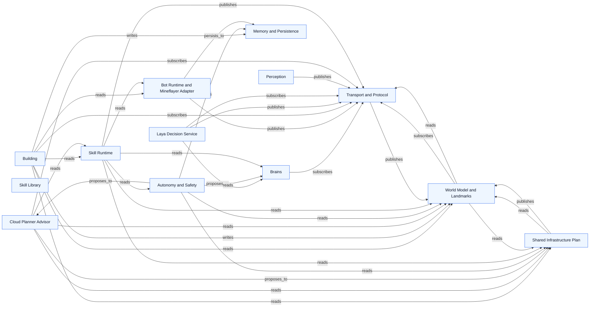

## Per-system graphs

### Coordinator Runtime

Source: `docs/architecture/graphs/system-core.mmd`


### Transport and Protocol

Source: `docs/architecture/graphs/system-transport.mmd`

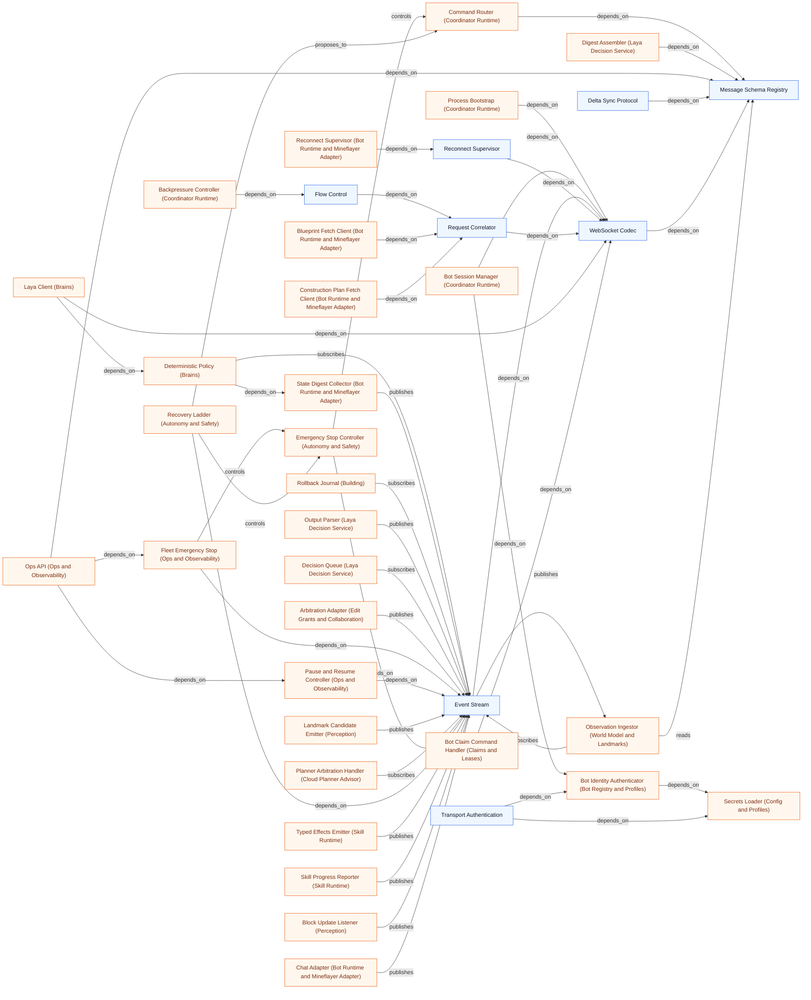

### Shared Infrastructure Plan

Source: `docs/architecture/graphs/system-sip.mmd`

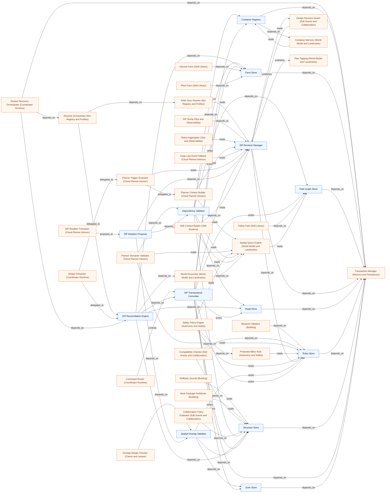

### Task Board

Source: `docs/architecture/graphs/system-tasks.mmd`

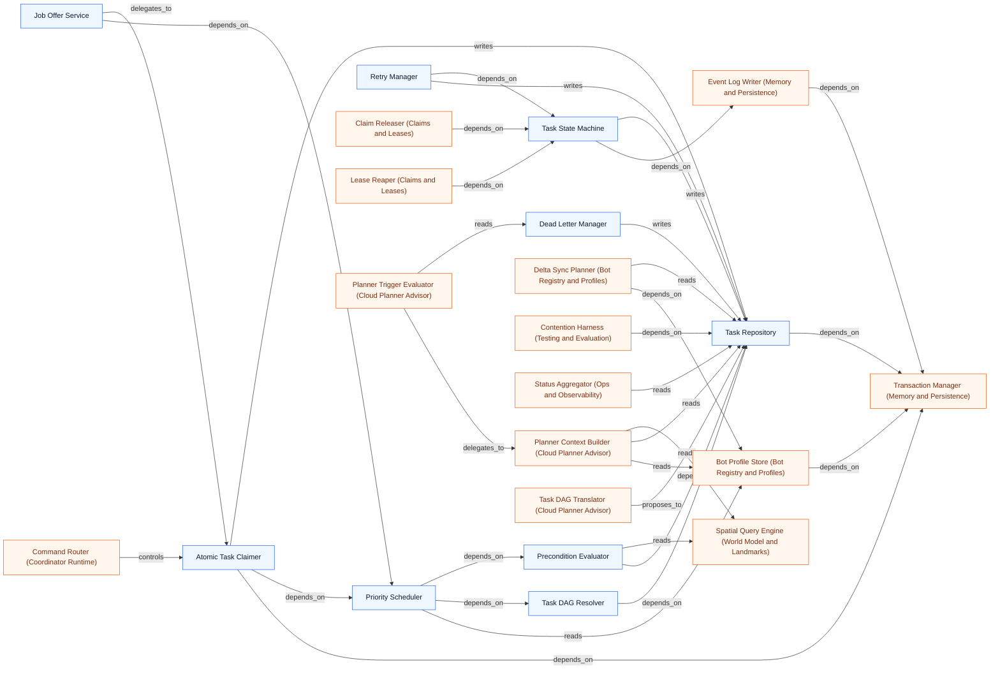

### Claims and Leases

Source: `docs/architecture/graphs/system-claims.mmd`

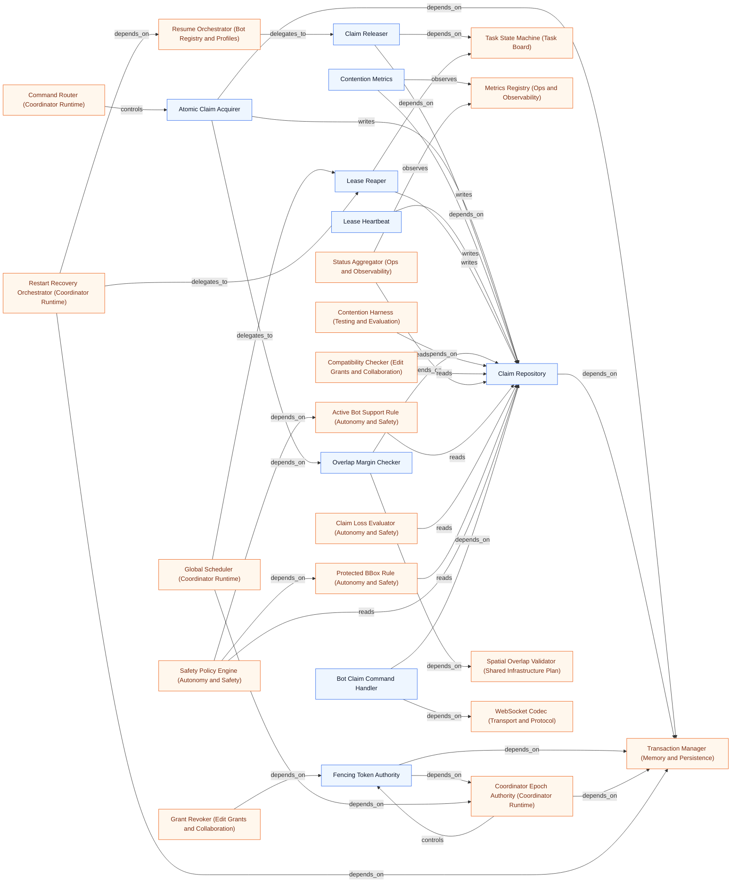

### Edit Grants and Collaboration

Source: `docs/architecture/graphs/system-grants.mmd`


### Bot Registry and Profiles

Source: `docs/architecture/graphs/system-bots.mmd`

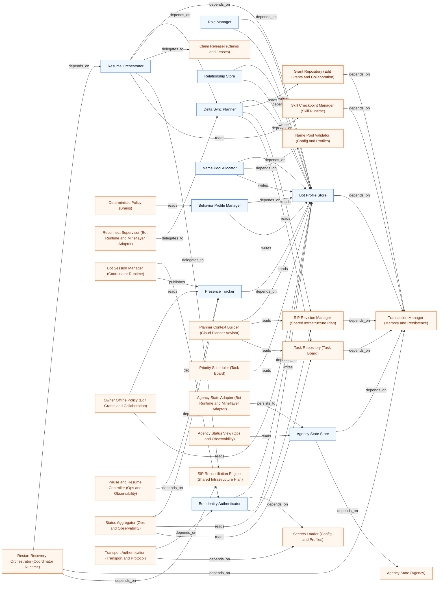

### World Model and Landmarks

Source: `docs/architecture/graphs/system-world.mmd`

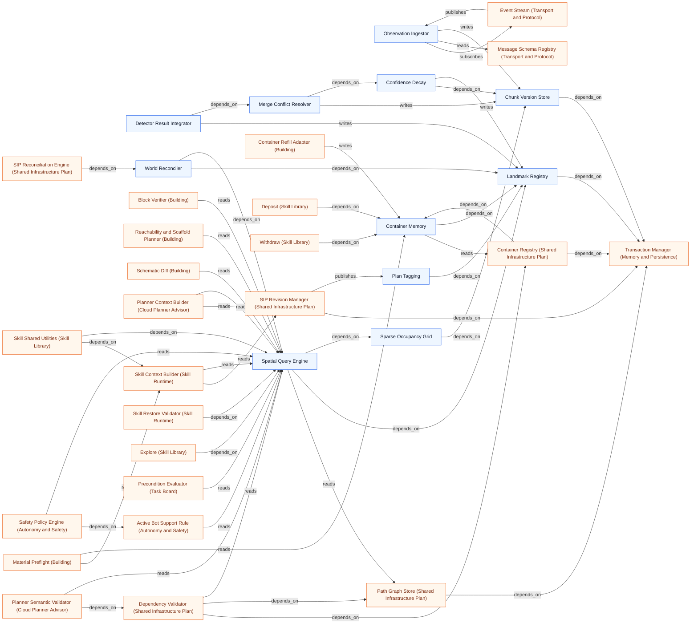

### Perception

Source: `docs/architecture/graphs/system-perception.mmd`

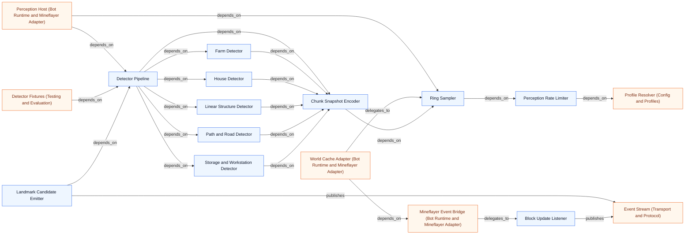

### Laya Decision Service

Source: `docs/architecture/graphs/system-decision.mmd`


### Cloud Planner Advisor

Source: `docs/architecture/graphs/system-planner.mmd`

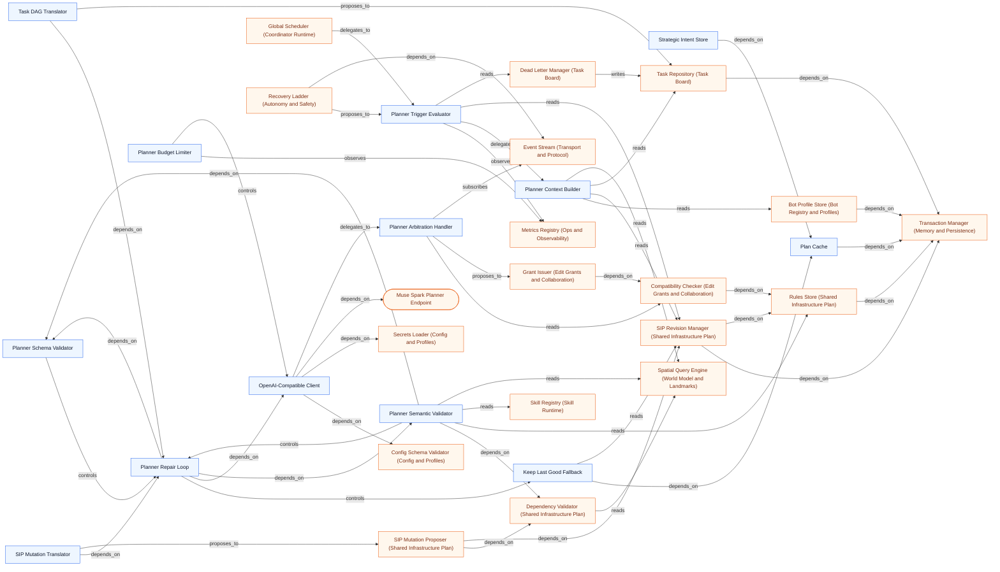

### Skill Runtime

Source: `docs/architecture/graphs/system-skill-runtime.mmd`

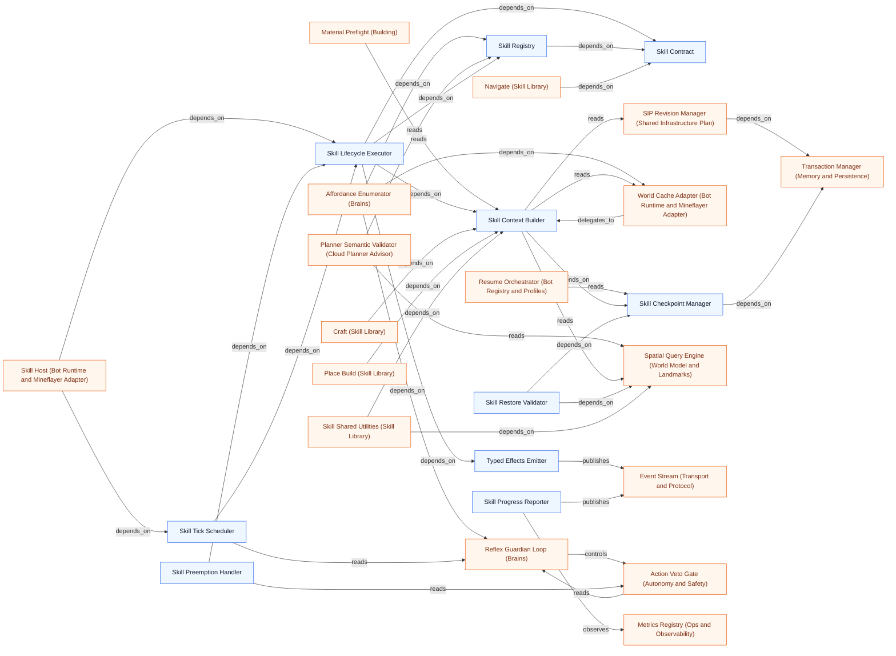

### Skill Library

Source: `docs/architecture/graphs/system-skills.mmd`

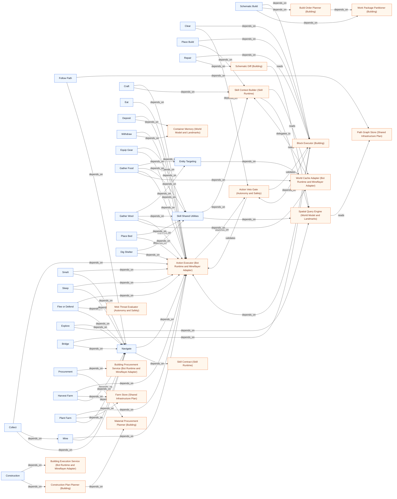

### Building

Source: `docs/architecture/graphs/system-building.mmd`

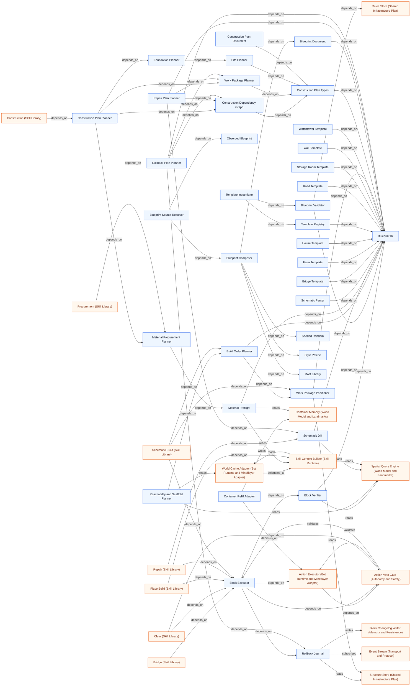

### Bot Runtime and Mineflayer Adapter

Source: `docs/architecture/graphs/system-bot-runtime.mmd`

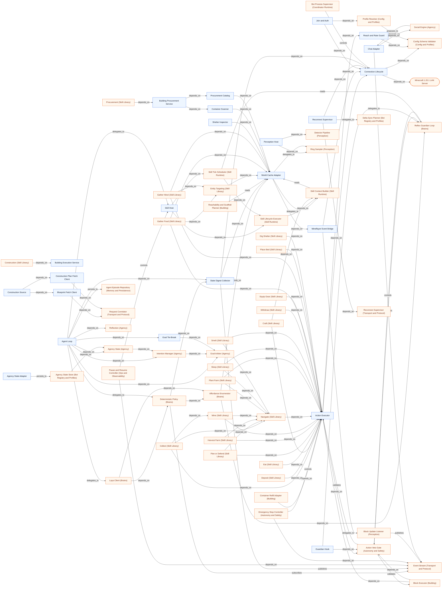

### Autonomy and Safety

Source: `docs/architecture/graphs/system-safety.mmd`

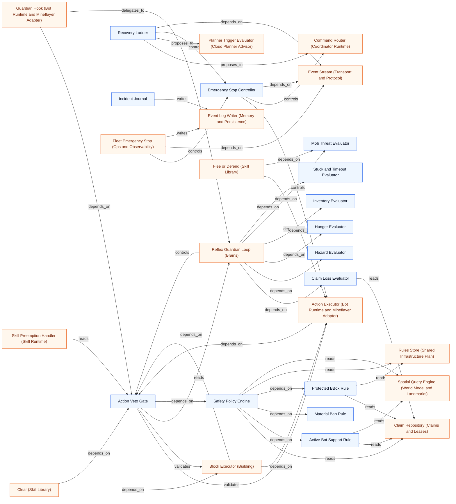

### Memory and Persistence

Source: `docs/architecture/graphs/system-memory.mmd`

```mermaid
flowchart LR
n293["SQLite Runtime"]
n176["Migration Runner"]
n170["Transaction Manager"]
n228["Event Log Writer"]
n287["Block Changelog Writer"]
n172["Retention Pruner"]
n294["Snapshot Export"]
n295["Schema Version Registry"]
n296["Episode Store"]
n291["Agent Episode Repository"]
n227["Bot Profile Store (Bot Registry and Profiles)"]
n111["Rollback Journal (Building)"]
n165["Atomic Claim Acquirer (Claims and Leases)"]
n229["Claim Repository (Claims and Leases)"]
n163["Fencing Token Authority (Claims and Leases)"]
n30["Coordinator Epoch Authority (Coordinator Runtime)"]
n31["Global Scheduler (Coordinator Runtime)"]
n72["Process Bootstrap (Coordinator Runtime)"]
n32["Restart Recovery Orchestrator (Coordinator Runtime)"]
n297["Replay Engine (Testing and Evaluation)"]
n233["Grant Repository (Edit Grants and Collaboration)"]
n160["Audit Viewer (Ops and Observability)"]
n159["Health and Readiness (Ops and Observability)"]
n81["Plan Cache (Cloud Planner Advisor)"]
n153["Incident Journal (Autonomy and Safety)"]
n198["Container Registry (Shared Infrastructure Plan)"]
n197["Farm Store (Shared Infrastructure Plan)"]
n199["Path Graph Store (Shared Infrastructure Plan)"]
n201["SIP Revision Manager (Shared Infrastructure Plan)"]
n196["Road Store (Shared Infrastructure Plan)"]
n200["Rules Store (Shared Infrastructure Plan)"]
n195["Structure Store (Shared Infrastructure Plan)"]
n167["SIP Transactional Committer (Shared Infrastructure Plan)"]
n194["Zone Store (Shared Infrastructure Plan)"]
n88["Skill Checkpoint Manager (Skill Runtime)"]
n168["Atomic Task Claimer (Task Board)"]
n217["Task Repository (Task Board)"]
n224["Task State Machine (Task Board)"]
n298["Trace Exporter (Laya Training)"]
n242["Chunk Version Store (World Model and Landmarks)"]
n246["Landmark Registry (World Model and Landmarks)"]
n67["Pause and Resume Controller (Ops and Observability)"]
n68["Fleet Emergency Stop (Ops and Observability)"]
n60["Agent Loop (Bot Runtime and Mineflayer Adapter)"]
n238["Agency State Store (Bot Registry and Profiles)"]
n155["Agency Status View (Ops and Observability)"]
n227 -->|depends_on| n170
n111 -->|writes| n287
n111 -->|reads| n195
n165 -->|writes| n229
n165 -->|depends_on| n170
n229 -->|depends_on| n170
n163 -->|depends_on| n30
n163 -->|depends_on| n170
n30 -->|controls| n163
n30 -->|depends_on| n170
n31 -->|depends_on| n30
n31 -->|delegates_to| n172
n72 -->|depends_on| n32
n72 -->|depends_on| n176
n32 -->|depends_on| n170
n297 -->|depends_on| n228
n233 -->|depends_on| n170
n287 -->|depends_on| n170
n228 -->|depends_on| n170
n176 -->|depends_on| n293
n172 -->|depends_on| n287
n172 -->|depends_on| n228
n172 -->|depends_on| n170
n295 -->|depends_on| n176
n294 -->|depends_on| n170
n170 -->|depends_on| n293
n160 -->|reads| n287
n160 -->|reads| n228
n159 -->|depends_on| n293
n81 -->|depends_on| n170
n153 -->|writes| n228
n198 -->|depends_on| n170
n197 -->|depends_on| n170
n199 -->|depends_on| n170
n201 -->|depends_on| n170
n201 -->|depends_on| n200
n196 -->|depends_on| n170
n200 -->|depends_on| n170
n195 -->|depends_on| n170
n167 -->|depends_on| n170
n167 -->|writes| n198
n167 -->|writes| n197
n167 -->|writes| n199
n167 -->|depends_on| n201
n167 -->|writes| n196
n167 -->|writes| n200
n167 -->|writes| n195
n167 -->|writes| n194
n194 -->|depends_on| n170
n88 -->|depends_on| n170
n168 -->|depends_on| n170
n168 -->|writes| n217
n217 -->|depends_on| n170
n224 -->|depends_on| n228
n224 -->|writes| n217
n298 -->|reads| n228
n242 -->|depends_on| n170
n246 -->|depends_on| n170
n297 -->|reads| n296
n298 -->|reads| n296
n160 -->|reads| n296
n172 -->|depends_on| n296
n67 -->|writes| n228
n68 -->|writes| n228
n60 -->|persists_to| n291
n238 -->|depends_on| n170
n291 -->|depends_on| n170
n155 -->|reads| n238
n155 -->|reads| n291
classDef internal fill:#eef6ff,stroke:#2563eb,color:#0f172a;
classDef external fill:#fff7ed,stroke:#ea580c,color:#7c2d12;
class n293,n176,n170,n228,n287,n172,n294,n295,n296,n291 internal;
class n227,n111,n165,n229,n163,n30,n31,n72,n32,n297,n233,n160,n159,n81,n153,n198,n197,n199,n201,n196,n200,n195,n167,n194,n88,n168,n217,n224,n298,n242,n246,n67,n68,n60,n238,n155 external;
```

### Ops and Observability

Source: `docs/architecture/graphs/system-ops.mmd`

```mermaid
flowchart LR
n66["Ops API"]
n154["Status Aggregator"]
n155["Agency Status View"]
n67["Pause and Resume Controller"]
n68["Fleet Emergency Stop"]
n156["SIP Dump"]
n157["Metrics Registry"]
n158["Structured Logger"]
n159["Health and Readiness"]
n160["Audit Viewer"]
n231["Contention Metrics (Claims and Leases)"]
n35["Execution Provider Selector (Laya Decision Service)"]
n80["Latency Metrics (Laya Decision Service)"]
n299["Metrics Reporter (Testing and Evaluation)"]
n28(["Fleet Operator"])
n287["Block Changelog Writer (Memory and Persistence)"]
n228["Event Log Writer (Memory and Persistence)"]
n65["Emergency Stop Controller (Autonomy and Safety)"]
n184["Event Stream (Transport and Protocol)"]
n34["Model Loader (Laya Decision Service)"]
n293["SQLite Runtime (Memory and Persistence)"]
n169["Message Schema Registry (Transport and Protocol)"]
n59["Skill Host (Bot Runtime and Mineflayer Adapter)"]
n182["Presence Tracker (Bot Registry and Profiles)"]
n201["SIP Revision Manager (Shared Infrastructure Plan)"]
n229["Claim Repository (Claims and Leases)"]
n217["Task Repository (Task Board)"]
n49["Planner Budget Limiter (Cloud Planner Advisor)"]
n43["Planner Trigger Evaluator (Cloud Planner Advisor)"]
n87["Skill Progress Reporter (Skill Runtime)"]
n296["Episode Store (Memory and Persistence)"]
n238["Agency State Store (Bot Registry and Profiles)"]
n291["Agent Episode Repository (Memory and Persistence)"]
n231 -->|depends_on| n229
n231 -->|observes| n157
n35 -->|controls| n34
n35 -->|observes| n158
n80 -->|observes| n157
n80 -->|writes| n157
n299 -->|observes| n157
n28 -->|controls| n66
n160 -->|reads| n287
n160 -->|reads| n228
n68 -->|controls| n65
n68 -->|depends_on| n184
n159 -->|depends_on| n34
n159 -->|depends_on| n293
n159 -->|depends_on| n154
n66 -->|depends_on| n68
n66 -->|depends_on| n67
n66 -->|depends_on| n154
n66 -->|depends_on| n169
n67 -->|controls| n59
n67 -->|depends_on| n182
n67 -->|depends_on| n184
n156 -->|depends_on| n201
n154 -->|depends_on| n182
n154 -->|reads| n229
n154 -->|observes| n157
n154 -->|reads| n201
n154 -->|reads| n217
n49 -->|observes| n157
n43 -->|observes| n157
n43 -->|reads| n201
n65 -->|depends_on| n184
n87 -->|observes| n157
n87 -->|publishes| n184
n160 -->|reads| n296
n67 -->|writes| n228
n68 -->|writes| n228
n155 -->|reads| n238
n155 -->|reads| n291
n66 -->|depends_on| n155
classDef internal fill:#eef6ff,stroke:#2563eb,color:#0f172a;
classDef external fill:#fff7ed,stroke:#ea580c,color:#7c2d12;
class n66,n154,n155,n67,n68,n156,n157,n158,n159,n160 internal;
class n231,n35,n80,n299,n287,n228,n65,n184,n34,n293,n169,n59,n182,n201,n229,n217,n49,n43,n87,n296,n238,n291,n28 external;
```

### Config and Profiles

Source: `docs/architecture/graphs/system-config.mmd`

```mermaid
flowchart LR
n175["Environment Parser"]
n174["Config Schema Validator"]
n180["Profile Resolver"]
n262["Hardware Probe"]
n190["Secrets Loader"]
n240["Name Pool Validator"]
n263["Laya Runtime Resolver"]
n300["Fail Fast Handler"]
n54["Connection Lifecycle (Bot Runtime and Mineflayer Adapter)"]
n129["Join and Auth (Bot Runtime and Mineflayer Adapter)"]
n131["Reach and Rate Guard (Bot Runtime and Mineflayer Adapter)"]
n181["Bot Identity Authenticator (Bot Registry and Profiles)"]
n239["Name Pool Allocator (Bot Registry and Profiles)"]
n27(["Host Hardware"])
n72["Process Bootstrap (Coordinator Runtime)"]
n73["Service Composition (Coordinator Runtime)"]
n39["Confidence Calibrator (Laya Decision Service)"]
n35["Execution Provider Selector (Laya Decision Service)"]
n34["Model Loader (Laya Decision Service)"]
n77["Decision Rate Limiter (Laya Decision Service)"]
n260["Perception Rate Limiter (Perception)"]
n41["OpenAI-Compatible Client (Cloud Planner Advisor)"]
n187["Transport Authentication (Transport and Protocol)"]
n162["Tactical Decision Policy (Brains)"]
n54 -->|depends_on| n174
n129 -->|depends_on| n54
n129 -->|depends_on| n180
n131 -->|depends_on| n174
n181 -->|depends_on| n190
n239 -->|depends_on| n240
n174 -->|depends_on| n175
n300 -->|depends_on| n174
n262 -->|depends_on| n180
n262 -->|depends_on| n27
n263 -->|depends_on| n262
n263 -->|depends_on| n180
n240 -->|depends_on| n174
n180 -->|depends_on| n174
n190 -->|depends_on| n175
n72 -->|depends_on| n174
n72 -->|depends_on| n175
n72 -->|depends_on| n73
n73 -->|depends_on| n180
n39 -->|depends_on| n174
n35 -->|depends_on| n262
n35 -->|controls| n34
n34 -->|depends_on| n263
n77 -->|depends_on| n180
n260 -->|depends_on| n180
n41 -->|depends_on| n174
n41 -->|depends_on| n190
n187 -->|depends_on| n181
n187 -->|depends_on| n190
n162 -->|depends_on| n174
classDef internal fill:#eef6ff,stroke:#2563eb,color:#0f172a;
classDef external fill:#fff7ed,stroke:#ea580c,color:#7c2d12;
class n175,n174,n180,n262,n190,n240,n263,n300 internal;
class n54,n129,n131,n181,n239,n72,n73,n39,n35,n34,n77,n260,n41,n187,n162,n27 external;
```

### Testing and Evaluation

Source: `docs/architecture/graphs/system-eval.mmd`

```mermaid
flowchart LR
n301["Unit Fixtures"]
n261["Detector Fixtures"]
n302["Docker Server Harness"]
n303["Scenario Runner"]
n297["Replay Engine"]
n226["Contention Harness"]
n299["Metrics Reporter"]
n304["Soak Runner"]
n305["Architecture Guard Tests"]
n264["Laya Benchmark Harness"]
n229["Claim Repository (Claims and Leases)"]
n217["Task Repository (Task Board)"]
n259["Detector Pipeline (Perception)"]
n24(["Minecraft 1.20.1 LAN Server"])
n80["Latency Metrics (Laya Decision Service)"]
n34["Model Loader (Laya Decision Service)"]
n157["Metrics Registry (Ops and Observability)"]
n228["Event Log Writer (Memory and Persistence)"]
n306["Promotion Gate (Laya Training)"]
n296["Episode Store (Memory and Persistence)"]
n80 -->|observes| n157
n80 -->|writes| n157
n305 -->|depends_on| n301
n226 -->|depends_on| n229
n226 -->|delegates_to| n303
n226 -->|depends_on| n217
n261 -->|depends_on| n301
n261 -->|depends_on| n259
n302 -->|depends_on| n301
n302 -->|depends_on| n24
n264 -->|depends_on| n80
n264 -->|depends_on| n34
n264 -->|delegates_to| n303
n299 -->|observes| n157
n297 -->|depends_on| n303
n297 -->|depends_on| n228
n303 -->|controls| n302
n303 -->|publishes| n299
n304 -->|depends_on| n299
n304 -->|delegates_to| n303
n306 -->|depends_on| n264
n297 -->|reads| n296
classDef internal fill:#eef6ff,stroke:#2563eb,color:#0f172a;
classDef external fill:#fff7ed,stroke:#ea580c,color:#7c2d12;
class n301,n261,n302,n303,n297,n226,n299,n304,n305,n264 internal;
class n229,n217,n259,n80,n34,n157,n228,n306,n296,n24 external;
```

### Laya Training

Source: `docs/architecture/graphs/system-training.mmd`

```mermaid
flowchart LR
n298["Trace Exporter"]
n307["Labeling Pipeline"]
n308["Reward Computer"]
n309["Fine-tune Runner"]
n310["ONNX Exporter"]
n265["Calibration Fitter"]
n306["Promotion Gate"]
n39["Confidence Calibrator (Laya Decision Service)"]
n264["Laya Benchmark Harness (Testing and Evaluation)"]
n228["Event Log Writer (Memory and Persistence)"]
n296["Episode Store (Memory and Persistence)"]
n265 -->|reads| n39
n265 -->|depends_on| n298
n309 -->|depends_on| n307
n309 -->|depends_on| n308
n307 -->|depends_on| n298
n310 -->|depends_on| n309
n306 -->|depends_on| n264
n306 -->|depends_on| n265
n306 -->|depends_on| n310
n308 -->|depends_on| n298
n298 -->|reads| n228
n298 -->|reads| n296
classDef internal fill:#eef6ff,stroke:#2563eb,color:#0f172a;
classDef external fill:#fff7ed,stroke:#ea580c,color:#7c2d12;
class n298,n307,n308,n309,n310,n265,n306 internal;
class n39,n264,n228,n296 external;
```

### Brains

Source: `docs/architecture/graphs/system-brains.mmd`

```mermaid
flowchart LR
n69["Reflex Guardian Loop"]
n161["Affordance Enumerator"]
n70["Deterministic Policy"]
n71["Laya Client"]
n162["Tactical Decision Policy"]
n56["World Cache Adapter (Bot Runtime and Mineflayer Adapter)"]
n84["Skill Registry (Skill Runtime)"]
n139["State Digest Collector (Bot Runtime and Mineflayer Adapter)"]
n236["Behavior Profile Manager (Bot Registry and Profiles)"]
n184["Event Stream (Transport and Protocol)"]
n58["Guardian Hook (Bot Runtime and Mineflayer Adapter)"]
n39["Confidence Calibrator (Laya Decision Service)"]
n63["Action Veto Gate (Autonomy and Safety)"]
n148["Claim Loss Evaluator (Autonomy and Safety)"]
n143["Hazard Evaluator (Autonomy and Safety)"]
n145["Hunger Evaluator (Autonomy and Safety)"]
n147["Inventory Evaluator (Autonomy and Safety)"]
n144["Mob Threat Evaluator (Autonomy and Safety)"]
n146["Stuck and Timeout Evaluator (Autonomy and Safety)"]
n86["Skill Tick Scheduler (Skill Runtime)"]
n177["WebSocket Codec (Transport and Protocol)"]
n60["Agent Loop (Bot Runtime and Mineflayer Adapter)"]
n174["Config Schema Validator (Config and Profiles)"]
n161 -->|depends_on| n56
n161 -->|depends_on| n69
n161 -->|depends_on| n84
n70 -->|depends_on| n161
n70 -->|depends_on| n139
n70 -->|reads| n236
n70 -->|subscribes| n184
n58 -->|depends_on| n63
n58 -->|delegates_to| n69
n139 -->|depends_on| n56
n139 -->|publishes| n184
n39 -->|proposes_to| n70
n39 -->|depends_on| n174
n63 -->|reads| n69
n69 -->|controls| n63
n69 -->|depends_on| n148
n69 -->|depends_on| n143
n69 -->|depends_on| n145
n69 -->|depends_on| n147
n69 -->|depends_on| n144
n69 -->|depends_on| n146
n86 -->|reads| n69
n184 -->|depends_on| n177
n71 -->|depends_on| n161
n71 -->|depends_on| n177
n71 -->|depends_on| n70
n60 -->|delegates_to| n71
n60 -->|delegates_to| n70
n60 -->|depends_on| n139
n71 -->|depends_on| n162
n162 -->|depends_on| n174
classDef internal fill:#eef6ff,stroke:#2563eb,color:#0f172a;
classDef external fill:#fff7ed,stroke:#ea580c,color:#7c2d12;
class n69,n161,n70,n71,n162 internal;
class n56,n84,n139,n236,n184,n58,n39,n63,n148,n143,n145,n147,n144,n146,n86,n177,n60,n174 external;
```

### Agency

Source: `docs/architecture/graphs/system-agency.mmd`

```mermaid
flowchart LR
n311["Personality Model"]
n312["Needs Model"]
n313["Goal Catalog"]
n314["Goal Generator"]
n288["Goal Arbiter"]
n289["Intention Manager"]
n315["Routine Model"]
n316["Item Knowledge"]
n317["Night Preparation Config"]
n318["Shelter Strategy"]
n319["Shelter Plan"]
n320["Night Readiness"]
n290["Social Engine"]
n321["Working Memory"]
n322["Project Focus Policy"]
n241["Agency State"]
n323["Strategic Intent Policy"]
n292["Reflection"]
n60["Agent Loop (Bot Runtime and Mineflayer Adapter)"]
n61["Chat Adapter (Bot Runtime and Mineflayer Adapter)"]
n238["Agency State Store (Bot Registry and Profiles)"]
n141["Goal Tie-Break (Bot Runtime and Mineflayer Adapter)"]
n60 -->|depends_on| n288
n60 -->|depends_on| n289
n60 -->|depends_on| n241
n61 -->|depends_on| n290
n314 -->|depends_on| n313
n314 -->|depends_on| n312
n314 -->|depends_on| n311
n288 -->|depends_on| n314
n288 -->|depends_on| n312
n288 -->|depends_on| n311
n289 -->|depends_on| n288
n290 -->|depends_on| n311
n241 -->|depends_on| n312
n241 -->|depends_on| n311
n241 -->|depends_on| n289
n241 -->|depends_on| n315
n241 -->|depends_on| n321
n322 -->|depends_on| n321
n290 -->|proposes_to| n61
n238 -->|depends_on| n241
n320 -->|depends_on| n316
n320 -->|depends_on| n317
n320 -->|depends_on| n315
n320 -->|depends_on| n319
n320 -->|depends_on| n318
n318 -->|depends_on| n317
n314 -->|depends_on| n317
n314 -->|depends_on| n320
n314 -->|depends_on| n315
n323 -->|depends_on| n288
n323 -->|depends_on| n321
n60 -->|depends_on| n141
n141 -->|depends_on| n288
n60 -->|depends_on| n292
classDef internal fill:#eef6ff,stroke:#2563eb,color:#0f172a;
classDef external fill:#fff7ed,stroke:#ea580c,color:#7c2d12;
class n311,n312,n313,n314,n288,n289,n315,n316,n317,n318,n319,n320,n290,n321,n322,n241,n323,n292 internal;
class n60,n61,n238,n141 external;
```

### Bootstrap and Toolchain

Source: `docs/architecture/graphs/system-toolchain.mmd`

```mermaid
flowchart LR
n324["Bootstrap Orchestrator"]
n325["Capability Check"]
n326["Python Environment"]
n327["Minecraft Server Controller"]
n328["Firefox SVG Renderer"]
n324 -->|depends_on| n325
n324 -->|depends_on| n326
n324 -->|depends_on| n327
n324 -->|depends_on| n328
classDef internal fill:#eef6ff,stroke:#2563eb,color:#0f172a;
classDef external fill:#fff7ed,stroke:#ea580c,color:#7c2d12;
class n324,n325,n326,n327,n328 internal;
```
