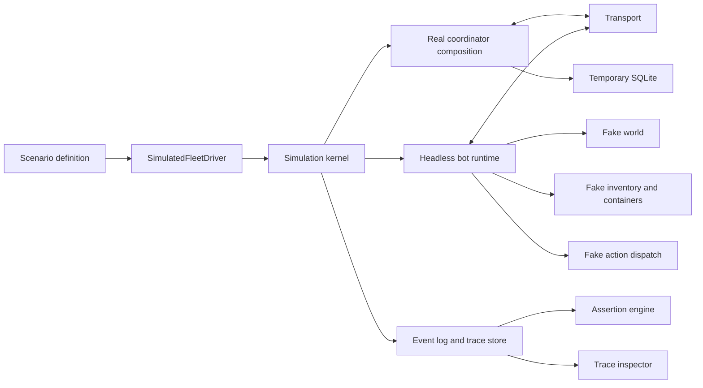

# TiCrafter Behavior Validation Harness

Status: phase 1 implemented. The clock port, fake platform layer, headless bot
runtime, in-process coordinator runner, simulated driver, assertions, trace
inspector, and `simulated-build` scenario exist. Later phases remain open.

This document defines the milestone 19 behavior validation harness. It is the
canonical companion to the milestone description in `main.md`.

The harness exists to validate the real agency, planning, skill, building, and
coordination code without starting a Minecraft server, logging in a Mineflayer
bot, or watching a live world. It runs one scenario definition in two modes:

- `simulate`: fake world, inventory, clock, and transport; real runtime code.
- `live`: the same scenario and assertions against the repo-provisioned server.

The harness validates runtime behavior. It does not change production behavior.

## 1. Purpose

The current scenario path in `packages/eval/src/scenario-runner` starts a
Minecraft server and spawns the coordinator and bots. That path is valuable for
integration signoff, but it is slow, requires a live world, and cannot explain a
failure without manual observation.

The behavior validation harness provides:

- fast, deterministic scenarios that run in CI without a server;
- the same scenario definitions and assertions in simulated and live modes;
- a per-bot decision timeline instead of raw event inspection;
- readable evidence for every failed assertion;
- controlled fault injection for restart, claim, material, and safety paths;
- behavior traces that prove movement, gaze, dwell, pacing, chat, and
  progression stay inside player-likeness ranges.

The target is confidence that the bots behave correctly and plausibly, not that
the simulation looks like Minecraft.

## 2. Scope

In scope:

- single-bot and multi-bot behavior scenarios;
- building, repair, procurement, project, and autonomy scenarios;
- early-game progression, village-farm, idle-life, and social-chat scenarios;
- movement, gaze, dwell, pause, and chat-latency realism checks;
- restart and interruption scenarios;
- controlled fault injection;
- declarative assertions over events, metrics, world state, tasks, claims,
  grants, projects, safety, behavior traces, and progression plans;
- a trace inspector for goal, plan, planner, skill, gaze, movement, chat, and
  build decisions;
- CI execution without a Minecraft server;
- a live mode that reuses the same scenario definitions and assertions.

Out of scope:

- replacing the live server as the final physics and integration signoff;
- simulating the Minecraft protocol or Mineflayer internals;
- reproducing exact vanilla physics, mob AI, or chunk loading;
- benchmarking Laya model quality; use the Laya benchmark harness for that;
- multi-machine or production-scale fleet simulation;
- freely generated scenarios that are not committed and reviewable.

## 3. Relationship to existing docs

- `main.md` defines the milestone 19 goal and required scenarios.
- `docs/operations.md` defines the operator-facing commands and failure classes.
- `docs/building-system.md` defines the single-bot building acceptance gate.
- `docs/cognitive-architecture.md` defines agency, working memory, interruption,
  project focus, progression, and behavior realism.
- `docs/behavior-roadmap.md` defines the implementation order for behavior
  realism, progression, perception realism, and validation.
- `docs/architecture/graph.json` is updated only when the harness modules exist.

This document is the detailed design for the validation system itself. It does
not redefine the runtime architecture it validates.

## 4. Test layers

The harness is one layer in a test pyramid. Each layer has a different job.

| Layer | Runtime                     | Fake ports                         | Proves                                               | Does not prove                          |
| ----- | --------------------------- | ---------------------------------- | ---------------------------------------------------- | --------------------------------------- |
| 0     | Unit and package tests      | Local fakes inside each test       | Contract behavior, edge cases, validation            | Cross-component timing and coordination |
| 1     | Headless single bot         | World, inventory, clock, transport | One bot's agency, skills, and building loop          | Multi-bot claims and coordination       |
| 2     | In-process fleet simulation | World, inventory, clock, transport | Coordinator, claims, grants, task board, safety      | Real physics, chunk loading, Mineflayer |
| 3     | Live-server integration     | Nothing                            | Real server behavior, physics, pathfinding, protocol | Fast CI feedback                        |

The harness owns layers 1 and 2. Existing package tests remain layer 0. The
current `FleetScenarioDriver` remains the live layer 3 driver.

## 5. Architecture



The coordinator is real. The bot composition is real. Only the platform edges
are simulated.

## 6. Real versus fake boundary

Real code under test:

- agency state, needs, goal generation, working memory, focus, and interruption;
- project focus and personal project lifecycle;
- planner integration and task proposal application when enabled;
- task autonomy, claims, leases, heartbeats, and retry classes;
- skill runtime, skill catalog, checkpoints, and restore;
- construction, procurement, repair, and rollback skills;
- safety evaluation, guardian decisions, and action vetting;
- coordinator claims, grants, SIP, task board, progress, and verification;
- blueprint fetching, plan fetching, construction source, and block execution.

Fake code:

- world blocks and terrain;
- block update delivery;
- inventory contents and capacity;
- containers and container scanning;
- crafting recipes and gather sources;
- action dispatch latency and outcomes;
- bot position and movement;
- time of day and clock;
- transport connection lifecycle;
- chat and social delivery;
- optional hostile entities.

The fake pieces must implement the same ports the live adapters implement. They
must not import coordinator database internals or bypass the coordinator.

## 7. Runtime components

### 7.1 Scenario catalog

A scenario is a committed TypeScript or JSON definition. The catalog is
deterministic and reviewable. Scenarios do not contain free-form LLM prompts.

The scenario catalog supplies:

- scenario identity, title, mode support, and timeout;
- world seed and world setup;
- bot identities, roles, traits, and starting inventory;
- starting time of day;
- optional task and project seeds;
- scheduled faults and world events;
- assertions;
- artifact options.

### 7.2 Simulated driver

`SimulatedFleetDriver` implements the existing `ScenarioDriver` interface:

```ts
interface ScenarioDriver {
    start(definition: ScenarioDefinition): Result<void, string>;
    run(definition: ScenarioDefinition): Promise<Result<ScenarioObservation, string>>;
    stop(definition: ScenarioDefinition): Result<void, string>;
}
```

The simulated driver:

1. creates an isolated temporary data directory;
2. opens a temporary SQLite database;
3. builds the real coordinator with auto-spawn disabled;
4. starts a transport on an ephemeral localhost port;
5. creates one fake world per bot;
6. composes one headless bot runtime per bot;
7. drives the simulation kernel until the scenario terminates;
8. evaluates assertions and writes artifacts;
9. stops every component and removes temporary state unless artifacts are kept.

The driver must fail closed. A missing port, failed assertion, or unexpected
runtime exception produces a failed scenario with evidence.

### 7.3 Headless bot runtime

The headless runtime is the shared bot composition without Mineflayer. It lives
under `apps/bot/src/headless/` and is exposed through an explicit package subpath
export, for example `@ticrafter/bot/headless`.

The runtime keeps the same composition as the live bot:

- agency runtime and agency persistence adapter;
- task autonomy and job decisions;
- skill host and skill services;
- construction source, build execution service, and procurement service;
- guardian and safety snapshot source;
- transport client and session restore;
- project and home context.

The live `BotConnection` becomes the Mineflayer adapter around the shared
runtime. The headless runtime supplies fake platform ports.

Proposed platform boundary:

```ts
interface BotPlatformPorts {
    world: BuildingWorldView;
    inventory: InventoryPort;
    containers: ContainerScannerPort;
    procurement: ProcurementCatalogPort;
    dispatch: ActionDispatchPort;
    clock: ClockPort;
    position: () => Result<Vec3, string>;
    timeOfDay: () => number | null;
    health: () => number;
    food: () => number;
    safetySnapshot: () => Result<SafetySnapshot, string>;
    transport: BotTransportPort;
    home: () => AgencyHomeSnapshot | null;
    project: () => ProjectSummary | null;
    chat: ChatPort;
}
```

The exact ports may be split during implementation. The rule is that fake
adapters satisfy the same contracts as live adapters.

### 7.4 Coordinator

The simulated run starts the real coordinator composition in the same process.

Required coordinator conditions:

- temporary `DATA_DIR` and SQLite database;
- planner disabled by default, with a deterministic planner fixture for scenarios
  that exercise planner behavior;
- `AUTO_SPAWN_BOTS=false`;
- transport host `127.0.0.1` and port `0` or another ephemeral port;
- ops disabled or bound to an ephemeral port;
- no access to the repository `data/` directory;
- no live server connection;
- deterministic epoch and schema initialization.

Phase 1 uses an ephemeral localhost WebSocket. The real `TransportServer` and
`BotTransportClient` are used so the message boundary is exercised. An
in-memory loopback transport is a later optimization, not a phase 1 requirement.

Laya uses the deterministic policy or a committed decision fixture in simulated
mode. CI does not require model inference.

### 7.5 Simulation kernel, clock, and scheduler

Simulation time is virtual from the start. Runtime code must not use `Date.now()`
or real `setInterval` for behavior that affects the scenario.

Proposed clock contract:

```ts
interface ClockPort {
    now(): number;
    setTimeout(callback: () => void, delayMilliseconds: number): ClockHandle;
    clearTimeout(handle: ClockHandle): void;
    setInterval(callback: () => void, delayMilliseconds: number): ClockHandle;
    clearInterval(handle: ClockHandle): void;
}
```

The kernel advances fixed simulation ticks. Due timers fire in deterministic
order by deadline and creation order. The same seed and same scenario must
produce the same decision order.

Clock consumers that must be audited and injected during implementation:

- `AgencyRuntime` goal cadence and timers;
- `SkillHost` and `TickScheduler`;
- `TaskAutonomy` tick, timeout, and lease renewal;
- `GuardianHook` evaluation cadence;
- `ReconnectSupervisor` backoff;
- `BuildingExecutionService` attribution TTL;
- coordinator lease, claim, grant, retention, and progress timers;
- scenario timeouts and fault schedules.

Persisted timestamps in simulated mode derive from the virtual clock. Live mode
uses the system clock.

### 7.6 Simulated transport

Phase 1 transport requirements:

- real coordinator `TransportServer`;
- real bot transport client;
- ephemeral localhost port;
- deterministic connect and disconnect injection;
- no server process;
- no Minecraft or Mineflayer connection.

The transport adapter must support scripted faults:

- reject a connection;
- drop an established connection;
- delay a frame;
- reject a stale session;
- restart the coordinator while preserving the database.

### 7.7 Simulated world

The simulated world is a deterministic in-memory voxel store. It implements the
same world query ports used by construction, safety, perception, and planning.

Required world features:

- finite world bounds with explicit outside-world behavior;
- deterministic flat terrain;
- deterministic uneven terrain with slopes and cliffs;
- water and lava regions;
- tree and vegetation blocks;
- air and replaceable block handling;
- block state and properties;
- `blockAt` and `blocksInBox` queries;
- block update events delivered to perception and safety listeners;
- atomic application of verified block changes;
- reset to the scenario seed.

Initial scenarios do not require mobs, fluids, gravity, or full vanilla block
physics. Those features may be added only when a scenario asserts on them.

### 7.8 Simulated action dispatch

The fake dispatcher applies actions after a deterministic latency measured in
ticks.

Place semantics:

- item must exist in the simulated inventory;
- target must be in reach;
- target must be replaceable or air unless replacement is explicitly allowed;
- support and attachment rules are validated by the real building code before
  dispatch;
- block orientation and properties are preserved;
- multi-block objects are applied atomically or fail closed;
- verified mutation updates the fake world and emits block update events.

Break semantics:

- target must exist and be in reach;
- protected and no-build zones are enforced by the real safety and world ports;
- the broken block is removed;
- drops may be added to the bot inventory or a world drop queue.

Movement semantics:

- deterministic grid movement with a configurable step and reach limit;
- no physics, knockback, or collision simulation;
- unreachable targets produce `no-path` or `target-missing`;
- a scripted fault may force a movement failure.

The dispatcher must support expected failure injection without bypassing the real
verification and safety code.

### 7.9 Simulated inventory, containers, and procurement

Inventory requirements:

- typed item stacks with counts;
- slot capacity;
- deterministic item removal and addition;
- tool presence for mining and placement checks;
- no silent item creation.

Container requirements:

- named containers at fixed positions;
- bounded contents;
- inventory and container snapshots used by material preflight;
- withdrawals and deposits;
- reservation behavior used by procurement and multi-bot scenarios.

Procurement requirements:

- recipe lookup from a committed fixture catalog;
- gather-source lookup;
- deterministic gather blocks and drops;
- predictable failures for missing recipes and missing sources.

## 8. Scenario contract

The harness extends the existing scenario definition rather than replacing it.
Existing live scenarios remain valid.

Proposed shape:

```ts
interface BehaviorScenario {
    id: string;
    title: string;
    mode: 'simulate' | 'live' | 'both';
    seed: number;
    world: ScenarioWorldSpec;
    bots: readonly ScenarioBotSpec[];
    startTime: {
        timeOfDay: number;
    };
    tasks?: readonly ScenarioTaskSeed[];
    projects?: readonly ScenarioProjectSeed[];
    assumptions?: {
        planner?: 'disabled' | 'fixture';
        goalTieBreak?: 'disabled' | 'enabled';
        laya?: 'deterministic' | 'fixture';
    };
    faults?: readonly ScenarioFault[];
    events?: readonly ScenarioEvent[];
    assertions: readonly ScenarioAssertion[];
    timeoutTicks: number;
    artifacts?: {
        keepOnSuccess?: boolean;
        keepOnFailure?: boolean;
    };
}
```

Example:

```json
{
    "id": "simulated-build",
    "title": "Single bot builds an arbitrary house on uneven terrain",
    "mode": "simulate",
    "seed": 1847,
    "world": {
        "kind": "uneven",
        "bounds": { "min": { "x": -16, "y": 60, "z": -16 }, "max": { "x": 32, "y": 96, "z": 32 } },
        "groundY": 64,
        "maximumStep": 2
    },
    "bots": [
        {
            "name": "TiBot1",
            "role": "builder",
            "traits": { "curiosity": 0.5, "diligence": 0.8 },
            "inventory": { "oak_log": 64, "cobblestone": 64 }
        }
    ],
    "startTime": { "timeOfDay": 1000 },
    "assumptions": {
        "planner": "disabled",
        "goalTieBreak": "disabled"
    },
    "assertions": [
        {
            "id": "build-complete",
            "kind": "world.diff-empty",
            "blueprintId": "blueprint.simulated-build",
            "message": "the final world must match the stored blueprint"
        },
        {
            "id": "no-duplicate-writes",
            "kind": "blocks.no-duplicate-writes",
            "message": "no block position may be written twice"
        }
    ],
    "timeoutTicks": 12000
}
```

Simulation-only fields include world setup, fake inventory, virtual time, faults,
and mode-specific assertions. Shared fields include bots, tasks, projects,
safety expectations, and scenario identity.

## 9. Scenario lifecycle

1. Validate the scenario and reject unknown fields.
2. Create an isolated data directory and temporary SQLite database.
3. Build and start the real coordinator with deterministic configuration.
4. Create fake worlds from the scenario seed.
5. Compose headless bots and connect them through the transport.
6. Seed tasks, projects, inventory, and starting world changes.
7. Advance the simulation kernel.
8. Inject scheduled faults and world events at their assigned ticks.
9. Stop when all terminal assertions pass, a fatal assertion fails, or the
   timeout tick is reached.
10. Evaluate all assertions and produce evidence.
11. Write artifacts.
12. Stop bots, coordinator, transport, and database.
13. Remove temporary state unless artifact retention is requested.

Live mode follows the same lifecycle with real server and bot adapters. It does
not use fake world, inventory, or clock ports.

## 10. Fault injection

Faults are scenario data, not ad hoc test code. Each fault has a tick, target,
type, and optional recovery.

Required fault types:

| Fault                   | Purpose                                             |
| ----------------------- | --------------------------------------------------- |
| `missing-material`      | Force procurement or fail before the package starts |
| `missing-recipe`        | Force a procurement `missing-item` failure          |
| `missing-gather-source` | Force a procurement `missing-item` failure          |
| `unreachable-target`    | Exercise scaffold or `no-path` behavior             |
| `action-failure`        | Exercise retry and failure classification           |
| `action-delay`          | Exercise timeouts and stale actions                 |
| `block-mismatch`        | Exercise verification and replacement               |
| `protected-zone`        | Exercise safety veto and audit                      |
| `claim-conflict`        | Exercise claim contention                           |
| `grant-expiry`          | Exercise helper authorization failure               |
| `bot-disconnect`        | Exercise reconnect, lease, and checkpoint restore   |
| `coordinator-restart`   | Exercise epoch, lease recovery, and resume          |
| `stale-session`         | Exercise fencing and stale-claim rejection          |
| `inventory-change`      | Exercise replanning and material shortages          |

Every fault must be deterministic for a given seed and scenario.

## 11. Assertions

Assertions are declarative. They do not mutate the world and do not retry.

Proposed categories:

```ts
type ScenarioAssertion =
    | WorldAssertion
    | TaskAssertion
    | ProjectAssertion
    | EventAssertion
    | MetricAssertion
    | SafetyAssertion
    | CheckpointAssertion
    | BehaviorAssertion
    | ProgressionAssertion;
```

Required assertion kinds:

- `world.diff-empty`: the final world matches the stored blueprint.
- `world.block-exists`: a specific block state exists.
- `world.no-duplicate-writes`: no position appears twice in the block changelog.
- `world.no-protected-zone-edits`: protected zone checks stayed clean.
- `task.status`: a task reached `completed`, `failed`, or `dead-letter`.
- `task.failure-class`: a failed task carries the expected retry class.
- `project.status`: a project reached `completed`, `abandoned`, or `active`.
- `project.progress`: work package progress reached a threshold.
- `event.exists`: an expected audit or decision event exists.
- `event.absent`: an unexpected event never occurred.
- `metric.threshold`: a measured metric crosses a defined boundary.
- `safety.no-veto`: no safety veto occurred.
- `safety.veto`: a safety veto occurred with the expected reason.
- `checkpoint.resumed`: a restart resumed the expected checkpoint.
- `checkpoint.no-duplicate-blocks`: resume did not place duplicate blocks.
- `behavior.no-unplanned-place`: no block was placed by navigation rather than a
  plan or skill.
- `behavior.max-yaw-rate`: yaw changes stay within the gaze limit.
- `behavior.max-displacement`: displacement stays within the movement limit.
- `behavior.look-before-interact`: every break, place, use, attack, and container
  open is preceded by a look at the target.
- `behavior.min-dwell`: non-urgent goals meet the minimum dwell.
- `behavior.max-switch-rate`: goal and plan switches stay below the limit.
- `behavior.chat-latency`: replies fall inside the configured delay range.
- `behavior.sprint-policy`: sprint is not used indoors, near hazards, or while
  eating.
- `behavior.visible-target`: selected targets respect the view cone and line of
  sight, or a remembered sighting.
- `behavior.no-repeat-action`: identical action and target sequences stay below
  the configured repeat limit.
- `behavior.plan-progress`: the progression plan advances within the scenario
  deadline.
- `behavior.idle-fraction`: idle time stays inside the configured range.
- `behavior.no-zero-look`: no interaction lacks a preceding gaze event.
- `behavior.farm-permission`: every harvest or replant is self-owned,
  allowlisted, or backed by a valid grant from a base-linked player at or above
  the confidence threshold.
- `behavior.trace-present`: required gaze, pause, and movement events exist.

Each assertion must produce:

- assertion id;
- pass or fail;
- expected and actual values where applicable;
- evidence references into the trace;
- a human-readable failure message.

## 12. Trace and artifacts

The harness writes both machine-readable and human-readable artifacts.

Required artifacts:

- `metrics.json`: scenario metrics and assertion results;
- `events`: the coordinator event log and block changelog from the temporary
  SQLite database;
- `trace.jsonl`: normalized per-bot timeline;
- `report.json`: final scenario result;
- optional `report.md`: readable failure summary.

Trace event shape:

```ts
interface TraceEvent {
    tick: number;
    at: string;
    botId: string | null;
    kind:
        | 'goal'
        | 'focus'
        | 'plan'
        | 'progression'
        | 'planner'
        | 'laya'
        | 'task'
        | 'skill'
        | 'movement'
        | 'gaze'
        | 'pause'
        | 'humanization'
        | 'chat'
        | 'permission'
        | 'block'
        | 'safety'
        | 'project'
        | 'checkpoint'
        | 'assertion';
    summary: string;
    data: Readonly<Record<string, unknown>>;
    refs?: readonly string[];
}
```

The trace inspector renders per-bot timelines with filters for bot, tick range,
event kind, task, project, structure, and assertion. It may read the temporary
SQLite database directly and must also support replay from a stored artifact
directory.

The inspector also produces a human-likeness report:

- dwell times and switches per 10 minutes;
- action-start jitter and pause frequency;
- look-before-interact rate and zero-look interactions;
- scans per travel segment and route segments;
- sprint policy violations;
- chat reply latency and duplicate replies;
- idle fraction;
- progression milestone timeline;
- farm ownership verdicts, permission inquiries, grants, denials, and timeouts;
- player confidence and base-link evidence;
- oddity-detector counts with evidence references.

Trace events that support these checks include:

- `decision`: goal, plan step, candidates, chosen option, revision, latency;
- `movement`: segment start and end, distance, sprint flag, pause, scan;
- `gaze`: target, yaw, pitch, delta, reason;
- `pause`: reason, duration, resumed;
- `action`: skill, action kind, target, planned flag, duration, outcome;
- `chat`: incoming or outgoing, intent, delay, text;
- `permission`: plot, ownership verdict, linked base, player confidence, inquiry,
  reply, decision, reason;
- `progression`: milestone, attempt, blocked, pivot, completed.

## 13. CLI and CI

Extend `tools/eval/run.mjs` with simulated mode and inspection commands.

```sh
bun tools/eval/run.mjs scenario simulated-build --mode simulate
bun tools/eval/run.mjs scenario personal-homes --mode simulate --seed 42
bun tools/eval/run.mjs scenario personal-homes --mode live --accept-eula
bun tools/eval/run.mjs inspect data/eval/personal-homes --bot bot.tibot1
bun tools/eval/run.mjs check data/eval/personal-homes --scenario personal-homes
```

Defaults:

- `scenario` defaults to `--mode simulate`.
- `--mode live` requires an explicit server and `--accept-eula` when needed.
- `--data-dir` overrides the artifact location.
- `--seed` overrides the scenario seed.
- `--json` prints machine-readable output.
- `--fail-fast` stops at the first failed assertion.
- `--keep-artifacts` keeps the temporary data directory.

CI runs simulated scenarios only. Live scenarios remain manual or nightly
integration signoff. The simulated suite must be runnable from a clean checkout
with no Minecraft server, no credentials, and no network access.

Live player-likeness review rubric:

- movement looks paced and deliberate; no sliding, teleporting, or instant turns;
- the bot looks at what it interacts with;
- no bridge or scaffold appears unless a plan reported one;
- the bot pauses, scans, and changes approach after failure;
- goals last long enough to be readable;
- chat replies feel delayed and varied;
- idle behavior looks purposeful;
- the early-game arc is recognizable from wood to base.

A live signoff records the artifact directory, seed, bot list, and reviewer
notes. Any oddity found in review becomes a scenario assertion or an oddity
detector before the scenario is marked `both`.

## 14. Scenario catalog

Each scenario declares which modes it supports.

### Building

| Scenario                      | Purpose                                                          | Modes    |
| ----------------------------- | ---------------------------------------------------------------- | -------- |
| `simulated-build`             | Single bot composes and builds a house on uneven terrain         | simulate |
| `simulated-repair`            | Repair a damaged structure from a blueprint diff                 | simulate |
| `simulated-material-shortage` | Withdraw, craft, or gather missing materials before construction | simulate |
| `simulated-multi-bot`         | Multiple bots build one structure without duplicate work         | simulate |
| `arbitrary-house`             | Building acceptance for arbitrary composition                    | both     |
| `uneven-terrain`              | Foundation and site adaptation acceptance                        | both     |
| `scaffold-tower`              | Reachability, scaffold stacks, and top-down cleanup              | both     |

### Coordination and safety

| Scenario               | Purpose                                                  | Modes |
| ---------------------- | -------------------------------------------------------- | ----- |
| `house-build`          | Three bots build one house without duplicate blocks      | both  |
| `farm-race`            | Two bots race for one plot; one proceeds                 | both  |
| `road-segments`        | Partitioned road construction                            | both  |
| `storage-reservations` | Shared storage deposit and withdrawal with reservations  | both  |
| `nearby-edit-safety`   | One bot edits while another is nearby                    | both  |
| `compatible-helper`    | Compatible helper edit is allowed without duplicate work | both  |
| `incompatible-edit`    | Incompatible edit is denied with a reason                | both  |
| `owner-offline`        | Owner-offline edit policy is applied                     | both  |
| `design-revision-bump` | Revision bump invalidates outstanding grants             | both  |
| `bot-restart-resume`   | Restart restores task, lease, and checkpoint             | both  |
| `coordinator-restart`  | Coordinator restart recovers leases and SIP              | both  |
| `eight-bot-contention` | Claim and decision contention without deadlock           | both  |

### Autonomy and projects

| Scenario                | Purpose                                                        | Modes |
| ----------------------- | -------------------------------------------------------------- | ----- |
| `autonomy-no-tasks`     | Planner off and no seed jobs; bots survive and self-direct     | both  |
| `personality-diversity` | Different traits produce different routines                    | both  |
| `night-routine`         | Bots eat, shelter, sleep, and resume work                      | both  |
| `personal-homes`        | Bots build distinct homes without overlap or conflicting edits | both  |
| `social-village`        | Bots greet, share, cooperate, and update trust                 | both  |
| `goal-resume`           | Restart restores needs, intention, home, and claims            | both  |
| `planner-advisory`      | Planner project is accepted, deferred, or declined             | both  |
| `tactical-interruption` | Survival interruption preserves lease and resumes the task     | both  |
| `stale-decision`        | Late Laya result cannot overwrite newer focus or revision      | both  |
| `project-build`         | Project proposal creates construction tasks and completes      | both  |

### Behavior realism and progression

| Scenario               | Purpose                                                                                      | Modes |
| ---------------------- | -------------------------------------------------------------------------------------------- | ----- |
| `early-game-bootstrap` | Empty inventory reaches tools, stations, chest, and bed                                      | both  |
| `human-signature`      | Movement, gaze, dwell, pauses, and chat stay in player ranges                                | both  |
| `human-movement`       | No auto-scaffold, teleport steps, or instant turns                                           | both  |
| `village-farm`         | Resolve ownership, harvest permitted plots, replant, store surplus, and leave village chests | both  |
| `idle-life`            | Idle time is bounded and purposeful                                                          | both  |
| `social-chat`          | Delayed, varied, rate-limited replies without duplication                                    | both  |
| `no-oscillation`       | Goal and plan switching stays below the configured rate                                      | both  |

`village-farm` covers self-owned plots, other-owned plots, unknown plots with an
operator allowlist, linked high-confidence players, linked low-confidence
players, unlinked players, affirmative replies, denials, timeouts, and ambiguous
nearby bases.

A scenario may start as `simulate` only and become `both` when its live adapter
is verified.

## 15. Determinism and flakiness

Determinism rules:

- one seed drives world generation, bot randomness, humanization variation,
  planner fixtures, and fault schedules;
- all ids are stable or generated from deterministic counters;
- all timers use the simulation clock;
- transport frames are delivered in deterministic order;
- task, claim, and package ordering uses stable sort keys;
- behavior assertions use configured ranges, not exact wall-clock values;
- no assertion depends on real wall-clock duration;
- no scenario depends on network access;
- humanization remains deterministic per seed, so replaying a scenario
  reproduces the same pauses, scans, and decision delays.

A failed simulated scenario must reproduce with the same seed. A failure that
does not reproduce is a harness defect and must be fixed before the scenario is
trusted.

Flaky live scenarios are recorded with their seed and artifact directory. Live
flakiness does not justify weakening simulated assertions.

## 16. Safety and isolation

The simulated harness is isolated from real state.

Requirements:

- never read or write the repository `data/` directory;
- never connect to the configured live server;
- never use bot credentials;
- never start Mineflayer;
- use a unique temporary directory per run;
- keep temporary database and artifacts under the scenario data directory;
- stop all timers and close all sockets on teardown;
- fail closed on cleanup errors that could leak state.

The real safety code remains active. A simulated unsafe action must be vetoed by
the real guardian and recorded as a safety event.

## 17. Module ownership and architecture graph

Planned modules:

| Module                                   | Responsibility                                               |
| ---------------------------------------- | ------------------------------------------------------------ |
| `apps/bot/src/headless/`                 | Headless bot composition and platform ports                  |
| `packages/eval/src/simulation-harness/`  | Simulated driver, kernel, fake ports, and scenario lifecycle |
| `packages/eval/src/behavior-assertions/` | Assertion schema and evaluators                              |
| `packages/eval/src/trace-inspector/`     | Trace normalization, filtering, and rendering                |
| `packages/eval/src/scenario-runner/`     | Shared scenario contract and live driver compatibility       |
| `tools/eval/run.mjs`                     | CLI wiring for simulate, inspect, and check                  |

The full milestone 19 graph components are added only when implementation
starts:

- `eval.simulation-harness`;
- `eval.behavior-assertions`;
- `eval.trace-inspector`;
- a headless bot runtime component under `sys.bot-runtime`.

The graph must record the dev-only dependency from the evaluation system to the
headless bot runtime. The simulator must not be imported by runtime code.

## 18. Implementation phases

Phase 1: headless single-bot build.

- extract the headless bot runtime and platform ports;
- add `ClockPort`, the simulation kernel, and deterministic scheduling;
- add the fake world, inventory, containers, action dispatch, and transport;
- run `simulated-build` against the real coordinator and construction path;
- write `metrics.json`, `trace.jsonl`, and `report.json`.

Phase 2: assertions and inspection.

- add the assertion schema and evaluators;
- add the trace inspector and `inspect` command;
- add `check` for stored artifact directories;
- wire the simulated suite into CI.

Phase 3: projects and autonomy.

- add `personal-homes` and `project-build`;
- validate project focus, task seeding, construction completion, and progress;
- validate interruption and restart paths.

Phase 4: coordination and faults.

- add `simulated-multi-bot`, `simulated-repair`, and
  `simulated-material-shortage`;
- add claim, grant, safety, and procurement fault injection;
- validate coordinator restart and bot restart recovery.

Phase 5: live parity.

- make every `both` scenario run against the real server with the same scenario
  definition and assertions;
- keep simulated mode as the fast feedback path and live mode as final signoff.

Phase 6: behavior realism and progression.

- add movement, gaze, pause, and chat traces to the fake and live drivers;
- model travel time, action latency, and gaze events in simulation;
- add `early-game-bootstrap`, `human-signature`, `human-movement`,
  `village-farm`, `idle-life`, `social-chat`, and `no-oscillation`;
- add behavior and progression assertions and oddity detectors;
- add the human-likeness report to the trace inspector;
- add the live review rubric and A/B humanization comparison.

## 19. Acceptance criteria

The harness is done when:

- simulated scenarios run without a Minecraft server or Mineflayer login;
- no scenario requires manual observation to explain a failure;
- `simulated-build`, `personal-homes`, and `simulated-multi-bot` pass in
  simulated mode;
- `early-game-bootstrap`, `human-signature`, `human-movement`, `village-farm`,
  `idle-life`, `social-chat`, and `no-oscillation` pass in simulated mode;
- behavior realism gates pass: no unplanned scaffold, no zero-look interaction,
  dwell and switch rates in range, paced movement, delayed chat, and bounded
  idle time;
- the same scenario definitions and assertions are used in live mode;
- rerunning a failed scenario with the same seed reproduces the failure;
- CI runs the simulated suite from a clean checkout;
- the trace inspector explains goal, plan, planner, skill, gaze, movement, chat,
  safety, and building decisions with filters;
- graph validation, lint, typecheck, formatting, and tests pass.

## 20. Risks and limitations

| Risk                         | Mitigation                                                          |
| ---------------------------- | ------------------------------------------------------------------- |
| Fake-world drift             | Keep only platform ports fake; use real behavior code               |
| Clock injection gaps         | Audit every timer and `Date.now()` call before trusting determinism |
| Transport divergence         | Use the real message schemas and real coordinator in phase 1        |
| False confidence             | Keep live-server signoff mandatory for physics and protocol         |
| Flaky simulated scenarios    | Fail closed; fix nondeterminism before trusting the suite           |
| Slow scenarios               | Measure virtual ticks; avoid wall-clock waits                       |
| Maintenance cost             | Keep scenarios declarative and assert only important behavior       |
| Over-simulation of Minecraft | Add mobs, fluids, and physics only when a scenario needs them       |
| Humanization hides failures  | Trace planned versus actual actions; never suppress skill failures  |
| Range assertions too strict  | Calibrate ranges against live traces and A/B results                |
| Seeded variation drift       | One seed per scenario; record and replay the seed in artifacts      |

## 21. Open questions

- When to replace the ephemeral WebSocket with an in-memory loopback transport.
- How much grid pathfinding fidelity is required for building scenarios.
- Whether mobs and social entities need a simulation layer for autonomy
  scenarios.
- Whether soak scenarios should run in simulated mode or remain live-only.
- Default artifact retention policy for CI and local runs.
- Whether headless runtime extraction eventually becomes its own package.
