# TiCrafter Building System

Status: implementation in progress. Steps 1–3 exist: blueprint storage and
composer, terrain site planning, foundation planning, dependency ordering,
scaffolding, phase-aware packages, and material procurement planning.
Execution wiring and coordinator lifecycle remain.

`docs/architecture/graph.json` tracks the implemented module paths.

## 1. Purpose

Building is a first-class player capability, not a fixed-template placement
feature. A bot must be able to decide what to build, choose a site, adapt the
design to terrain, gather or withdraw materials, construct safely, verify the
result, recover from failure, and leave an auditable record.

The first milestone is a single bot building an arbitrary, functional home or
village structure. Multi-bot construction follows after that path is reliable.

## 2. Scope

In scope:

- houses and shelters
- storage rooms and workshops
- farms, walls, roads, bridges, and watchtowers
- multi-storey structures, slopes, foundations, and scaffolds
- interiors, doors, windows, stairs, beds, storage, furnaces, and lighting
- schematic import and observation of existing structures
- repair, renovation, expansion, and rollback
- single-bot execution first; coordinated multi-bot construction later
- player-like design variety, style, and incremental home improvement

Out of scope for the first milestone:

- redstone logic
- large-scale castles or megabases
- arbitrary terrain generation
- free-form LLM-authored block lists by default
- multi-bot construction before the single-bot path is stable

## 3. Design principles

- The deterministic composer is the authority. It turns a compact brief into a
  valid, functional blueprint.
- The LLM planner may propose a brief, a template choice, or a schematic
  reference. It does not author raw block lists by default.
- Templates are motifs and quick sources, not the only building vocabulary.
- Output is deterministic for a given brief and seed.
- Every design is validated before it reaches the world.
- Every block change is support-aware, verified, rate-limited, and journaled.
- Site adaptation never silently mutates the canonical design. Preparation and
  foundation changes belong to the construction plan.
- Safety, ownership, grants, and claims are enforced outside the composer.
- A bot with the planner disabled can still build a functional structure.

## 4. Current state and gaps

Current pieces:

- `packages/building/src/blueprint-ir.ts`: blueprint blocks, materials,
  bounds, rotation, translation, and work-package types.
- `packages/building/src/blueprint-document.ts`: document revisions, hashes,
  sources, provenance, and construction phases.
- `packages/building/src/blueprint-composer.ts`: deterministic brief-to-
  blueprint composition with layout, shell, roof, openings, and interior.
- `packages/building/src/blueprint-source-resolver.ts`: template, composed,
  schematic, observed, and gated raw-block sources.
- `packages/building/src/template-*.ts`: seven fixed templates.
- `packages/building/src/schematic-parser.ts`: `.schem` parsing.
- `packages/building/src/site-planner.ts`: terrain, slope, hazard, protection,
  access, and candidate scoring.
- `packages/building/src/foundation-planner.ts`: fill, cut, clearance, and
  foundation materials.
- `packages/building/src/construction-dependency-graph.ts`: support-aware,
  attachment-aware, multi-block-aware dependency ordering.
- `packages/building/src/construction-plan-planner.ts`: site, foundation,
  blueprint, scaffold, and package integration.
- `packages/building/src/work-package-planner.ts`: phase-aware package
  partitioning with dependency-stack merging.
- `packages/building/src/material-procurement-planner.ts`: shortages,
  crafting, gathering, and container reservations.
- `packages/building/src/block-executor.ts`: verified, journaled, rate-limited
  block execution.
- `packages/building/src/build-order-planner.ts`: compatibility wrapper around
  support-first ordering.
- `packages/building/src/work-package-partitioner.ts`: layer, slice, quadrant,
  and single-package partitioning.
- `packages/building/src/material-preflight.ts`: inventory and container
  material coverage.
- `packages/building/src/reachability-scaffold-planner.ts`: reachability and
  scaffold planning with reserved blueprint positions.
- `packages/building/src/rollback-journal.ts`: before/after records and inverse
  operations.
- `packages/skills/src/blueprint.ts`: direct multi-target placement skill.
- `packages/skills/src/schematic-build.ts`: schematic-to-target pipeline.
- `apps/bot/src/building-services.ts`: template and `.schem` catalog for bots.

Gaps:

- The runtime uses direct placement, not `BlockExecutor`, so journaling,
  verification, rollback, and scaffold handling are largely unused.
- The planner can validate and store blueprints but cannot yet drive the
  construction plan through the bot execution service.
- SIP structures store `blueprintRef` without a stored blueprint payload.
- Work packages are not created from blueprints or claimed by bots.
- Claims and grants are not wired into bot safety snapshots.
- Agency build project state is planned but not implemented. The cognitive
  architecture plan adds project focus.
- Project proposals create claims and SIP structures but do not yet create
  construction tasks, so a proposed project can remain claimed but unbuilt.
- Block changelog entries lack plan, structure, package, design-revision, and
  fencing-token attribution.

## 5. Terminology

- **BuildingBrief**: compact functional and stylistic description of a
  desired structure. This is what a planner or agency goal may emit.
- **Blueprint**: exact block placement, block state, materials, and
  constraints. This is what the executor consumes.
- **BlueprintDocument**: persisted blueprint plus revision, hash, source, and
  provenance.
- **SitePlan**: chosen anchor, rotation, entrance direction, clearance,
  access, and site preparation needs.
- **ConstructionPlan**: phased block changes, dependencies, scaffolds,
  cleanup, and work packages derived from a blueprint and site plan.
- **WorkPackage**: a claimable, spatially coherent portion of a construction
  plan.
- **ConstructionTask**: a task-board job for one work package.
- **BuildProject**: agency-level long-lived project such as a personal home or
  village expansion.
- **StyleProfile**: palette, roof shape, symmetry, decoration density, and
  other personality-derived design preferences.
- **MaterialPlan**: bill of materials, inventory coverage, substitutions,
  withdrawals, crafting, gathering, and shortages.

## 6. End-to-end lifecycle

```mermaid
flowchart LR
    A[Bot goal or planner brief] --> B[BuildingBrief]
    B --> C[Deterministic composer]
    C --> D[Blueprint validator]
    D --> E[Blueprint store]
    E --> F[Site planner]
    F --> G[SitePlan]
    E --> H[Construction planner]
    G --> H
    H --> I[Work packages]
    I --> J[Construction tasks and claims]
    J --> K[Construction skill]
    K --> L[Verified block execution]
    L --> M[World changes]
    K --> N[Block change events]
    N --> O[Changelog and progress]
    O --> P[Structure completion or repair]
```



The same pipeline serves a single bot, a planner-originated project, an owned
home, a repair job, and a multi-bot village build.

## 7. Design sources and composer

### 7.1 Source types

A blueprint request may come from:

- `template`: a direct template instantiation, retained for compatibility.
- `composed`: a `BuildingBrief` expanded by the deterministic composer.
- `schematic`: an imported `.schem` file.
- `observed`: a structure observed in the world and captured for repair,
  imitation, or documentation.
- `blocks`: an explicit block list, allowed only behind a config gate and
  strict validation.

The default planner path is `composed` or `template`. Raw `blocks` output from
an LLM is disabled by default.

### 7.2 BuildingBrief

Proposed shape:

```ts
type BuildingBrief = {
    kind:
        | 'house'
        | 'shelter'
        | 'storage'
        | 'workshop'
        | 'farm'
        | 'wall'
        | 'road'
        | 'bridge'
        | 'watchtower'
        | 'compound';
    size: {
        width: number;
        depth: number;
        storeys: number;
    };
    program: {
        rooms: readonly {
            kind: string;
            count: number;
            minimumSize?: number;
        }[];
        amenities: readonly string[];
    };
    style: StyleProfile;
    site: {
        anchor?: Vec3;
        rotation?: 0 | 90 | 180 | 270;
        maximumSlope?: number;
        connection?: 'road' | 'path' | 'none';
    };
    seed: number;
    notes?: string;
};
```

The brief is intentionally small. It is safe to pass through a planner context
and it does not depend on an LLM to enumerate blocks.

### 7.3 Composer stages

1. **Layout planner**
    - place the footprint
    - split rooms
    - add corridors
    - reserve door and window openings
    - ensure every room is reachable
2. **Assembly planner**
    - floors and ceilings
    - walls
    - roof shape
    - stairs or ladders
    - doors and windows
    - interior furniture and lighting
3. **Motif library**
    - door, window, stairs, railing, bed, storage, crafting table, furnace,
      farm plot, path, fence, torch, and roof sections
    - motifs are small and reusable; they are not whole buildings
4. **Style palette**
    - material families for structure, floor, roof, accent, and glass
    - substitutions based on biome and available materials
    - personality-derived variation
5. **Validator**
    - structural support
    - no floating blocks
    - reachable access
    - material counts
    - protected and no-build zones
    - size and block-count limits

The composer uses a seeded random source. The same brief and seed always
produce the same blueprint.

### 7.4 Planner integration

The planner emits a brief or a source reference, not block placements:

```ts
type PlannerBlueprintRequest = {
    id: string;
    source: 'template' | 'composed' | 'schematic';
    anchor: Vec3;
    rotation: 0 | 90 | 180 | 270;
    brief?: BuildingBrief;
    template?: string;
    parameters?: Readonly<Record<string, unknown>>;
    schematicRef?: string;
};
```

The coordinator composes and validates the request before storing it. The
planner never writes SIP state and never writes blocks directly.

Raw block output is a separate, explicitly enabled mode. Even then, the
coordinator validates size, support, materials, zones, and safety before
commit.

### 7.5 Schematics and observation

- `.schem` parsing remains supported.
- `.litematic` support is deferred until the core pipeline is stable.
- Observation scans a structure or landmark bbox and produces a blueprint.
- Observation is used for repair, renovation, and imitation, not for copying
  terrain or protected infrastructure.
- Observed blueprints record provenance and confidence.

## 8. Blueprint model

The existing blueprint IR stays the canonical block-level representation.
Proposed additions:

```ts
type BlueprintDocument = {
    id: string;
    revision: number;
    hash: string;
    source: 'template' | 'composed' | 'schematic' | 'observed' | 'blocks';
    provenance: {
        createdBy: string;
        createdAt: string;
        briefId?: string;
        landmarkId?: string;
        plannerPlanId?: string;
    };
    blueprint: Blueprint;
};
```

Backward compatibility:

- existing `Blueprint` fields remain valid
- existing templates and `.schem` files continue to work
- `blueprintRef` may resolve to a stored document or fall back to the legacy
  template/schematic catalog
- design revisions invalidate grants and stale package tasks

## 9. Site planning

The site planner chooses where and how to place the structure.

Inputs:

- blueprint footprint and accessibility requirements
- world blocks in the candidate region
- SIP zones, protected bboxes, and no-build zones
- known landmarks and path graph
- bot position and available materials

Outputs:

- anchor and rotation
- entrance orientation
- clearance and vegetation removal
- foundation fill or cut
- slope handling: terrace, retaining wall, or stilts
- water, lava, and void rejection
- access path, stairs, or bridge connection
- scaffold needs
- a rationale suitable for audit

Candidate scoring considers flatness, access, distance, material cost, zone
compliance, spacing from active structures, and style fit.

Site adaptation does not modify the canonical blueprint. Preparation and
foundation blocks are construction-plan changes.

## 10. Construction planning

### 10.1 Phases

1. site clear
2. foundation
3. scaffold placement
4. load-bearing walls, bottom-up
5. floors and ceilings
6. roof
7. doors and windows
8. stairs, ladders, and access
9. interior and furnishing
10. lighting and decoration
11. scaffold removal
12. cleanup and drop collection

### 10.2 Dependency rules

The construction planner must understand:

- support below a block
- side support for torches, ladders, rails, and similar attachments
- multi-block doors and beds
- gravity-affected blocks
- liquids and water sources
- block orientation for stairs, slabs, and doors
- reachable standing space
- temporary scaffold placement and inverse cleanup

The dependency graph covers these rules. Runtime execution wiring is the
remaining integration step.

### 10.3 Work packages

Work packages are:

- phase-aware
- spatially contiguous
- balanced by block count and travel cost
- limited by a configurable maximum block count
- forbidden from splitting multi-block objects or dependency stacks
- annotated with phase, bbox, block keys, materials, scaffolds, and
  predecessor packages

### 10.4 Material planning

The material plan covers:

- bill of materials
- inventory coverage
- nearby container coverage
- palette substitutions
- crafting requirements
- gathering requirements
- shortages that block package start
- reservations that prevent multi-bot races

A package does not start until its required materials are available or a
procurement task is created.

### 10.5 Scaffolding

Scaffolds are construction-plan artifacts:

- planned for unreachable targets
- placed through the same verified block pipeline
- tracked per work package
- removed during cleanup
- reversible from the journal

## 11. Execution

### 11.1 Action model

`place-block` must carry enough information for arbitrary designs:

- target position
- item name
- reference block and face
- block state or orientation hints
- multi-block metadata where needed

The mineflayer executor must handle orientation, doors, beds, and reference
validation. Unsupported placements fail closed.

### 11.2 Verified execution

`BlockExecutor` becomes the normal path:

- `prepare(change, snapshot)`: verify before, evaluate safety, journal, return
  an action
- `complete(execution, outcome)`: verify after
- `rollback(execution, snapshot)`: execute inverse changes

The bot-side `BuildingExecutionService` owns the verifier, journal writer,
safety gate, and world port. It sends block-change events to the coordinator.

### 11.3 Construction skill

A new `construction` skill consumes a work package:

- resolve blueprint document and revision
- diff blueprint against the world
- skip satisfied blocks
- select next block by dependency and reachability
- prepare and dispatch the action
- verify completion
- place or remove scaffolds
- update progress
- checkpoint and restore

Checkpoint state includes blueprint id and revision, package id, phase, cursor,
placed and skipped keys, pending change, and scaffold positions. Restore always
re-diffs the world instead of replaying stale coordinates.

### 11.4 Failure classes

Map construction failures to existing task and skill classes:

- missing materials: `missing-item`
- missing tool: `missing-tool`
- unreachable target: `no-path` or `target-missing`
- unsafe placement or removal: `unsafe`
- verification mismatch: `execution-failed`
- lost claim or lease: `preempted`
- invalid blueprint or package: `invalid-input`

## 12. Coordination and persistence

### 12.1 Blueprint store

The coordinator owns blueprint documents in SQLite:

- id
- revision
- hash
- source
- JSON payload
- provenance
- created timestamp

Bots fetch blueprints by id and revision and cache them locally. Bot processes
do not open the coordinator database.

### 12.2 Proposal and commit flow

1. A bot or planner submits a blueprint or project request.
2. The coordinator validates zones, overlap, size, and material feasibility.
3. The composer produces or validates the blueprint.
4. The coordinator stores the document and assigns a design revision.
5. The structure is upserted in SIP.
6. Work packages are partitioned.
7. Construction tasks are created and carry `projectId` and `structureId`
   metadata.
8. Claims and grants are issued for package execution.
9. The project remains agency focus; the bot claims matching construction tasks
   as sub-work without replacing that focus.

Project proposal alone is not a build. A proposed project without seeded
construction tasks is incomplete design.

The detailed ownership boundary is in
[`docs/cognitive-architecture.md`](cognitive-architecture.md).

### 12.3 Claims, grants, and fencing

- Each work package is claimed before execution.
- Every edit carries a claim id and fencing token.
- Non-owner edits to an active structure require a valid grant.
- Design revision changes invalidate grants and stale package tasks.
- Bot safety snapshots receive the active structure bbox, protected regions,
  claim, grant, and fencing token.

### 12.4 Progress and completion

- Bots emit block-change events.
- The coordinator appends the authoritative changelog.
- Structure progress is recomputed by diffing the stored blueprint against the
  world model.
- Progress does not decrease from a missing observation.
- A structure completes only when all required packages complete and the final
  diff is empty or within allowed deviations.

### 12.5 Repair, renovation, and rollback

- Repair uses a blueprint diff to find missing, mismatched, and extra blocks.
- Extra blocks require a grant.
- Renovation creates a new design revision.
- Rollback builds inverse operations from the block changelog and executes
  them as a construction job.
- Every rollback is attributed and auditable.

## 13. Player-like behavior

Building is part of agency, not only job execution.

Proposed goals:

- `build-shelter`: first safe shelter when no home exists
- `build-home`: personal home
- `expand-home`: add a room, storage, farm, or workshop
- `repair-home`: fix damage or incomplete work
- `decorate-home`: lighting, paths, fences, and interior detail
- `help-build`: help a friend or shared project

Behavior:

- starter shelter first, permanent home later
- night and survival needs interrupt building
- style comes from personality, biome, and available materials
- personal projects persist across restarts
- bots may observe and imitate existing structures
- social help uses claims, grants, and the same construction pipeline
- a project is agency focus; construction tasks are sub-work
- survival or recovery interruptions preserve project focus and task leases
- a late tactical decision cannot replace newer project focus

Agency project goals, working memory, and interruption semantics are defined in
[`docs/cognitive-architecture.md`](cognitive-architecture.md).

## 14. Safety and watching

Safety invariants:

- no block change without verification and journaling
- no removal of support under an active bot
- no protected or no-build zone edits
- no active-structure edit without a grant
- no destructive materials unless explicitly enabled
- scaffolds are tracked and removed
- rollback is always possible

Planned metrics:

- blocks placed and removed per minute
- verification failures
- rollback count
- material shortages
- package status counts
- structure progress
- site rejection reasons
- scaffold placements
- construction latency

Every audit record should include:

- bot id
- structure id
- blueprint revision
- work package id
- plan id
- grant id
- claim id
- fencing token
- before and after block state
- reason or phase

Operator endpoints and runbook updates are deferred until the endpoints exist.

## 15. Single-bot acceptance

The first implementation milestone is complete when one bot can:

1. receive or generate a `BuildingBrief`
2. compose a valid arbitrary blueprint
3. choose and adapt a site on uneven terrain
4. build a foundation and complete shell
5. place doors, windows, stairs, and interior furniture
6. remove scaffolds and leave no floating blocks
7. handle missing materials through withdrawal, crafting, or gathering
8. resume after a restart without duplicate blocks
9. roll back a failed package
10. produce a complete audit trail
11. pass protected-zone and active-bot safety checks

Multi-bot construction is not part of this gate.

## 16. Multi-bot future

After the single-bot gate:

- package claims drive work distribution
- bots hand off or release packages safely
- shared scaffolds are coordinated
- duplicate work is detected and prevented
- helper grants allow compatible edits
- design revisions invalidate stale work
- coordinator restart preserves leases and package state

## 17. Testing and evaluation

Unit tests:

- composer determinism and structural validity across many seeds
- room and roof generation
- material substitution
- site selection on slopes, water, trees, and cliffs
- dependency ordering and scaffold cleanup
- package coverage and no duplicate blocks
- verification, journaling, rollback, and checkpoint restore
- blueprint store revisioning

Integration tests:

- single bot builds an arbitrary blueprint on uneven terrain
- schematic import
- missing material procurement
- interrupted build resumes
- rollback restores the world

Evaluation scenarios:

- `arbitrary-house`
- `uneven-terrain`
- `scaffold-tower`
- `personal-homes`
- `observe-and-repair`
- multi-bot scenarios after the single-bot gate
- `simulated-build`
- `simulated-repair`
- `simulated-material-shortage`
- `simulated-multi-bot`

The `simulated-*` scenarios run in the milestone 16 behavior validation harness
against a fake world with the real building and skill code. They are not part of
the building milestone itself.

## 18. Migration and compatibility

- Keep existing templates and `.schem` files.
- Keep `Blueprint` field compatibility.
- Route `place-build` and `schematic-build` through the new pipeline or keep
  them as compatibility wrappers.
- Add blueprint storage and changelog migrations with the implementation.
- Update `docs/architecture/graph.json` and regenerate architecture docs only
  when the modules exist.
- Add the milestone 16 validation components to `graph.json` only when the
  behavior harness implementation starts.
- Update `docs/operations.md` when building endpoints and metrics exist.

## 19. Implementation sequence

The building refactor is the next implementation step after this document is
accepted. Each phase follows the docs-first gate:

1. update design docs;
2. implement;
3. update `docs/architecture/graph.json` when the planned module paths exist;
4. run graph validation and regeneration;
5. run tests and behavior validation.

Planned order:

1. contracts, blueprint storage, changelog attribution, and building config
2. deterministic composer, motif library, palette, schematics, and observation
3. site planner, foundation planner, dependency graph, scaffolds, and material
   procurement
4. execution wiring: action model, `BlockExecutor` refactor, bot execution
   service, and `construction` skill
5. coordinator lifecycle: proposal, design revisions, packages, claims,
   grants, progress, repair, and rollback
6. agency project focus and player-like behavior, including project task seeding
7. multi-bot coordination
8. architecture graph update, generated docs, ops runbook, and evaluation

Steps 1–3 are implemented. Step 4 is next.

The single-bot acceptance gate lands after step 5.

## 20. Open questions

- When to add `.litematic` support.
- Whether raw block blueprints remain a config-gated escape hatch or are
  removed entirely.
- How blueprints are transferred to bots: task payload or dedicated fetch
  message.
- How large a style taxonomy should be before it becomes content work.
- How repair ownership and grants work for abandoned structures.
- Default maximum structure size and package size per hardware profile.

## Appendix A: Example brief

```json
{
    "kind": "house",
    "size": { "width": 9, "depth": 7, "storeys": 2 },
    "program": {
        "rooms": [
            { "kind": "bedroom", "count": 1, "minimumSize": 3 },
            { "kind": "storage", "count": 1, "minimumSize": 2 }
        ],
        "amenities": ["bed", "chest", "crafting_table", "furnace", "torch"]
    },
    "style": {
        "palette": "oak_and_cobblestone",
        "roof": "gable",
        "symmetry": 0.8,
        "decoration": 0.5
    },
    "site": {
        "maximumSlope": 3,
        "connection": "path"
    },
    "seed": 1847
}
```

## Appendix B: Example blueprint excerpt

```ts
{
    id: 'blueprint.house.1847',
    anchor: { x: 120, y: 64, z: -40 },
    rotation: 90,
    blocks: [
        { x: 120, y: 64, z: -40, state: { name: 'cobblestone' }, priority: 0 },
        { x: 121, y: 65, z: -40, state: { name: 'oak_planks' }, priority: 1 },
        { x: 121, y: 66, z: -40, state: { name: 'oak_door' }, priority: 3 }
    ],
    materials: [
        { item: 'cobblestone', count: 1 },
        { item: 'oak_planks', count: 1 },
        { item: 'oak_door', count: 1 }
    ],
    constraints: []
}
```

## Appendix C: Example construction task payload

```json
{
    "skillId": "construction",
    "structureId": "structure.home.tibot1",
    "blueprintId": "blueprint.house.1847",
    "blueprintRevision": 1,
    "workPackageId": "structure.home.tibot1:layers:2",
    "anchor": { "x": 120, "y": 64, "z": -40 },
    "rotation": 90,
    "claimId": "claim.package.2",
    "fencingToken": 7
}
```
